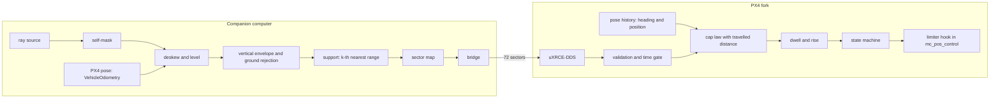

# 0020. Architecture for the operational scenarios: rework, not rewrite

Status: proposed (SE and SA review, 2026-11-20). The owner approves it in a separate PR. The IDs it
uses (OS, FEAT, SYS-CP-017 to 027, HZ-CP-016 to 023, OPEN-038 to 043) are defined in PR #116.

## Context
The code was built from approved interfaces (ICD-CP-01 to 06) and approved decisions (ADR 0001 to
0019), but the requirements it has to meet were incomplete. The SE review (#114, PR #116) adds 32
operational scenarios, 8 hazards, 11 requirements, 20 features and 6 open items. The owner asked on
2026-11-20: after the SE review, design the architecture; if the existing design cannot meet the
scenarios, delete and rewrite it instead of building on a design that lacked an initial one.

Facts, checked in the sources on 2026-11-20:
- Size of what exists: the four ROS packages hold about 2,200 lines of source and 2,200 of tests
  (128 tests); `cp_brake` in the fork holds about 2,800 lines of source and 2,600 of tests; the
  limiter hook (fork PR #8, held) adds about 1,900 lines with its tests.
- No lidar-side package has an attitude input (FEAT-05 is missing, deskew is #57).
- `CpBrake.cpp` calls `sectorSpeedCap(..., 0.f, ...)`: the distance moved since the sample is
  designed (ICD-CP-04) and unit tested in the stopping model, but never passed (FEAT-11, #115).
- The builder makes a sector occupied from one return inside the elevation band, and counts clear
  rays at any elevation inside that band (FEAT-06, 07).
- A level Mid-360S sees -7 to 52 degrees (ICD-CP-01). With the lidar horizontal, a nose-up pitch
  above 7 degrees puts the horizon in the direction of motion below the field of view.
- The stock Gazebo `x500_lidar_2d` lidar is on a fixed joint to `base_link`, so its plane tilts with
  the vehicle.
- The hook smoke run of fork PR #8 (virtual wall, bench values, 5 m/s) held the vehicle 1.6 to 2.1 m
  from the wall with a closest approach of 1.25 m against a margin of 2.0 m. It is not the stopping
  proof; the missing travelled-distance correction is one candidate cause, not a measured one.

## Criteria
A component is kept when its contract and algorithm meet every scenario allocated to it. It is
reworked when it needs added functions or parameters but no contract (ICD) and no module boundary
changes. It is rewritten when a scenario forces a contract change that changes two or more
components, or when its core algorithm cannot meet a requirement.

## Decision
No component meets the rewrite criteria today: the missing functions are additions around unchanged
contracts. The architecture is kept and reworked as below. Section "What would change this" lists
what turns the verdict into a rewrite.

### Verdict per component
| Component | Verdict | Evidence | Change |
| --- | --- | --- | --- |
| `livox_ray_source` | Rework | `MaskingRaySource` already wraps a `RaySource`; `RaySample` has direction, range, time, `masked`, `return_kind` | Add deskew and leveling, vertical envelope, support stage as new decorators (FEAT-04 to 07) |
| `obstacle_sector_map` | Rework, small | Pure C++, 288 lines, tested | Height band instead of elevation band, coverage counted in the envelope window, k-th nearest range (FEAT-06, 07) |
| `px4_obstacle_bridge` | Keep | Encoding only, tested | None |
| `obstacle_sector_node` | Rework | Composes source, map, bridge | Pose input for both sources, parameters for the new stages |
| `cp_brake` | Rework | State machine, cap law, dwell and rise, time gate meet their scenarios | Pose history with travelled distance (FEAT-11), start-up rule (FEAT-14) |
| Limiter hook (fork PR #8) | Keep, after approval | Stateless pure function between position and velocity control | Owner approves the behaviours below; scope per D7 |
| Messages and wiring (fork) | Keep | Merged, tested | `cp_brake_hook` names for approval |

### Target architecture

The split stays: the Orin perceives and reduces to 72 sectors, the FMU decides and acts (ADR 0001,
0005, 0014). The vertical dimension is resolved before the reduction, so ICD-CP-03 carries no
elevation.

### D1. Deskew and leveling are one transform (FEAT-04, 05; SYS-CP-016, 017)
For a ray at time `t_i`: sensor point, calibrated mount to the body frame, `q(t_i)` from
`VehicleOdometry` (interpolated) to NED, add `x(t_i) - x(t_ref)`, then rotate by the heading at
`t_ref` only. The result is in the gravity-aligned, yaw-only frame of ICD-CP-06 at the map reference
time. One pose chain and one interpolation (ADR 0018, 0019). The origin-motion filter of ADR 0018
(OPEN-031) uses the same `x(t_i) - x(t_ref)`. The planar-scan source for Gazebo gets the same
transform from the same topic, so the SITL path exercises leveling (OS-11 to OS-13).

### D2. Vertical envelope as a height band (FEAT-06; SYS-CP-019, 020; OPEN-036)
A return is obstacle evidence when its height in the level frame, `range * sin(elevation)`, is
inside the band of OPEN-005. Its horizontal range then gives the class exactly as the builder does
today: below 0.10 m it is too close (ICD-CP-03 distance 0), which the height test never drops and
which blocks any clear in that sector; up to 40 m it is occupied at the nearest range. The ground is
rejected by height, with no ground model: it falls below the band when the height above ground is at
least the minimum of OPEN-038. A no-return ray is clear evidence only for the elevations where it
stays inside the band up to the qualified range, `|elevation| <= asin(h / range)` (1.43 degrees for
h = 1 m at 40 m, an example, not a value); a ray outside that window says nothing about the band.

### D3. Attitude and field of view (FEAT-05, 06; SYS-CP-018; OPEN-039)
Leveling cannot add rays that the sensor does not emit. A sector can be clear only if two conditions
hold: the whole envelope window of D2 lies inside the level-frame elevation range that the field of
view covers in that direction (the field-of-view edges of ICD-CP-01 passed through the transform of
D1, with the mount and the attitude at the reference time), and at least
`coverage_min_rays_per_sector` no-return rays (OPEN-023) fall inside the window. A ray count alone is
not enough: with the level mount and an 8 degree nose-up pitch the forward field of view starts at
+1 degree and still overlaps a window of +-1.43 degrees, so rays in the overlap could pass a count
while the horizon is unobserved. When the window is not fully visible, the sector is unknown and its
cap is 0: the failure is safe by construction, and it costs availability, which OS-12 and OS-14
measure. A mount pitched down by `d` degrees keeps the horizon in view up to a nose-up pitch
of `7 + d` degrees. Screening: braking at 3 m/s^2 (PERF-02) pitches the vehicle about
`atan(3 / 9.81)` = 17 degrees before drag and wind, so `d` of about 10 degrees would be needed;
this is a requirement on the mount pose (ICD-CP-01, OPEN-029, OPEN-039), not a hardware design
(ADR 0013).

### D4. Support for isolated returns (FEAT-07; SYS-CP-021; OPEN-041)
The sector distance becomes the k-th nearest return range of the sector (k = 1 is today's nearest
range). It adds no latency and needs only k ranges per sector. `k` is a parameter whose default stays 1
until real captures and noise injection give the false-brake and miss curve against `k` (a pole at
40 m returns few rays per frame, so a high `k` misses it). Temporal confirmation across frames is
not used: it adds latency (PERF-03) and the release side already has the 0.3 s dwell.

### D5. Distance moved since the sample (FEAT-11; SYS-CP-026; #115)
Extend the heading history to a pose history keyed by `timestamp_sample`: heading and local
north and east position from `vehicle_local_position`, with the same interpolation, gap limit and
reset-counter rules as the heading. For sector `i` the travelled distance is
`max(0, (p_now - p_sample) . u_i)` with `u_i` the sector direction at the sample heading, passed to
`sectorSpeedCap`. If the history cannot answer, the map is not used (unknown), as for the heading.
The cp_brake cycle between publish and hook is not corrected; it is part of `CPB_T_LAT`, which is
measured and includes that cycle (SYS-CP-027). Option for the owner: use `CPB_MAX_V * age` as an upper
bound when the history cannot answer, instead of unknown.

### D6. Start-up (FEAT-14; SYS-CP-024; #112; OPEN-042)
When the PX4 state becomes valid in flight the history starts empty, and a map whose sample time
precedes the first history sample cannot be answered. That case alone, "before the history start",
is `NOT_READY` with its own reason, not `SAFE_STOP`. A gap, a reset failure, or any failure for a
sample time after the first history sample keeps today's rule (`SAFE_STOP`, ADR 0019). The exemption
is bounded without a time value: maps sampled after the first history sample can be answered, and a
map older than the age limit (`CPB_AGE_STOP`, 0.5 s) is stale, so a warm-up that cannot complete
ends in `SAFE_STOP`. While in this `NOT_READY` the hook takes no action, as for any invalid PX4 state
(ADR 0007), and the report says so.

### D7. Mode release (FEAT-16; SYS-CP-023; #113; OPEN-042)
Options: (A) keep Position and Mission only, log and notify the release, state the non-claim (the
approved V1 scope); (B) also enforce in Hold (`AUTO_LOITER`), which uses the same position controller
and is the usual outcome of a failsafe or a pilot switch; no mode request is made (ADR 0007);
(C) all position-controlled modes, which would also constrain RTL and Land and so conflict with
failsafe authority. Recommended: B, because in the smoke run the release to Hold carried the vehicle
6.85 m past the virtual wall; the owner decides.

### D8. Verification infrastructure (FEAT-20; SYS-CP-025, 027)
A scenario harness under the existing `tools/` directory: a world and model library for OS-01 to 19
(wall, oblique, corners, pole, partial cover, slope, overhang, low fence, tree, noise injection), a
scenario runner (arm, take off, Mission or stick profile, wind), an analyzer that turns a ULog into
the metrics of each scenario (closest approach, rest distance, oscillation, false brakes, state
timeline, constraint age) with the run verdict of ICD-CP-05, and a velocity step-response measurement
of `CPB_T_LAT`. Sensor models: the planar lidar (today) and a Livox-like non-repetitive 3D lidar
(OPEN-029), because a regular pattern hides coverage gaps (section 7). Each scenario has an
owner-approved pass criterion before it counts (OPEN-043).

### PX4-side behaviours of the hook for the owner to approve (fork PR #8)
| # | Behaviour | Recommendation |
| --- | --- | --- |
| 1 | Feed-forward toward a limiting sector is removed in proportion to how close the vehicle already is to its cap (none at rest or moving away, all at the cap), by projection until every sector holds; the ICD only says "removes" | Accept; four review rounds found three defects here, so keep the property tests |
| 2 | Only Position and Mission enforce; `POSITION_SLOW` is transparent | Accept for V1; D7 may extend it to Hold |
| 3 | A latched SAFE_STOP gives zero horizontal velocity even when its caps are usable | Accept |
| 4 | The hook's age check comes before `enforcement_active`: in flight, in an enforced mode, a stale constraint is a safe stop even if the last state was observer-only; with `CPB_CSTR_AGE` unset (-1) the vehicle cannot fly Position or Mission with `CPB_EN` on | Accept as a fail-safe; the value `CPB_CSTR_AGE` needs approval before real use |
| 5 | The hook publishes its own topic `cp_brake_hook` (a two-publisher topic hid its status); ICD-CP-04 and 05 name `cp_brake_status` for this | Accept; correct the ICD text; names listed in the PR |
| 6 | Numerical constants: tolerance 1e-4 m/s, at most 8 projection passes then zero | Accept; not safety values |

### Interface impact
| ICD | Change |
| --- | --- |
| ICD-CP-01 | Requirement on the mount pitch (D3, OPEN-039); no structural change |
| ICD-CP-02 | None |
| ICD-CP-03 | None: the wire stays 72 sectors; the vertical envelope is applied before the reduction |
| ICD-CP-04 | Reason bits for the start-up and for an unavailable travelled distance; the hook topic; text correction |
| ICD-CP-05 | None |
| ICD-CP-06 | None: `RaySample` already carries direction, range, time, `masked`, `return_kind` in the level frame |

### What would change this
The verdict becomes a rewrite of the affected side if the owner requires: vertical collision
prevention or obstacle memory (a 3D or persistent map) in V1, which changes ICD-CP-03, ICD-CP-06 and
SYS-CP-010 and so both sides; collision prevention in every mode, which reopens the hook placement
of ADR 0014; or if measurement shows a requirement unreachable by the present structure: end-to-end
latency above the 500 ms gate with this split (ADR 0005), or an oscillating or too-short stop with the
stateless setpoint hook after `CPB_T_LAT` is measured, which would call for an acceleration-level
limiter in place of the setpoint limiter.

## Consequences
- Issues to open after approval, one task each: deskew and leveling with the pose input (extends #57),
  vertical envelope and ground rejection, support stage `k`, pose history and start-up (with #115 and
  #112), scenario harness and the `CPB_T_LAT` measurement, hook scope (D7, #113). Order: harness and the
  baseline stopping proof first (it needs no new function), then leveling, envelope, pose history,
  support after data.
- Fork PR #8 is not merged until the owner approves the table above and the stopping proof has run
  on its head commit.
- Until D1 to D3 exist, OS-11 to OS-17 carry no claim, and the stopping evidence is a bench result at
  one altitude with a level lidar plane (section 7).
- Open decisions for the owner: OPEN-038 to 043, the mount pitch, the `CPB_MAX_V * age` fallback of
  D5, the scope option of D7, and the approval of the proposals of PR #116.
