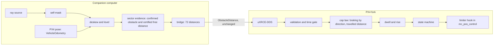

# 0020. Architecture for the operational scenarios: rework, not rewrite

Status: proposed (SE and SA review, 2026-11-20). The owner approves it in a separate PR. The IDs it
uses (OS, FEAT, SYS-CP-017 to 027, HZ-CP-016 to 023, OPEN-038 to 043) are defined in PR #116.

## Context
The code was built from approved interfaces (ICD-CP-01 to 06) and approved decisions (ADR 0001 to
0019), but the requirements it has to meet were incomplete. The SE review (#114, PR #116) adds 34
operational scenarios, 8 hazards, 11 requirements, 20 features and 6 open items. The owner asked on
2026-11-20: after the SE review, design the architecture; if the existing design cannot meet the
scenarios, delete and rewrite it instead of building on a design that lacked an initial one. The
owner also asked for a design that handles the intended operations well and stays small and easy to
maintain, not one that handles every case.

Owner decisions in chat on 2026-11-20 that this record builds on (to be recorded in the approval PR):
- The lidar is mounted pitched down by 10 degrees; lateral and rear speeds are lower so that the
  forward direction (+x) keeps the best performance.
- Rear flight is allowed at a low speed, and obstacles lower than the lidar behind the vehicle are a
  stated non-claim (option B).
- Isolated returns are rejected by counting returns that lie close together in range inside a sector.
- Flying above the obstacles with nothing in view must work; it must not stop the vehicle.

Facts, checked in the sources on 2026-11-20:
- Size of what exists: the four ROS packages hold about 2,200 lines of source and 2,200 of tests
  (128 tests); `cp_brake` in the fork holds about 2,800 lines of source and 2,600 of tests; the
  limiter hook (fork PR #8, held) adds about 1,900 lines with its tests.
- No lidar-side package has an attitude input (FEAT-05 is missing, deskew is #57).
- `CpBrake.cpp` calls `sectorSpeedCap(..., 0.f, ...)`: the distance moved since the sample is
  designed (ICD-CP-04) but never passed (FEAT-11, #115).
- The builder makes a sector occupied from one return inside the elevation band; it needs
  `coverage_min_rays_per_sector` no-return rays to call a sector clear, which certifies all of the
  40 m at once or nothing (FEAT-06, 07).
- The Mid-360S sees -7 to 52 degrees (ICD-CP-01). The stock Gazebo `x500_lidar_2d` lidar is on a
  fixed joint to `base_link`, so its plane tilts with the vehicle.
- The hook smoke run of fork PR #8 (virtual wall, bench values, 5 m/s) held the vehicle 1.6 to 2.1 m
  from the wall with a closest approach of 1.25 m against a margin of 2.0 m. It is not the stopping
  proof; the missing travelled-distance correction is one candidate cause, not a measured one.

## Criteria
A component is kept when its contract and algorithm meet every scenario allocated to it. It is
reworked when it needs added functions or parameters but no contract (ICD) and no module boundary
changes. It is rewritten when a scenario forces a contract change that changes two or more
components, or when its core algorithm cannot meet a requirement.

## Decision
No component meets the rewrite criteria: the missing functions are additions around unchanged
contracts. The architecture is kept and reworked with six small functions, each testable alone:
leveling, sector evidence, direction-dependent braking, travelled distance, start-up, mode scope.

### Verdict per component
| Component | Verdict | Evidence | Change |
| --- | --- | --- | --- |
| `livox_ray_source` | Rework | `MaskingRaySource` already wraps a `RaySource`; `RaySample` has direction, range, time, `masked`, `return_kind` | Deskew and leveling as one more wrapper (D1) |
| `obstacle_sector_map` | Rework | Pure C++, 288 lines, tested | Sector evidence of D2 replaces the nearest-return and clear-count rules |
| `px4_obstacle_bridge` | Rework, small | Encoding, plus a check that rejects the whole map when a clear sector has fewer than `coverage_min_rays_per_sector` no-return rays (`encoder.cpp`) | That check follows D2: a sector is clear when its certified free distance reaches the qualified range with `n_free` rays of any kind; otherwise one sector valid under D2 would suppress all 72 and lead to a stale-map stop |
| `obstacle_sector_node` | Rework | Composes source, map, bridge | Pose input for both sources, parameters for D1 and D2 |
| `cp_brake` | Rework | State machine, cap law, dwell and rise, time gate meet their scenarios | Direction-dependent braking (D3), travelled distance (D4), start-up (D5) |
| Limiter hook (fork PR #8) | Rework, small | Stateless pure function between position and velocity control | Feed-forward rule simplified (table below); scope per D6 |
| Messages and wiring (fork) | Keep | Merged, tested | `cp_brake_hook` names for approval |

### Target architecture

The split stays: the Orin perceives and reduces to 72 distances, the FMU decides and acts (ADR 0001,
0005, 0014). The vertical dimension is resolved before the reduction, so ICD-CP-03 carries no
elevation.

### D1. Deskew and leveling are one transform (FEAT-04, 05; SYS-CP-016, 017)
For a ray at time `t_i`: sensor point, calibrated mount (10 degrees down) to the body frame, `q(t_i)`
from `VehicleOdometry` (interpolated) to NED, add `x(t_i) - x(t_ref)`, rotate by minus the heading at
`t_ref` (giving a heading-aligned forward-right-down frame), then convert to forward-left-up by
negating the right and down axes. The result is in the gravity-aligned, yaw-only FLU frame of
ICD-CP-06 at the map reference time, which the bridge then converts to FRD sectors as today; omitting
the last step would mirror lateral obstacles and flip the height band. One pose chain and one interpolation (ADR 0018, 0019); the origin-motion filter of ADR 0018
(OPEN-031) uses the same `x(t_i) - x(t_ref)`. The planar-scan source for Gazebo gets the same
transform, so the SITL path exercises leveling (OS-11 to OS-13).

### D2. Sector evidence: confirmed obstacle and certified free distance (FEAT-06, 07; SYS-CP-018 to 021)
One rule replaces the elevation band, the single-return obstacle and the all-or-nothing clear. In the
level frame the vertical envelope is a height band from `-h_down` to `+h_up` around the vehicle
(OPEN-005, OPEN-036).
- Confirmed obstacle: the returns inside the band are taken in order of horizontal range; the
  obstacle distance is the near edge of the nearest window of width `dr` that holds at least
  `n_obstacle` returns. A few isolated returns never fill a window, so they do not brake the vehicle
  (the owner's counting rule). A window below 0.10 m gives too close (ICD-CP-03 distance 0).
- Certified free distance: every ray that is not obstacle evidence proves the band empty along its
  path up to where it leaves the band or ends, measured horizontally like every sector distance:
  `r_free = min(end * cos(elevation), h / tan|elevation|)`, with `h_up` above the horizon, `h_down`
  below it, and `end` the return range or, for a no-return, the qualified range (40 m, DET-01). For
  each half of the band, the certified distance is the `n_free`-th largest `r_free`; the sector's free
  distance is the smaller of the two halves.
- The distance sent for the sector is the smaller of the confirmed obstacle distance and the free
  distance. A free distance at the qualified range with no obstacle is clear (`max_distance + 1`); no
  evidence at all is unknown. PX4 computes the cap as if an obstacle stood at that distance.

What this gives: above the obstacles, near-horizon no-returns and ground returns below the band
certify a long free distance, so the vehicle flies at the speed it allows (OS-33); with `h` = 1 m a
lowest ray at 5 degrees still certifies about 11.4 m horizontally. When pitch or roll takes part of the band out of
view, that half certifies a shorter distance and the vehicle slows instead of stopping at once
(OS-12 to OS-14); with no evidence the cap is 0. The ground is rejected by height: it lies below the
band when the height above ground is at least the minimum of OPEN-038. Values `dr`, `n_obstacle`,
`n_free`, `h_up`, `h_down` are TBD from captured data (OPEN-005, 023, 036, 041). Trade-off: a thin
pole far away returns few rays and may not fill a window; a larger `n_obstacle` rejects more noise and
misses more thin targets, which the data decides.

### D3. Mount and braking by direction (FEAT-12; SYS-CP-018, 027; OPEN-039)
With the 10 degree pitched-down mount the lower edge of the field of view is about -17 degrees ahead,
-7 degrees to the side and +3 degrees behind (small-angle estimate `-(7 + 10 cos(bearing))`). Braking
tilts the vehicle away from the motion, so the braking acceleration of the cap law is set by
direction to keep the horizon in view while braking: about 3.0 m/s^2 ahead (`g tan 17 deg`, which
matches PERF-02), about 1.2 m/s^2 to the side (`g tan 7 deg`), screening values only. Three direction
classes keep this simple: forward (bearing within 45 degrees), lateral, rear (beyond 135 degrees),
each with its own braking acceleration and maximum speed. Behind the vehicle (beyond about 134
degrees) the lidar never sees below its own height, so rear sectors use the upper half of the band
only, the rear maximum speed is low, and obstacles lower than the lidar behind the vehicle are a
stated non-claim (owner option B). New parameters (names for approval, TBD sentinels): braking
acceleration and maximum speed for the lateral and rear classes; the present `CPB_A_BRK` and
`CPB_MAX_V` become the forward class.

### D4. Distance moved since the sample (FEAT-11; SYS-CP-026; #115)
The travelled distance toward sector `i` is the present velocity toward it times the age of the map,
plus an allowance for a vehicle that slowed down during that age:
`max(0, v_now . u_i) * age + 0.5 * a_bound * age^2`, with `age = now - sample`, `v_now` from
`vehicle_local_position`, `u_i` at the sample heading, and `a_bound` an upper bound on the horizontal
deceleration (a parameter, TBD, no smaller than the braking accelerations of D3), passed to
`sectorSpeedCap`. The allowance keeps the estimate on the safe side, so `CPB_MARGIN` stays a full
clearance and is never spent on this error (at 3 m/s^2 and a 0.5 s map it is 0.375 m). No position
history is added. An invalid velocity means the map is not used (unknown). The cp_brake cycle between publish and hook
is part of `CPB_T_LAT`, which is measured with that cycle included (SYS-CP-027).

### D5. Start-up (FEAT-14; SYS-CP-024; #112; OPEN-042)
When the PX4 state becomes valid in flight the history starts empty, and a map whose sample time
precedes the first history sample cannot be answered. That case alone, "before the history start",
is `NOT_READY` with its own reason, not `SAFE_STOP`. A gap, a reset failure, or any failure for a
sample time after the first history sample keeps today's rule (`SAFE_STOP`, ADR 0019). The exemption
is bounded without a time value: maps sampled after the first history sample can be answered, and a
map older than the age limit (`CPB_AGE_STOP`, 0.5 s) is stale, so a warm-up that cannot complete
ends in `SAFE_STOP`. While in this `NOT_READY` the hook takes no action, as for any invalid PX4 state
(ADR 0007), and the report says so.

### D6. Mode scope (FEAT-16; SYS-CP-023; #113; OPEN-042)
Options: (A) keep Position and Mission only, log and notify the release, state the non-claim (the
approved V1 scope); (B) also enforce in Hold (`AUTO_LOITER`), which uses the same position controller
and is the usual outcome of a failsafe or a pilot switch; no mode request is made (ADR 0007);
(C) all position-controlled modes, which would also constrain RTL and Land and so conflict with
failsafe authority. Recommended: B, because in the smoke run the release to Hold carried the vehicle
6.85 m past the virtual wall; the owner decides.

### D7. Verification (FEAT-20; SYS-CP-025, 027)
A small scenario harness under the existing `tools/` directory: Gazebo worlds, a scenario runner (arm,
take off, Mission or stick profile, wind), an analyzer from ULog to the metrics of each scenario
(closest approach, rest distance, oscillation, false brakes, state timeline, constraint age) with the
run verdict of ICD-CP-05, and a velocity step-response measurement of `CPB_T_LAT`. A must-pass set
for V1 comes first: OS-01, 02, 03, 04, 11, 12, 22, 23, 25, 28, 33, 34; the rest stay non-claims or
later work. Gazebo's generic 3D lidar is enough for leveling, height band and free distance; the
Livox scan pattern and ray density are checked on captured data, not modelled. Each scenario has an
owner-approved pass criterion before it counts (OPEN-043).

### PX4-side behaviours of the hook for the owner to approve (fork PR #8)
| # | Behaviour | Recommendation |
| --- | --- | --- |
| 1 | PR #8 removes the feed-forward toward a limiting sector in proportion to how close the vehicle is to its cap, by projection; four review rounds found three defects in this part | Replace by a simpler rule: when any sector limits the velocity setpoint, clear the horizontal feed-forward. Cost: a small acceleration step when limiting starts. Needs a change in PR #8 |
| 2 | Only Position and Mission enforce; `POSITION_SLOW` is transparent | Accept for V1; D6 may extend it to Hold |
| 3 | A latched SAFE_STOP gives zero horizontal velocity even when its caps are usable | Accept |
| 4 | The hook's age check comes before `enforcement_active`: in flight, in an enforced mode, a stale constraint is a safe stop even if the last state was observer-only; with `CPB_CSTR_AGE` unset (-1) the vehicle cannot fly Position or Mission with `CPB_EN` on | Accept as a fail-safe; `CPB_CSTR_AGE` needs approval before real use |
| 5 | The hook publishes its own topic `cp_brake_hook` (a two-publisher topic hid its status); ICD-CP-04 and 05 name `cp_brake_status` for this | Accept; correct the ICD text; names listed in the PR |
| 6 | Numerical constants: tolerance 1e-4 m/s, at most 8 projection passes then zero | Accept; not safety values |

### Interface impact
| ICD | Change |
| --- | --- |
| ICD-CP-01 | Mount pitched down 10 degrees (owner decision); calibration of that pose |
| ICD-CP-02 | None |
| ICD-CP-03 | No field changes. A sector distance may now be a certified free limit rather than a seen obstacle; PX4 treats both the same way, so only the text and the bridge's clear-evidence check change |
| ICD-CP-04 | Reason bits for the start-up and for an unavailable velocity; the hook topic; the lateral and rear parameters; text correction |
| ICD-CP-05 | None |
| ICD-CP-06 | None: `RaySample` already carries direction, range, time, `masked`, `return_kind` in the level frame |

### What would change this
The verdict becomes a rewrite of the affected side if the owner requires: vertical collision
prevention or obstacle memory (a 3D or persistent map) in V1, which changes ICD-CP-03, ICD-CP-06 and
SYS-CP-010 and so both sides; collision prevention in every mode, which reopens the hook placement
of ADR 0014; or if measurement shows a requirement unreachable by the present structure: end-to-end
latency above the 500 ms gate with this split (ADR 0005), or an oscillating or too-short stop with the
stateless setpoint hook after `CPB_T_LAT` is measured, which would call for an acceleration-level
limiter in place of the setpoint limiter.

## Consequences
- Issues to open after approval, one task each: deskew and leveling with the pose input (extends #57),
  sector evidence in the map and the bridge (D2), braking by direction and the rear limit (D3), travelled distance (D4, #115),
  start-up (D5, #112), mode scope (D6, #113), scenario harness and the `CPB_T_LAT` measurement (D7),
  and the feed-forward change in fork PR #8. Order: harness and the baseline stopping proof first (it
  needs no new function), then leveling, sector evidence, braking by direction, travelled distance.
- Fork PR #8 is not merged until the owner approves the table above, the feed-forward change is made,
  and the stopping proof has run on its head commit.
- Until D1 to D3 exist, OS-11 to OS-17, OS-33 and OS-34 carry no claim, and the stopping evidence is a
  bench result at one altitude with a level lidar plane (section 7 of the architecture document).
- Open decisions for the owner: OPEN-038 to 043, the values of D2 and D3, the mode scope of D6, and
  the approval of the proposals of PR #116.
