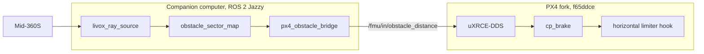

# Architecture

Status: DRAFT. G1 approved by the owner on 2026-11-19 with one exception (HZ-CP-009 stays open as
OPEN-020); the owner is the sole safety approver (waiver, 2026-11-19); G2 not approved. Values
marked approved are design/test baselines, not flight-qualified limits. Decided items are in
`docs/adr/`; platform values in `config/platforms/`.

## 1. Context and ConOps

V1 goal: reduce the risk that a multicopter hits a static obstacle in horizontal flight in
Position or Mission mode, with no planner and no companion-computer control authority. This is risk
mitigation inside the ODD, not a guarantee.

| ODD dimension | In scope V1 | Out of scope or conditional |
| --- | --- | --- |
| Vehicle | Multicopter (X500 SITL first, M350-class target) | Fixed-wing, VTOL |
| Motion and phase | Horizontal transit, valid estimate and control authority | Vertical, takeoff, landing, terrain following |
| Obstacles | Static, inside the qualified detection envelope | Dynamic; wires and branches |
| Modes | Position (`MPC_POS_MODE=4`), Mission | Offboard, Orbit, rerouting |
| Behaviour | Slow, stop, retain constraint, report | Mode change, Hold, RTL, planner, SLAM |
| Coverage | 360 degrees azimuth inside the qualified vertical FOV | Outside that FOV |
| Environment | Light rain <= 2.5 mm/h, wind <= 5 m/s, no fog or dust, clean window | Anything unqualified |

Claims: (1) mitigation of static obstacles inside the ODD; (2) on loss of the observation
contract free space is never assumed and safe-stop applies while required PX4 state is valid;
(3) non-claim: no guarantee once perception, time, frame, estimator or authority is lost.
Electrical, power, EMI, thermal and humidity design belong to vehicle integration (ADR 0013).

Verified facts (PX4 1.17 at `f65ddce`, `px4_msgs` at `86d8239`):
- PX4 collision prevention covers the manual Position path, not Mission.
- `PositionControl::update()` runs `_positionControl()` before `_velocityControl()`, so a hook
  between them sees the final velocity of a position-only Mission setpoint.
- `PositionSmoothing` slows its trajectory when the vehicle lags (`MPC_XY_ERR_MAX` default 2 m).
- uXRCE-DDS timesync maps timestamps to PX4 monotonic time; zero is replaced by receive time and a later timestamp is clamped to it.
  The stock CP range stream times out after 0.5 s.
- `gz_x500_lidar_2d` is a smoke-test model: about 270 degrees, rays averaged per 5 degrees.
- Seven required message definitions are byte-identical (`tools/check_msg_parity.sh`).

## 2. Requirements

| ID | Requirement | Source | Verify | Status |
| --- | --- | --- | --- | --- |
| SYS-CP-001 | Constrain horizontal motion in Position and Mission modes | ADR 0001 | SITL | Draft |
| SYS-CP-002 | 72 sectors of 5 degrees, body FRD, sector 0 forward, clockwise | ADR 0002 | UT | Draft, encoder UT exist |
| SYS-CP-003 | Exactly one CP authority modifies motion; stock PX4 CP is disabled when `cp_brake` is enabled | ADR 0014, HZ-CP-007 | UT, SITL | Draft |
| SYS-CP-004 | Unknown, invalid or stale observation is never free space; velocity into it is zero | ADR 0004 | UT, SITL | Draft |
| SYS-CP-005 | Constraint acts on the final horizontal setpoint, so position-only Mission is covered | ADR 0014 | SITL | Draft |
| SYS-CP-006 | Disabling V1 CP preserves PX4 baseline behaviour | ADR 0001 | SITL | Draft |
| SYS-CP-007 | Invalid config, math fault or lost constraint gives safe-stop while PX4 state and authority are valid; otherwise `UNQUALIFIED`, existing failsafes act, no mode command | ADR 0007 | UT, SITL | Draft |
| SYS-CP-008 | No Hold, RTL or mode request; persistent blockage keeps the constraint and notifies | ADR 0007 | SITL | Draft |
| SYS-CP-009 | Log enough to reconstruct observation age, constraint application and response | HZ-CP-003 | SITL, HIL | Draft |
| SYS-CP-010 | No planner, SLAM, dynamic tracking, vertical CP or sliding | Scope | Review | Draft |
| SYS-CP-011 | Clear only from positive, time-valid evidence meeting the coverage rule; else `UINT16_MAX` | ADR 0004 | UT | Draft, UT partial, OPEN-023 |
| SYS-CP-012 | Constrain only motion entering an affected direction; empty feasible set gives zero horizontal output and a report | ADR 0008 | UT, SITL | Draft |
| SYS-CP-013 | New obstacle tightens at once; relaxation after 0.3 s of qualified clear data, rise bounded | ADR 0008 | UT, SITL | Draft, OPEN-024 |
| SYS-CP-014 | Observer-only before `TAKEOFF_STATE_FLIGHT`; landing needs an explicit logged disable | ADR 0009 | SITL | Draft |
| SYS-CP-015 | Static self-mask removes self-returns; masked rays are neither obstacle nor clear evidence | ADR 0006 | UT | Draft |
| SYS-CP-016 | Map timestamp is the earliest contributing acquisition time; zero or unconvertible is rejected | ADR 0003 | UT, HIL | Draft |
| PERF-01 | Maximum speed 12 m/s (Mission nominal 5, Position nominal 10) | ADR 0010 | SITL, Flight | Approved baseline, OPEN-002 |
| PERF-02 | Braking reference 3 m/s^2, jerk 4 m/s^3 (setpoint limits, not physical guarantees) | ADR 0010 | Flight | Approved baseline, OPEN-003 |
| PERF-03 | Sensor sample to PX4 enforcement <= 350 ms at p99, hard gate 500 ms; attitude response excluded | ADR 0005 | HIL | Approved baseline, OPEN-004 |
| PERF-04 | Safe-stop at 0.5 s sample age; no Hold timer | ADR 0007 | SITL, HIL | Approved baseline (owner, 2026-11-19); qualify at G5 |
| PERF-05 | Rise 2.0 m/s^2 after 0.3 s clear dwell | ADR 0008 | SITL, Flight | Approved baseline, OPEN-024 |
| SAFE-01 | Clearance margin 2.0 m beyond body and self-mask radius | ADR 0010 | Analysis | Approved baseline, OPEN-005 |
| DET-01 | Detect at >= 40 m a static target: width >= 0.30 m, reflectivity >= 10%; wires unqualified | ADR 0010 | Flight | Approved baseline, OPEN-006 |
| REL-01 | False-brake <= 5% of labelled 60 s clear windows (>= 0.5 m/s reduction for >= 0.2 s) | ADR 0010 | Flight | Approved baseline, OPEN-007 |
| ENV-01 | Light rain <= 2.5 mm/h, wind <= 5 m/s, no fog, dust or water film | ADR 0010 | Flight | Approved baseline, OPEN-008 |
| NFR-CP-001 | Deterministic output for the same input | Baseline | UT | Draft |
| NFR-CP-002 | External floats finite and in bounds before use; cm conversion saturates before integer cast | Baseline | UT | Draft |
| NFR-CP-003 | Expose health, reason, age and counters | Baseline | SITL | Draft |
| NFR-CP-004 | Safe-stop when the latency envelope is exceeded | HZ-CP-011 | HIL | Draft |

Stopping envelope (screening, not an oracle): jerk-limited braking from 12 m/s is about 28.5 m;
with the 0.5 s freshness gate and 2.0 m margin the envelope is `28.5 + 12 * 0.5 + 2.0 = 36.5 m`
(34.7 m at 350 ms). Half-sector quantization at 36.5 m is `36.5 * tan(2.5 deg) = 1.59 m`. If
measured range is below 40 m or errors exceed the residual margin, the 12 m/s claim is invalid.

## 3. Hazards

| ID | Hazard | Cause | Safety constraint, requirement |
| --- | --- | --- | --- |
| HZ-CP-001 | Collision with static obstacle in a qualified sector | Late or weak braking | Conservative caps, tighten at once: SYS-CP-001, 012, PERF-01/02 |
| HZ-CP-002 | Obstacle outside FOV, masked, thin or unobserved | Coverage gap | Unknown is not free: SYS-CP-004, 011 |
| HZ-CP-003 | Stale, malformed or missing stream | Link, driver or process fault | Reject, safe-stop, report: SYS-CP-004, 007, 009, PERF-04 |
| HZ-CP-004 | Wrong timestamp, clock, frame or sector sign | Metadata or conversion fault | Validate and reject: SYS-CP-002, 016 |
| HZ-CP-005 | NaN, overflow, bad parameter or denominator | Math or config fault | Validate; fault gives safe-stop: SYS-CP-007, NFR-CP-002 |
| HZ-CP-006 | Self-reflection or filter overreach causes false obstacle | Mask error or temporal filter | Static mask, no debounce: SYS-CP-015, REL-01 |
| HZ-CP-007 | Two CP authorities constrain at once | Both enabled | One-authority rule: SYS-CP-003 |
| HZ-CP-008 | Mission blocked after repeated intervention | Persistent obstacle | Retain constraint, never change mode: SYS-CP-008 |
| HZ-CP-009 | Pilot override without understanding risk | Missing procedure | None yet (gap), OPEN-020 |
| HZ-CP-010 | Estimator or authority lost while degraded | Co-occurring faults | `UNQUALIFIED`, PX4 failsafe: SYS-CP-007, ADR 0007 |
| HZ-CP-011 | Compute overload raises latency | CPU or thermal load | Monitor, safe-stop beyond budget: NFR-CP-004, PERF-03 |
| HZ-CP-012 | Weather, payload or geometry outside qualification | ODD violation | Restrict ODD, `UNQUALIFIED`: ENV-01, DET-01 |
| HZ-CP-013 | Empty Cartesian data read as clear | Zero-depth sample loses direction | Raw rays, positive coverage: SYS-CP-011 |
| HZ-CP-014 | Brake/release chatter on transient return | Immediate release | Dwell and bounded rise: SYS-CP-013, PERF-05 |
| HZ-CP-015 | Horizontal constraint during takeoff or landing | Removes PX4 correction authority | Observer-only: SYS-CP-014 |

Preliminary: no safety review, no residual-risk owners.

## 4. Architecture

| Component | Status | Owns | Does not own | Reqs |
| --- | --- | --- | --- | --- |
| `livox_ray_source` | Not implemented | Raw spherical samples: direction, depth, per-sample time, packet continuity; deskew (ADR 0015); static self-mask (ADR 0006), setting `RaySample.masked`; sensor tag and confidence filtering | Clear decisions, speed limits | SYS-CP-011, 016 |
| `obstacle_sector_map` (pure C++) | Reference impl | Validation, masked/return-kind handling, sector classification, nearest projected range; no ROS or PX4 types | Frames, units, safety policy, sensor tags | SYS-CP-004, 011, 015 |
| `px4_obstacle_bridge` | Reference impl | FLU/CCW to BODY_FRD/CW, cm conversion, fail-closed encoding | Filtering to improve results | SYS-CP-002, NFR-CP-002 |
| Orin node | Not implemented | One process composing source, map, bridge; publishes `/fmu/in/obstacle_distance` | Safety policy | SYS-CP-016, NFR-CP-003 |
| `cp_brake` (PX4 module) | Not implemented, ADR 0014 | Input validation, freshness, stopping model, sector caps, state machine | Planning, attitude, sensor filtering | SYS-CP-001, 003, 007, 008, 012, 013, 014 |
| Horizontal limiter hook (PX4) | Not implemented, ADR 0014 | Apply caps to the final horizontal setpoint | Sensor, DDS, mode logic | SYS-CP-005, 006, 012 |
| Existing PX4 modes and failsafes | Existing | Mode and failsafe handling | CP-owned mode logic | SYS-CP-008 |

Operational states (reason flags carry the cause): `DISABLED`, `OBSERVER_ONLY`, `NOT_READY`,
`ACTIVE_CLEAR`, `BRAKING`, `SAFE_STOP`. `SAFE_STOP` leaves only through pilot acknowledgement and
revalidation, or a logged override. Persistent blockage stays `BRAKING`; persistent invalid data
stays `SAFE_STOP`.

Directional limiting (ADR 0008): each sector is a half-plane on the horizontal setpoint; a side
obstacle does not reduce forward motion, a front obstacle does not reduce retreat. A global minimum
range applied to all motion is prohibited. Node and topic naming: `obstacle_sector_node`,
namespace `/obstacle_sector`. Unit suffixes: `_us`, `_s`, `_m`, `_cm`, `_m_s`, `_rad`, `_ns`.

## 5. Interfaces (ICD)

Frames: Orin `base_link` is FLU, positive angle counter-clockwise from above. Sector distance is
the minimum horizontal projected range `sqrt(x^2 + y^2)` of credible points inside the vertical
collision envelope. PX4 uses `MAV_FRAME_BODY_FRD`; only `px4_obstacle_bridge` converts.

| Interface | Contract | Invalid-data behaviour |
| --- | --- | --- |
| ICD-CP-01 sensor geometry | Mid-360S, 360 deg horizontal, -7 to 52 deg vertical; CAD self-mask; `livox_frame -> base_link` repeatability <= 5 mm, <= 0.5 deg | Out of tolerance: recalibrate, new mask revision |
| ICD-CP-02 time | Hardware PTPv2 or sim `/clock` (ADR 0003); three runtime timestamps: sample, constraint, status; `sample_age = status - sample`; sync residual <= 2 ms; integer microseconds | Zero or unconvertible: unknown sectors; regression or age > 0.5 s: safe-stop |
| ICD-CP-03 `ObstacleDistance` | `/fmu/in/obstacle_distance`; frame 12, sensor LASER (0); 72 x 5 deg, `angle_offset=0`; cm; 10 Hz nominal, no bursts; QoS best-effort, volatile, keep-last 2 (OPEN-011); `min_distance=10`, `max_distance=4000`; `0` too close, `max_distance+1` clear, `UINT16_MAX` unknown; timestamp = acquisition time | Missing, invalid or stale: no velocity toward affected sectors; never inferred clear |
| ICD-CP-04 PX4 constraint | `cp_brake` messages and limiter hook: proposed design below (ADR 0014) | Non-finite, stale or malformed constraint: zero velocity toward the affected direction plus a reason |
| ICD-CP-05 logging | Each intervention reconstructs sample, constraint, hook, response, recovery; status 10 Hz plus every transition; Orin diagnostics 1 Hz; raw clouds only in a debug profile; raw ULog, rosbag, MCAP stay out of Git (manifests and hashes only) | Run verdict `PASS`, `FAIL` or `INVALID`; incomplete evidence is never `PASS` |

ICD-CP-01, 02, 03 and 05 are approved by the owner (2026-11-19) as sole safety approver.
ICD-CP-04 is not approved: the design below is proposed and awaits the owner (issue #21).
Orin parameters (versioned, logged): `qualified_range_m` 40, `sector_map_rate_hz` 10, `coverage_window_ms` 100, `coverage_min_rays_per_sector` (no default
until OPEN-023, never tuned after an acceptance run). The sector-boundary tolerance is a fixed
constant of 2.0e-6 rad in `obstacle_sector_map`, approved by the owner (2026-11-19); it is a
numerical tolerance, not a safety threshold. Raw point cloud source: ADR 0004.

### ICD-CP-04 design (proposed, not approved)

- Inputs of `cp_brake`: uORB `obstacle_distance` (from `/fmu/in/obstacle_distance`),
  `vehicle_local_position`, `vehicle_status` and the takeoff state. Output: it never publishes a
  vehicle command and never requests a mode.
- `cp_brake_constraints` (uORB, from `cp_brake` to the limiter): publication `timestamp`;
  `sample_timestamp` of the source map; `heading_rad` and `heading_valid` at the sample time; 72
  body-FRD velocity caps in m/s clamped to `[0, CPB_MAX_V]`; `enforcement_active`; `valid`; state;
  reason flags; counters. `cp_brake_status` (uORB, logging) carries the three timestamps and ages,
  input and output setpoints, actual velocity, active sector, minimum range, free and stopping
  distance, state, reasons and counters.
- Hook (verified in the pinned source): `PositionControl::update()` runs `_positionControl()` and
  then `_velocityControl(dt)`. The limiter acts between them on `_vel_sp.xy()` and removes
  horizontal feed-forward acceleration `_acc_sp.xy()` toward an affected sector. `_vel_sp` there
  already holds the position-error term and the feed-forward, so position-only Mission setpoints
  are covered. Vertical, yaw, attitude and actuator outputs are not touched; no second control
  thread.
- Reference time: the deskew reference time of the rays equals the map timestamp (the earliest
  contributing ray time, SYS-CP-016), because `ObstacleDistance` carries only that timestamp. The
  heading used for the caps is the heading at that time. Another reference time cannot be
  recovered from the wire without a new field. `cp_brake` keeps a timestamped history of the PX4
  heading estimate and interpolates it at the map timestamp (converted to PX4 time); source topic
  and history depth are fixed at detailed design (OPEN-032). A timestamp outside the history is the
  "no heading for the sample time" case below.
- Frames: caps are body FRD at the sample heading. The limiter rotates them to local NED with the
  `heading_rad` in the constraint, not the current heading. If the PX4 heading or estimator state
  is itself invalid, the claim is `UNQUALIFIED` and the hook takes no action (ADR 0007). If PX4
  state is valid but no heading exists for the sample time, there is no valid transform, so the
  limiter outputs zero horizontal velocity and clears the horizontal feed-forward acceleration
  (safe-stop, SYS-CP-007), plus a reason.
- Limiter rule: ADR 0008 (directional half-plane per sector; no global minimum range).
- Transparent paths: with `CPB_EN` off, or before `TAKEOFF_STATE_FLIGHT` (observer-only, ADR 0009)
  whether the constraint is valid or not, the hook leaves the setpoints unchanged (SYS-CP-006, 014).
- Once `TAKEOFF_STATE_FLIGHT` is reached: a stale constraint, or one that is unusable as a whole
  (non-finite or malformed, no valid cap set), is no evidence of free space, so the limiter outputs
  zero horizontal velocity and clears the horizontal feed-forward acceleration (`SAFE_STOP`,
  SYS-CP-007), plus a reason. If only some sector entries are invalid, those sectors get zero
  velocity toward them. Constraint age is `status - constraint timestamp`; its staleness
  threshold is OPEN-032.
- Facts of the pinned PX4 (`f65ddce`) that the design must handle (no choice made here):
  `MulticopterPositionControl::Run()` calls `_control.update()` up to three times per cycle and
  falls back to the last valid setpoint or a failsafe setpoint when the output is not finite
  (`mc_pos_control/MulticopterPositionControl.cpp`); the position setpoint is published after the
  hook position and `FlightTask::_evaluateVehicleLocalPositionSetpoint()` reads it back
  (`flight_mode_manager/tasks/FlightTask/FlightTask.cpp`); `takeoff_status` is published only on
  change (`MulticopterPositionControl.cpp`); `obstacle_distance` has three publishers: DDS
  (`dds_topics.yaml`), MAVLink (`mavlink_receiver.cpp`) and the Gazebo bridge
  (`gz_bridge/GZBridge.cpp`, enabled by `SIM_GZ_EN_LIDAR`, default 1); DDS input clamps a later
  timestamp to the receive time (`Tools/msg/templates/ucdr/msg.h.em`), so how a clamped map
  timestamp is detected or rejected is not specified yet (OPEN-033).
- Parameters (`CPB_`): `EN`; `MAX_V` 12 m/s (PERF-01); `A_BRK` 3 m/s^2 and `JERK` 4 m/s^3 (PERF-02);
  `AGE_STOP` 0.5 s (PERF-04); `CLR_T` 0.3 s and `RISE` 2.0 m/s^2 (PERF-05); `MARGIN` 2.0 m
  (SAFE-01); `T_LAT` TBD (OPEN-004). Values are baselines, not qualified limits.

## 6. Budgets

| Budget | Value | Status |
| --- | --- | --- |
| End-to-end latency, sensor sample to PX4 enforcement | 350 ms p99, 500 ms hard gate | Approved baseline, OPEN-004 |
| Provisional stage split (ms) | frame gathering 100, driver 20, filtering 80, limiter 20, ROS 2 bridge 30, reserve 100 | Not approved, replace by measurement |
| Sector map rate | 10 Hz nominal | Approved baseline |
| Wire load | one 72-sector message per 100 ms | Measure at HIL |
| Orin CPU, memory, thermal | TBD: OPEN-028 | Open |
| FMU CPU and scheduling | TBD: OPEN-028 | Open |

Attitude response is in the measured braking envelope, not in PERF-03 (ADR 0005).

## 7. V&V plan and gates

| Lane | Claim | Shall not claim |
| --- | --- | --- |
| Unit and property (UT) | Numerical correctness, invariants | Aircraft dynamics |
| Synthetic SITL | PX4 integration, state machine, deterministic faults | Livox perception fidelity |
| Gazebo end to end (GZ) | Geometry and software flow | Qualified detection or stopping |
| Rosbag replay (RPL) | Perception on captured data | Closed-loop behaviour |
| HIL and bench | FMU timing, DDS, load, scheduling | Full flight envelope |
| Flight (FLT) | Behaviour inside the tested configuration | Untested conditions |

Rules: simulation preserves emitted-ray direction for returns and no-returns; sector downsampling
uses the minimum credible range, never the mean; no test invents or relaxes a requirement. Today
only host unit tests exist; they are not detection, integration, runtime or qualification evidence.

| Gate | Pass criteria |
| --- | --- |
| G0 Baseline | Repo, CI and branch rules active; submodule pins verified; message parity passes |
| G1 Requirements | ODD, hazards and SYS-CP requirements approved by the owner, who is the sole safety approver until another is named (waiver, 2026-11-19); every hazard traces to a requirement or an OPEN item; every requirement has a verify method |
| G2 Architecture | OPEN-026 and OPEN-027 closed by ADR 0014 and 0015; ICD-CP-01 to 06 approved (06 is the ray-source to map interface, still to be proposed); latency and CPU budget allocation and owners approved, values measured and approved at G5 (OPEN-004, OPEN-028); observation core reviewed against the proposed architecture (issue #5) before G2 is approved |
| G3 Core implementation | Build clean with `-Werror`; UT groups for assigned requirements pass; Orin node composes source, map and bridge; no SITL claim |
| G4 SITL X500 | `x500.yaml` values approved and filled; SITL scenarios pass with fidelity gaps below recorded; no detection or braking claim |
| G5 HIL | FMU timing, DDS, load and p99 latency within the approved budget on target hardware |
| G6 Flight | Flight scenarios pass; measured braking envelope closes OPEN-002 and OPEN-003; release review |

SITL fidelity gaps:

| Gap | Effect | Mitigation in sim | Gate that checks it |
| --- | --- | --- | --- |
| Per-point timestamp and deskew | Sim stamps a scan once and has no motion distortion; skew effects are invisible (ADR 0015) | Log per-ray time; inject synthetic skew in replay | G5 bench rotation, G6 |
| Non-repetitive scan and ray density | A regular sim pattern hides coverage gaps; the coverage rule cannot be tuned in sim (OPEN-023) | Randomised or Livox-like pattern; synthetic gap tests | G5 with real data, RPL-003 |
| Self-mask, landing legs, propellers | X500 geometry and rotating props differ from the target; a sim lidar may ignore them | Model the mask cylinders from the X500 model; inject self-returns | G5 mounting data (RPL-001), G6 |
| Noise, dropout, reflectivity | Ideal sim returns hide false obstacles and missing returns | Noise and dropout injection; fault injection | RPL-002, G6 |
| X500 vs M350 kinematics | Mass, inertia, thrust and motor response differ, so `t_lag` and braking differ | Measure X500 values for X500 only; never reuse for M350 | G6 on the target class (OPEN-002/003) |

## 8. Open items

| ID | Open question | Owner | Due | Blocks |
| --- | --- | --- | --- | --- |
| OPEN-002 | Qualify the 12 m/s maximum speed | SE + Flight Test | TBD | G6 |
| OPEN-003 | Measure braking and jerk against 3 m/s^2 and 4 m/s^3 | Controls + Flight Test | TBD | G6 |
| OPEN-004 | Approve 350 ms latency and 500 ms gate | SE + Orin + PX4 | TBD | G5 |
| OPEN-005 | Approve 2.0 m margin, elevation band, self-mask values | Mechanical + SE | TBD | G4 |
| OPEN-006 | Qualify 40 m detection for the target class | Perception + Test | TBD | G6 |
| OPEN-007 | Freeze false-brake metric and 5% threshold | SE + Operations | TBD | G6 |
| OPEN-008 | Rain and optical contamination envelope | SE + Test | TBD | G6 |
| OPEN-010 | Freedom-to-operate review of referenced patents | Legal + SE | TBD | Release |
| OPEN-011 | Validate DDS QoS on the target network | Software Integration | TBD | G5 |
| OPEN-013 | Baseline target Orin OS, JetPack, native ROS 2 runtime | Orin Lead + SE | TBD | G5 |
| OPEN-014 | Project license and third-party notice policy | Project Owner | TBD | Release |
| OPEN-015 | Pin Micro XRCE-DDS Agent and target runtime versions | Software Integration | TBD | G5 |
| OPEN-016 | Record FMU V6X hardware revision, bootloader, baseline | Hardware + Test | TBD | G5 |
| OPEN-020 | Pilot enable, disable and override procedure; HZ-CP-009 has no requirement | SE + Operations | TBD | G6 (accepted G1 exception) |
| OPEN-022 | Pin Livox SDK2 and firmware; per-point timestamps, zero-depth, too-close, tag and packet-loss semantics | Perception + Test | TBD | G3 |
| OPEN-023 | Freeze the ray-coverage rule and `coverage_min_rays_per_sector` | Perception + SE + Test | TBD | G4 |
| OPEN-024 | Qualify dwell 0.3 s and rise 2.0 m/s^2 | Controls + Operations | TBD | G4, G6 |
| OPEN-025 | Raw-ray path: embed Livox SDK2 or patch `livox_ros_driver2` | Perception + SE | TBD | G3 |
| OPEN-028 | Orin and FMU CPU, memory and thermal budgets | Orin Lead + PX4 | TBD | G5 |
| OPEN-029 | X500 SITL model name and lidar mount pose | SE | TBD | G4 |
| OPEN-030 | Pose source for deskew: rate, latency, frame and interpolation | Perception + PX4 | TBD | G3 |
| OPEN-031 | Clear evidence when the ray origin moves during a scan: origin-aware evidence in the map, or a conservative filter in acquisition | Perception + SE | TBD | G3 |
| OPEN-032 | Staleness threshold and publish rate of the `cp_brake_constraints` output; heading history source and depth | PX4 + Controls | TBD | G3 |
| OPEN-033 | Time validity at PX4: a later map timestamp is clamped to the receive time and timesync convergence is not gated; how `cp_brake` establishes sample age and rejects such a map | PX4 + Software Integration | TBD | G3 |

OPEN-022, 023 and 025 block any operational clear-sector claim. OPEN-002 to OPEN-008 block the
12 m/s claim. Neither blocks the implementation and SITL work that produces the evidence.
