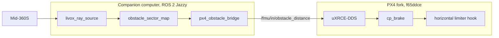

# Architecture

Status: DRAFT. G1 approved by the owner on 2026-11-19 with one exception (HZ-CP-009 stays open as
OPEN-020); the owner is the sole safety approver (waiver, 2026-11-19); G2 approved by the owner on
2026-11-19 (open items for G3 and later remain in section 8). Values marked approved are
design/test baselines, not flight-qualified limits. Decided items are in `docs/adr/`;
platform values in `config/platforms/`.

## 1. Context and ConOps

V1 goal: reduce the risk that a multicopter hits a static obstacle in horizontal flight in
Position or Mission mode, with no planner and no companion-computer control authority. This is risk
mitigation inside the ODD, not a guarantee.

| ODD dimension | In scope V1 | Out of scope or conditional |
| --- | --- | --- |
| Vehicle | Multicopter (X500 SITL first, M350-class target) | Fixed-wing, VTOL |
| Motion and phase | Horizontal transit, valid estimate and control authority | Vertical, takeoff, landing, terrain following |
| Obstacles | Static, inside the qualified detection envelope | Dynamic; wires and branches |
| Modes | Position (`MPC_POS_MODE=4`), Mission | Offboard, Orbit, rerouting |
| Behaviour | Slow, stop, retain constraint, report | Mode change, Hold, RTL, planner, SLAM |
| Coverage | 360 degrees azimuth inside the qualified vertical FOV | Outside that FOV |
| Environment | Light rain <= 2.5 mm/h, wind <= 5 m/s, no fog or dust, clean window | Anything unqualified |

ODD gaps (SE review, 2026-11-20; proposed, each is an open item for the owner): the table above
states no minimum height above ground (OPEN-038), no attitude envelope over which the sensor must
still see the direction of motion (OPEN-039), no terrain or vegetation classes that count as
obstacles (OPEN-040) and no policy for isolated returns (OPEN-041). A scenario below marked "Not
specified" carries no claim until its gap is decided.

Claims: (1) mitigation of static obstacles inside the ODD; (2) on loss of the observation
contract free space is never assumed and safe-stop applies while required PX4 state is valid;
(3) non-claim: no guarantee once perception, time, frame, estimator or authority is lost.
Electrical, power, EMI, thermal and humidity design belong to vehicle integration (ADR 0013).

Verified facts (PX4 1.17 at `f65ddce`, `px4_msgs` at `86d8239`):
- PX4 collision prevention covers the manual Position path, not Mission.
- `PositionControl::update()` runs `_positionControl()` before `_velocityControl()`, so a hook
  between them sees the final velocity of a position-only Mission setpoint.
- `PositionSmoothing` slows its trajectory when the vehicle lags (`MPC_XY_ERR_MAX` default 2 m).
- uXRCE-DDS timesync maps timestamps to PX4 monotonic time; zero is replaced by receive time and a later timestamp is clamped to it.
  The stock CP range stream times out after 0.5 s.
- `gz_x500_lidar_2d` is a smoke-test model: about 270 degrees, rays averaged per 5 degrees.
- Seven required message definitions are byte-identical (`tools/check_msg_parity.sh`).

### Operational scenarios (proposed, SE review 2026-11-20)

The catalogue extends the ODD with the cases that decide whether V1 works in the field. Expected
behaviour is stated with the existing requirements and the proposed ones below (SYS-CP-017 to 027,
HZ-CP-016 to 023). "Today": Specified (a requirement and a design exist), Partial, Not specified (no
requirement, so no claim), Out of ODD (a stated non-claim). Lanes: UT unit test, GZ Gazebo, RPL
replay of captured data, HIL, FLT flight (section 7). A scenario counts as evidence only after the
owner approves its pass criterion (SYS-CP-025, OPEN-043).

| ID | Situation | Expected V1 behaviour | Trace | Lane | Today |
| --- | --- | --- | --- | --- | --- |
| OS-01 | Level approach to a large flat wall at 3 to 12 m/s, Position and Mission | Speed falls so that the vehicle is at rest at least `CPB_MARGIN` before the wall, without oscillation (SITL proof criteria a to c) | SYS-CP-001, 005, 012, PERF-01, 02, SAFE-01 | GZ, FLT | Specified |
| OS-02 | Oblique wall, inside corner, outside corner, two obstacles at different bearings | Each sector limits only the motion entering it; no sliding; an empty feasible set gives zero horizontal output | SYS-CP-010, 012 | UT, GZ | Partial: unit tests only |
| OS-03 | Pole or post 0.15 to 0.5 m wide, 5 to 40 m ahead, in the path and at its edge | Detected and stopped for a width >= 0.30 m (DET-01); a narrower target is outside the claim and is stated as such | DET-01, HZ-CP-002 | GZ, RPL, FLT | Partial: DET-01 only |
| OS-04 | Obstacle covers only part of a 5 degree sector (building edge, pole, vehicle) | The sector takes the nearest return and its cap applies to the whole sector; the quantization error is half a sector (1.59 m at 36.5 m) | SYS-CP-011, ICD-CP-03 | UT, GZ | Specified |
| OS-05 | Obstacle appears suddenly (from behind another obstacle or around a corner) | The cap tightens at once on the first valid return; stopping is claimed only if the obstacle appears outside the stopping envelope | SYS-CP-013, HZ-CP-001, ADR 0008 | GZ | Partial: envelope only |
| OS-06 | Obstacle closer than 0.10 m: (a) with a valid return; (b) inside the sensor blind zone with no usable return (zero depth) | (a) The sector reports too close: cap 0. (b) Those rays are invalid and give no evidence; the blind zone lies inside the body and self-mask clearance that the 2.0 m margin already excludes (SAFE-01), so it is covered by the margin, not by detection | ICD-CP-03, SAFE-01, HZ-CP-013 | UT | Specified (a); (b) relies on the margin |
| OS-07 | Low reflectivity (< 10%), glass, water, mirror-like surface | Outside the detection claim; a no-return must not make such a sector clear unless the evidence rule of ADR 0004 holds | DET-01, HZ-CP-013, SYS-CP-011 | RPL, FLT | Partial |
| OS-08 | Wire, cable, thin branch | Outside the ODD; stated as a non-claim in the operator documentation | SYS-CP-022, HZ-CP-022 | Review | Out of ODD |
| OS-09 | Tree with foliage, hedge, bushes | Not decided whether foliage is an obstacle class (partial returns, thin branches) | HZ-CP-002, OPEN-040 | RPL, FLT | Not specified |
| OS-10 | Moving obstacle (person, vehicle, bird) | Outside the ODD | Scope | none | Out of ODD |
| OS-11 | Forward acceleration (nose down) at low height over level ground | The ground ahead is not an obstacle and does not lower the cap | HZ-CP-017, SYS-CP-017, 019, REL-01 | GZ, FLT | Not specified |
| OS-12 | Braking (nose up) toward an obstacle at flight level | The obstacle stays inside the field of view over the attitude envelope; where part of the envelope leaves it, the certified free distance shrinks and the vehicle slows; with no evidence the cap is 0 | HZ-CP-016, SYS-CP-004, 018 | GZ, FLT | Not specified |
| OS-13 | Roll while moving sideways or turning | As OS-11 and OS-12 for the lateral sectors | HZ-CP-016, 017 | GZ | Not specified |
| OS-14 | Gust within the ODD (wind <= 5 m/s) | The attitude excursion is handled as OS-11 to OS-13 | ENV-01, SYS-CP-018 | GZ with wind, FLT | Partial: ENV-01 only |
| OS-15 | Cruise near the minimum height above ground | Defined for a height at or above the minimum; below it, behaviour to be decided | OPEN-038, SYS-CP-019 | GZ | Not specified |
| OS-16 | Rising ground or slope ahead | Decide whether a slope is an obstacle and from which angle | OPEN-040 | GZ, FLT | Not specified |
| OS-17 | Overhang, bridge or canopy above the path; low wall or fence below it | Inside the vertical collision envelope it is an obstacle, outside it is ignored | OPEN-036, SYS-CP-020 | GZ | Partial |
| OS-18 | Climb or descent while moving horizontally | Horizontal caps only; no vertical collision claim | SYS-CP-010 | none | Out of ODD |
| OS-19 | Isolated or sparse returns (light rain, dust, insects) | The support a return needs before it counts, and its latency, are explicit; today one return in the envelope makes the sector occupied | HZ-CP-006, 019, REL-01, SYS-CP-021 | RPL, GZ with injection, FLT | Not specified |
| OS-20 | Rain at the ODD limit, dirty or blocked window | Degrades; the response follows the evidence the sensor still returns (returns outside the mask are obstacles or too close, missing returns leave sectors unknown), not an assumed end of the sample stream; the limits are qualified by OPEN-008 | ENV-01, SYS-CP-004, 011 | FLT | Partial |
| OS-21 | Self-returns from propellers, legs, mount, payload | Static self-mask; masked rays are neither obstacle nor clear evidence | SYS-CP-015 | UT, RPL | Specified |
| OS-22 | Lost packets or partial frame | A discontinuous frame gives no clear evidence (ICD-CP-06): sectors with credible obstacle returns stay occupied at their nearest range, the others are unknown and their cap is 0 | SYS-CP-004, 011, ICD-CP-06 | UT, GZ | Specified |
| OS-23 | Sample stream stops in flight (sensor or process failure, or only frames with no valid ray) | No map is published, `obstacle_distance` goes stale, SAFE_STOP at 0.5 s sample age | PERF-04, SYS-CP-007 | GZ, HIL | Specified |
| OS-24 | Time sync lost or clock jump | The map is rejected, its sectors are unknown, safe stop follows | SYS-CP-016, ICD-CP-02 | HIL | Specified |
| OS-25 | Mode change away from Position or Mission while enforcing (Hold, RTL, Land, Offboard, manual) | The hook is transparent and the vehicle is released (owner scope, 2026-11-19); the release is logged and stated as a non-claim | ADR 0007, HZ-CP-020, SYS-CP-023 | GZ | Partial: the consequence is not recorded (#113) |
| OS-26 | Takeoff, landing, ground contact | Takeoff: CP is observer-only before `TAKEOFF_STATE_FLIGHT`. Landing: an intentional landing or descent needs the pilot's explicit, logged CP disable first; a landing without it is not covered | SYS-CP-014, HZ-CP-015, ADR 0009 | GZ | Specified (the disable procedure is OS-27) |
| OS-27 | Pilot enables, disables or overrides CP in flight | Procedure not defined | HZ-CP-009, OPEN-020 | FLT | Not specified (accepted G1 exception) |
| OS-28 | PX4 state becomes valid for the first time in flight (heading good) | A defined start-up: no latched SAFE_STOP without a stated reason and a way out | HZ-CP-021, SYS-CP-024 | GZ | Not specified (#112) |
| OS-29 | Estimator or heading invalid in flight | `UNQUALIFIED`, no CP action, PX4 failsafes act | SYS-CP-007, ADR 0007 | GZ | Specified |
| OS-30 | Mission waypoint beyond an obstacle (persistent blockage) | Stays braking, the constraint is retained, the operator is told, no mode change; no timeout is defined | SYS-CP-008, HZ-CP-008 | GZ | Specified |
| OS-31 | Another PX4 failsafe acts at the same time (RC loss, battery, geofence) | PX4 owns the failsafe; the interplay with the hook is not specified | ADR 0007 | GZ | Partial |
| OS-32 | Pilot holds full stick toward an obstacle in Position mode | The caps limit the setpoint; the stick does not override them | SYS-CP-001, 005 | GZ | Specified |
| OS-33 | Cruise above the obstacles with nothing in view (open sky, ground far below) | Near-horizon no-return rays and ground returns below the band certify a free distance; the vehicle flies at the speed that distance allows and is not stopped for lack of returns | SYS-CP-011, 020 | GZ, FLT | Not specified |
| OS-34 | Flying sideways or backward in Position mode | Lower lateral and rear speeds than forward (owner, 2026-11-20); behind the vehicle only the part of the envelope above the lidar is observed (10 degree pitched-down mount), so obstacles lower than the lidar behind are a stated non-claim | SYS-CP-018, 022, OPEN-039 | GZ | Not specified |

## 2. Requirements

| ID | Requirement | Source | Verify | Status |
| --- | --- | --- | --- | --- |
| SYS-CP-001 | Constrain horizontal motion in Position and Mission modes | ADR 0001 | SITL | Draft |
| SYS-CP-002 | 72 sectors of 5 degrees, body FRD, sector 0 forward, clockwise | ADR 0002 | UT | Draft, encoder UT exist |
| SYS-CP-003 | Exactly one CP authority modifies motion; stock PX4 CP is disabled when `cp_brake` is enabled | ADR 0014, HZ-CP-007 | UT, SITL | Draft |
| SYS-CP-004 | Unknown, invalid or stale observation is never free space; velocity into it is zero | ADR 0004 | UT, SITL | Draft |
| SYS-CP-005 | Constraint acts on the final horizontal setpoint, so position-only Mission is covered | ADR 0014 | SITL | Draft |
| SYS-CP-006 | Disabling V1 CP preserves PX4 baseline behaviour | ADR 0001 | SITL | Draft |
| SYS-CP-007 | Invalid config, math fault or lost constraint gives safe-stop while PX4 state and authority are valid; otherwise `UNQUALIFIED`, existing failsafes act, no mode command | ADR 0007 | UT, SITL | Draft |
| SYS-CP-008 | No Hold, RTL or mode request; persistent blockage keeps the constraint and notifies | ADR 0007 | SITL | Draft |
| SYS-CP-009 | Log enough to reconstruct observation age, constraint application and response | HZ-CP-003 | SITL, HIL | Draft |
| SYS-CP-010 | No planner, SLAM, dynamic tracking, vertical CP or sliding | Scope | Review | Draft |
| SYS-CP-011 | Clear only from positive, time-valid evidence meeting the coverage rule; else `UINT16_MAX` | ADR 0004 | UT | Draft, UT partial, OPEN-023 |
| SYS-CP-012 | Constrain only motion entering an affected direction; empty feasible set gives zero horizontal output and a report | ADR 0008 | UT, SITL | Draft |
| SYS-CP-013 | New obstacle tightens at once; relaxation after 0.3 s of qualified clear data, rise bounded | ADR 0008 | UT, SITL | Draft, OPEN-024 |
| SYS-CP-014 | Observer-only before `TAKEOFF_STATE_FLIGHT`; landing needs an explicit logged disable | ADR 0009 | SITL | Draft |
| SYS-CP-015 | Static self-mask removes self-returns; masked rays are neither obstacle nor clear evidence | ADR 0006 | UT | Draft |
| SYS-CP-016 | Map timestamp is the earliest contributing acquisition time; zero or unconvertible is rejected | ADR 0003 | UT, HIL | Draft |
| PERF-01 | Maximum speed 12 m/s (Mission nominal 5, Position nominal 10) | ADR 0010 | SITL, Flight | Approved baseline, OPEN-002 |
| PERF-02 | Braking reference 3 m/s^2, jerk 4 m/s^3 (setpoint limits, not physical guarantees) | ADR 0010 | Flight | Approved baseline, OPEN-003 |
| PERF-03 | Sensor sample to PX4 enforcement <= 350 ms at p99, hard gate 500 ms; attitude response excluded | ADR 0005 | HIL | Approved baseline, OPEN-004 |
| PERF-04 | Safe-stop at 0.5 s sample age; no Hold timer | ADR 0007 | SITL, HIL | Approved baseline (owner, 2026-11-19); qualify at G5 |
| PERF-05 | Rise 2.0 m/s^2 after 0.3 s clear dwell | ADR 0008 | SITL, Flight | Approved baseline, OPEN-024 |
| SAFE-01 | Clearance margin 2.0 m beyond body and self-mask radius | ADR 0010 | Analysis | Approved baseline, OPEN-005 |
| DET-01 | Detect at >= 40 m a static target: width >= 0.30 m, reflectivity >= 10%; wires unqualified | ADR 0010 | Flight | Approved baseline, OPEN-006 |
| REL-01 | False-brake <= 5% of labelled 60 s clear windows (>= 0.5 m/s reduction for >= 0.2 s) | ADR 0010 | Flight | Approved baseline, OPEN-007 |
| ENV-01 | Light rain <= 2.5 mm/h, wind <= 5 m/s, no fog, dust or water film | ADR 0010 | Flight | Approved baseline, OPEN-008 |
| NFR-CP-001 | Deterministic output for the same input | Baseline | UT | Draft |
| NFR-CP-002 | External floats finite and in bounds before use; cm conversion saturates before integer cast | Baseline | UT | Draft |
| NFR-CP-003 | Expose health, reason, age and counters | Baseline | SITL | Draft |
| NFR-CP-004 | Safe-stop when the latency envelope is exceeded | HZ-CP-011 | HIL | Draft |

Proposed requirements (SE review 2026-11-20). They stay `Proposed` until the owner approves them in
a separate PR; every value in them is TBD.

| ID | Requirement | Source | Verify | Status |
| --- | --- | --- | --- | --- |
| SYS-CP-017 | Rays are expressed in a gravity-aligned, yaw-only frame at the map reference time, so the sector map does not depend on roll and pitch | ICD-CP-06, ADR 0015, 0019, HZ-CP-017 | UT, GZ | Proposed; designed, not implemented (#57) |
| SYS-CP-018 | Over the attitude envelope of the ODD (OPEN-039) the horizon in the direction of motion stays inside the sensor field of view, by the mount pose and by braking limits set per direction; where part of the envelope is not observed, the sector's certified free distance covers only what is observed, and with no evidence the sector is unknown (cap 0), never clear | HZ-CP-016 | Analysis, GZ, FLT | Proposed |
| SYS-CP-019 | A ground return is not an obstacle for a vehicle at or above the minimum height (OPEN-038); it is rejected by the vertical envelope in the gravity-aligned frame, not by range | HZ-CP-017 | UT, GZ | Proposed |
| SYS-CP-020 | The distance of a sector is the smaller of the confirmed obstacle distance and the free distance certified by rays covering both halves of the vertical collision envelope; the sector is clear only when that free distance reaches the qualified range, and rays at one elevation certify only the part of the envelope they cross | HZ-CP-018, OPEN-036 | UT | Proposed |
| SYS-CP-021 | The support a return needs before it counts as obstacle evidence (rays, time) is explicit, set from measured false-brake and miss rates, and its latency is in the budget | HZ-CP-006, 019, REL-01, PERF-03 | RPL, GZ, FLT | Proposed; value TBD (OPEN-041) |
| SYS-CP-022 | The operator documentation lists the obstacle classes outside the claim: wires, thin branches, foliage unless qualified, low reflectivity, dynamic obstacles | HZ-CP-022, DET-01 | Review | Proposed |
| SYS-CP-023 | Every release of the constraint by a mode change is logged and shown to the operator; the behaviour afterwards is PX4's | ADR 0007, HZ-CP-020 | GZ | Proposed (#113) |
| SYS-CP-024 | The change from invalid to valid PX4 state in flight gives a defined start-up: no latched SAFE_STOP without a stated reason and a stated way out | HZ-CP-021, SYS-CP-007 | GZ | Proposed (#112) |
| SYS-CP-025 | A scenario counts as evidence only after the owner approves its pass criterion; a scenario without one is exploratory and carries no claim | ADR 0011 | Review | Proposed |
| SYS-CP-026 | The range used for a cap is corrected for the distance moved toward the sector since the sample time (ICD-CP-04) | HZ-CP-023, HZ-CP-001 | UT, GZ | Proposed; designed, not implemented (#115) |
| SYS-CP-027 | The stopping model inputs (`CPB_T_LAT`, `CPB_A_BRK`, `CPB_JERK`) are set from measurement, and the achieved stopping distance is compared with the model across the speed range; a shortfall invalidates the speed claim | PERF-01, 02, OPEN-002, 003, 004 | GZ, FLT | Proposed |

Stopping envelope (screening, not an oracle): jerk-limited braking from 12 m/s is about 28.5 m;
with the 0.5 s freshness gate and 2.0 m margin the envelope is `28.5 + 12 * 0.5 + 2.0 = 36.5 m`
(34.7 m at 350 ms). Half-sector quantization at 36.5 m is `36.5 * tan(2.5 deg) = 1.59 m`. If
measured range is below 40 m or errors exceed the residual margin, the 12 m/s claim is invalid.

## 3. Hazards

| ID | Hazard | Cause | Safety constraint, requirement |
| --- | --- | --- | --- |
| HZ-CP-001 | Collision with static obstacle in a qualified sector | Late or weak braking | Conservative caps, tighten at once: SYS-CP-001, 012, PERF-01/02 |
| HZ-CP-002 | Obstacle outside FOV, masked, thin or unobserved | Coverage gap | Unknown is not free: SYS-CP-004, 011 |
| HZ-CP-003 | Stale, malformed or missing stream | Link, driver or process fault | Reject, safe-stop, report: SYS-CP-004, 007, 009, PERF-04 |
| HZ-CP-004 | Wrong timestamp, clock, frame or sector sign | Metadata or conversion fault | Validate and reject: SYS-CP-002, 016 |
| HZ-CP-005 | NaN, overflow, bad parameter or denominator | Math or config fault | Validate; fault gives safe-stop: SYS-CP-007, NFR-CP-002 |
| HZ-CP-006 | Self-reflection or filter overreach causes false obstacle | Mask error or temporal filter | Static mask, no debounce: SYS-CP-015, REL-01 |
| HZ-CP-007 | Two CP authorities constrain at once | Both enabled | One-authority rule: SYS-CP-003 |
| HZ-CP-008 | Mission blocked after repeated intervention | Persistent obstacle | Retain constraint, never change mode: SYS-CP-008 |
| HZ-CP-009 | Pilot override without understanding risk | Missing procedure | None yet (gap), OPEN-020 |
| HZ-CP-010 | Estimator or authority lost while degraded | Co-occurring faults | `UNQUALIFIED`, PX4 failsafe: SYS-CP-007, ADR 0007 |
| HZ-CP-011 | Compute overload raises latency | CPU or thermal load | Monitor, safe-stop beyond budget: NFR-CP-004, PERF-03 |
| HZ-CP-012 | Weather, payload or geometry outside qualification | ODD violation | Restrict ODD, `UNQUALIFIED`: ENV-01, DET-01 |
| HZ-CP-013 | Empty Cartesian data read as clear | Zero-depth sample loses direction | Raw rays, positive coverage: SYS-CP-011 |
| HZ-CP-014 | Brake/release chatter on transient return | Immediate release | Dwell and bounded rise: SYS-CP-013, PERF-05 |
| HZ-CP-015 | Horizontal constraint during takeoff or landing | Removes PX4 correction authority | Observer-only: SYS-CP-014 |

Proposed hazards (SE review 2026-11-20; `Proposed` until the owner approves them):

| ID | Hazard | Cause | Safety constraint, requirement |
| --- | --- | --- | --- |
| HZ-CP-016 | The obstacle ahead leaves the sensor field of view when the vehicle pitches or rolls: a level Mid-360S sees -7 to 52 degrees (ICD-CP-01), so a nose-up pitch above 7 degrees puts the horizon below the field of view (mount pose: OPEN-029) | Attitude, field of view, mount | Coverage over the attitude envelope, else unknown: SYS-CP-018 |
| HZ-CP-017 | The ground is read as an obstacle, so the vehicle brakes or limits its own speed at low height | Pitch or roll without leveling, no ground rejection | Gravity-aligned frame, vertical envelope: SYS-CP-017, 019 |
| HZ-CP-018 | A sector is called clear while part of the swept volume is not observed | Rays at some elevations only | Clear needs envelope coverage: SYS-CP-020 |
| HZ-CP-019 | An isolated false return brakes the vehicle, or a filter hides or delays a real one | Isolated-return policy | Explicit support rule from measured rates: SYS-CP-021 |
| HZ-CP-020 | A mode change releases the constraint while the vehicle still moves toward an obstacle | Hook transparent outside Position and Mission | Log, notify, state the non-claim: SYS-CP-023 |
| HZ-CP-021 | CP latches SAFE_STOP when the PX4 state becomes valid in flight | State machine start-up | Defined start-up: SYS-CP-024 |
| HZ-CP-022 | The operator expects protection from obstacle classes outside the claim | Unstated limits | Documented non-claims: SYS-CP-022 |
| HZ-CP-023 | A cap uses a range older than the vehicle position: the vehicle has moved since the sample | Motion since the sample not corrected | Range correction and measured stopping distance: SYS-CP-026, 027 |

Preliminary: no safety review, no residual-risk owners.

## 4. Architecture

| Component | Status | Owns | Does not own | Reqs |
| --- | --- | --- | --- | --- |
| `livox_ray_source` | Interface, segmentation, replay source, self-mask, spherical packet decoder, packet sampler and the Livox SDK2 adapter; no deskew yet (#57) | Raw spherical samples: direction, depth, per-sample time, packet continuity; deskew (ADR 0015); static self-mask (ADR 0006), setting `RaySample.masked`; sensor tag and confidence filtering | Clear decisions, speed limits | SYS-CP-011, 016 |
| `obstacle_sector_map` (pure C++) | Reference impl | Validation, masked/return-kind handling, sector classification, nearest projected range; no ROS or PX4 types | Frames, units, safety policy, sensor tags | SYS-CP-004, 011, 015 |
| `px4_obstacle_bridge` | Reference impl | FLU/CCW to BODY_FRD/CW, cm conversion, fail-closed encoding | Filtering to improve results | SYS-CP-002, NFR-CP-002 |
| Orin node (`obstacle_sector_node`) | Pipeline, platform config loader, ROS node class and an executable with a planar-scan source (Gazebo) and a Livox source (SDK2) | One process composing source, map, bridge; publishes `/fmu/in/obstacle_distance` | Safety policy | SYS-CP-016, NFR-CP-003 |
| `cp_brake` (PX4 module) | Fork PRs #1 to #6: checks, caps, limiter, state machine; no heading history and no hook yet, ADR 0014 | Input validation, freshness, stopping model, sector caps, state machine | Planning, attitude, sensor filtering | SYS-CP-001, 003, 007, 008, 012, 013, 014 |
| Horizontal limiter hook (PX4) | Not implemented, ADR 0014 | Apply caps to the final horizontal setpoint | Sensor, DDS, mode logic | SYS-CP-005, 006, 012 |
| Existing PX4 modes and failsafes | Existing | Mode and failsafe handling | CP-owned mode logic | SYS-CP-008 |

### Feature decomposition (proposed, SE review 2026-11-20)

| ID | Feature | Allocated to | Today | Reqs |
| --- | --- | --- | --- | --- |
| FEAT-01 | Lidar acquisition with per-point time | `livox_ray_source` | Exists; real-lidar checks open (#58) | SYS-CP-016 |
| FEAT-02 | Time alignment of the map and PX4 | Orin node, `cp_brake` | Exists; limits TBD (OPEN-033) | SYS-CP-016, ICD-CP-02 |
| FEAT-03 | Static self-mask | `livox_ray_source` | Exists | SYS-CP-015 |
| FEAT-04 | Pose-based deskew | `livox_ray_source` | Missing (#57) | SYS-CP-016 |
| FEAT-05 | Gravity-aligned leveling (roll and pitch removed) | `livox_ray_source` | Missing; no lidar-side package has an attitude input | SYS-CP-017 |
| FEAT-06 | Vertical envelope and ground rejection | `livox_ray_source`, `obstacle_sector_map` | Partial: elevation band only (OPEN-036) | SYS-CP-019, 020 |
| FEAT-07 | Evidence classification and isolated-return policy | `livox_ray_source`, `obstacle_sector_map` | Partial: return, no-return and invalid exist; one return makes a sector occupied, no support rule | SYS-CP-011, 021 |
| FEAT-08 | Sector map: nearest range, coverage, too close | `obstacle_sector_map` | Exists, unit tests | SYS-CP-004, 011 |
| FEAT-09 | Wire encoding and transport | `px4_obstacle_bridge`, Orin node | Exists | SYS-CP-002 |
| FEAT-10 | Input validation and freshness | `cp_brake` | Exists | SYS-CP-004, 007 |
| FEAT-11 | Heading and travelled distance at the sample time | `cp_brake` | Partial: heading history exists (#94); the travelled distance is not implemented, the module passes 0 (#115) | SYS-CP-016, 026 |
| FEAT-12 | Cap law: stopping model per sector | `cp_brake` | Exists; `CPB_T_LAT` unmeasured | SYS-CP-001, 012, 027 |
| FEAT-13 | Release policy: dwell and rise | `cp_brake` | Exists | SYS-CP-013 |
| FEAT-14 | State machine and start-up | `cp_brake` | Exists; start-up open (#112) | SYS-CP-007, 014, 024 |
| FEAT-15 | Setpoint limiting hook | `mc_pos_control` | In review, held (fork PR #8) | SYS-CP-005, 006, 012 |
| FEAT-16 | Mode scope and release | hook, `cp_brake` | Partial: Position and Mission only; release not recorded (#113) | SYS-CP-008, 023 |
| FEAT-17 | Logging, status, diagnostics | `cp_brake`, hook, Orin node | Partial | SYS-CP-009, NFR-CP-003 |
| FEAT-18 | Configuration and platform values | `config/platforms`, `CPB_` parameters | Partial: values TBD, sentinels fail safe | SYS-CP-007, OPEN-005 |
| FEAT-19 | Pilot procedure: enable, disable, acknowledge | Operations | Not specified | HZ-CP-009, OPEN-020 |
| FEAT-20 | Verification infrastructure: worlds, sensor models, replay, noise injection, scenario harness | tests, tools | Partial: unit tests and a Gazebo software-flow run | SYS-CP-025, ADR 0011 |

The "Today" column was checked in the sources on 2026-11-20: no attitude or gravity input exists in
`livox_ray_source`, `obstacle_sector_map`, `obstacle_sector_node` or `px4_obstacle_bridge`;
`CpBrake.cpp` calls `sectorSpeedCap(..., 0.f, ...)`, so the travelled-distance argument of the
stopping model is unused; `HeadingHistory` stores heading only; the builder makes a sector occupied
from one return inside the elevation band and needs `coverage_min_rays_per_sector` returns without
obstacle for clear.

Operational states (reason flags carry the cause): `DISABLED`, `OBSERVER_ONLY`, `NOT_READY`,
`ACTIVE_CLEAR`, `BRAKING`, `SAFE_STOP`. `SAFE_STOP` leaves only through pilot acknowledgement and
revalidation, or a logged override. Persistent blockage stays `BRAKING`; persistent invalid data
stays `SAFE_STOP`. `UNQUALIFIED` is a reason flag, not a state. `SAFE_STOP` means zero
horizontal velocity with the horizontal feed-forward cleared, no position hold. The operator is
told through the PX4 log and event channel; the pilot acknowledges with a MAVLink command handled
by `cp_brake` (command id fixed at detailed design). The exit rules are the ones stated above
(owner, 2026-11-19).

Directional limiting (ADR 0008): each sector is a half-plane on the horizontal setpoint; a side
obstacle does not reduce forward motion, a front obstacle does not reduce retreat. A global minimum
range applied to all motion is prohibited. Node and topic naming: `obstacle_sector_node`,
namespace `/obstacle_sector`. Unit suffixes: `_us`, `_s`, `_m`, `_cm`, `_m_s`, `_rad`, `_ns`.

## 5. Interfaces (ICD)

Frames: Orin `base_link` is FLU, positive angle counter-clockwise from above. Sector distance is
the minimum horizontal projected range `sqrt(x^2 + y^2)` of credible points inside the vertical
collision envelope. PX4 uses `MAV_FRAME_BODY_FRD`; only `px4_obstacle_bridge` converts.

| Interface | Contract | Invalid-data behaviour |
| --- | --- | --- |
| ICD-CP-01 sensor geometry | Mid-360S, 360 deg horizontal, -7 to 52 deg vertical; CAD self-mask; `livox_frame -> base_link` repeatability <= 5 mm, <= 0.5 deg | Out of tolerance: recalibrate, new mask revision |
| ICD-CP-02 time | Hardware PTPv2 or sim `/clock` (ADR 0003); three runtime timestamps: sample, constraint, status; `sample_age = status - sample`; sync residual <= 2 ms; integer microseconds | Zero or unconvertible: unknown sectors; regression or age > 0.5 s: safe-stop |
| ICD-CP-03 `ObstacleDistance` | `/fmu/in/obstacle_distance`; frame 12, sensor LASER (0); 72 x 5 deg, `angle_offset=0`; cm; 10 Hz nominal, no bursts; QoS best-effort, volatile, keep-last 2 (OPEN-011); `min_distance=10`, `max_distance=4000`; `0` too close, `max_distance+1` clear, `UINT16_MAX` unknown; timestamp = acquisition time | Missing, invalid or stale: no velocity toward affected sectors; never inferred clear |
| ICD-CP-04 PX4 constraint | `cp_brake` messages and limiter hook: approved design below (ADR 0014) | Non-finite, stale or malformed constraint: zero velocity toward the affected direction plus a reason |
| ICD-CP-05 logging | Each intervention reconstructs sample, constraint, hook, response, recovery; status 10 Hz plus every transition; Orin diagnostics 1 Hz; raw clouds only in a debug profile; raw ULog, rosbag, MCAP stay out of Git (manifests and hashes only) | Run verdict `PASS`, `FAIL` or `INVALID`; incomplete evidence is never `PASS` |
| ICD-CP-06 ray batch | `livox_ray_source` to `obstacle_sector_map`, in one process with no ROS hop: approved design below (ADR 0004, 0006, 0015) | A ray without a valid time or direction is `kInvalid`; a frame without continuity gives no clear evidence |

ICD-CP-01, 02, 03 and 05 are approved by the owner (2026-11-19) as sole safety approver.
ICD-CP-04 is approved by the owner (2026-11-19) with its open items (OPEN-032, 033, 035).
ICD-CP-06 is approved by the owner (2026-11-19) with its open items (OPEN-030, 031, 036).
ADR 0019 (one pose chain from the FMU for heading and deskew) is approved by the owner (2026-11-20).
Orin parameters (versioned, logged): `sector_map_rate_hz` 10, `coverage_window_ms` 100,
`coverage_min_rays_per_sector` (no default until OPEN-023, never tuned after an acceptance run).
The range limits (10 cm and 40 m, ICD-CP-03) are fixed constants, not parameters. The
sector-boundary tolerance is a fixed constant of 2.0e-6 rad in `obstacle_sector_map`, approved by
the owner (2026-11-19); it is a numerical tolerance, not a safety threshold. Raw point cloud
source: ADR 0004.

### ICD-CP-06 design (approved 2026-11-19)

- Contract: per map, one frame of `RaySample` (non-zero `timestamp_ns`, `range_m`, `azimuth_rad`
  counter-clockwise FLU, `elevation_rad`, `masked`, `return_kind`) plus one packet-continuity flag
  for the frame. Sensor tags and confidence stay in `livox_ray_source`.
- Frame: gravity-aligned, yaw only (roll and pitch removed), at the deskew reference time, which is
  the map timestamp (earliest contributing ray, SYS-CP-016).
- Framing: a window of `coverage_window_ms` by sensor timestamp; the whole frame is buffered, then
  `reset(continuity)`, `addRay` and `finalize` run, so the builder API is unchanged.
- Distance limits: one pair `kMinDistanceM` and `kMaxDistanceM` (ICD-CP-03: 10 cm, 4000 cm), fixed
  constants in `obstacle_sector_map` and not platform configuration; the separate name
  `qualified_range_m` is dropped.
- Self-mask (ADR 0006): `livox_ray_source` sets `masked`. A return is masked when its endpoint is
  inside a cylinder; a no-return is masked when its ray segment up to `max_distance_m` crosses a
  cylinder. A masked ray is neither obstacle nor clear evidence.
- Missing pose for a ray's time (ADR 0015): the ray is dropped and the frame's continuity flag is
  false, so no sector of that frame becomes clear.
- Vertical envelope: platform values (OPEN-005) in the gravity-aligned frame. The owner prefers a
  height band to an elevation-angle band; how a no-return ray, which has no endpoint, is tested
  against a height band is open (OPEN-036), and the builder still uses an elevation band.

### ICD-CP-04 design (approved 2026-11-19)

- Inputs of `cp_brake`: uORB `obstacle_distance` (from `/fmu/in/obstacle_distance`),
  `vehicle_local_position`, `vehicle_status` and the takeoff state. Output: it never publishes a
  vehicle command and never requests a mode.
- `cp_brake_constraints` (uORB, from `cp_brake` to the limiter): publication `timestamp`;
  `sample_timestamp` of the source map; `heading_rad` and `heading_valid` at the sample time; 72
  body-FRD velocity caps in m/s clamped to `[0, CPB_MAX_V]`; `enforcement_active`; `valid`; state;
  reason flags; counters. `cp_brake_status` (uORB, logging) carries the three timestamps and ages
  (the status timestamp is taken when the hook applies the constraint, so sample-to-status is
  sample-to-enforcement), input and output setpoints, actual velocity, active sector, minimum
  range, free and stopping distance, state, reasons and counters.
- Hook (verified in the pinned source): `PositionControl::update()` runs `_positionControl()` and
  then `_velocityControl(dt)`. The limiter acts between them on `_vel_sp.xy()` and removes
  horizontal feed-forward acceleration `_acc_sp.xy()` toward an affected sector. `_vel_sp` there
  already holds the position-error term and the feed-forward, so position-only Mission setpoints
  are covered. Vertical, yaw, attitude and actuator outputs are not touched; no second control
  thread.
- Reference time: the deskew reference time of the rays equals the map timestamp (the earliest
  contributing ray time, SYS-CP-016), because `ObstacleDistance` carries only that timestamp. The
  heading used for the caps is the heading at that time. Another reference time cannot be
  recovered from the wire without a new field. `cp_brake` keeps a timestamped history of the PX4
  heading estimate and interpolates it at the map timestamp (converted to PX4 time); source topic
  and history depth are fixed at detailed design (OPEN-032). A timestamp outside the history is the
  "no heading for the sample time" case below.
- Frames: caps are body FRD at the sample heading. The limiter rotates them to local NED with the
  `heading_rad` in the constraint, not the current heading. If the PX4 heading or estimator state
  is itself invalid, the claim is `UNQUALIFIED` and the hook takes no action (ADR 0007). If PX4
  state is valid but no heading exists for the sample time, there is no valid transform, so the
  limiter outputs zero horizontal velocity and clears the horizontal feed-forward acceleration
  (safe-stop, SYS-CP-007), plus a reason.
- Time alignment (fork PR #7, ADR 0019): a map whose alignment to PX4 time is not good, judged from
  `timesync_status`, is not used; its sectors are unknown, never free, and the reason flag is
  `REASON_TIME_SYNC`. The limits are OPEN-033 (sentinels). The heading history is fed from
  `vehicle_local_position` and keyed by `timestamp_sample`; a reset counter change invalidates
  interpolation across it.
- Limiter rule: ADR 0008 (directional half-plane per sector; no global minimum range).
- Transparent paths: with `CPB_EN` off, or before `TAKEOFF_STATE_FLIGHT` (observer-only, ADR 0009)
  whether the constraint is valid or not, the hook leaves the setpoints unchanged (SYS-CP-006, 014).
- Once `TAKEOFF_STATE_FLIGHT` is reached: a stale constraint, or one that is unusable as a whole
  (non-finite or malformed, no valid cap set), is no evidence of free space, so the limiter outputs
  zero horizontal velocity and clears the horizontal feed-forward acceleration (`SAFE_STOP`,
  SYS-CP-007), plus a reason. If only some sector entries are invalid, those sectors get zero
  velocity toward them. Constraint age is `status - constraint timestamp`; its staleness
  threshold is OPEN-032.
- Facts of the pinned PX4 (`f65ddce`) that the design must handle (no choice made here):
  `MulticopterPositionControl::Run()` calls `_control.update()` up to three times per cycle and
  falls back to the last valid setpoint or a failsafe setpoint when the output is not finite
  (`mc_pos_control/MulticopterPositionControl.cpp`); the position setpoint is published after the
  hook position and `FlightTask::_evaluateVehicleLocalPositionSetpoint()` reads it back
  (`flight_mode_manager/tasks/FlightTask/FlightTask.cpp`); `takeoff_status` is published only on
  change (`MulticopterPositionControl.cpp`); `obstacle_distance` has three publishers: DDS
  (`dds_topics.yaml`), MAVLink (`mavlink_receiver.cpp`) and the Gazebo bridge
  (`gz_bridge/GZBridge.cpp`, enabled by `SIM_GZ_EN_LIDAR`, default 1); DDS input clamps a later
  timestamp to the receive time (`Tools/msg/templates/ucdr/msg.h.em`), so PX4 cannot
  see a per-map clamp and `ObstacleDistance` has no spare field for it (ADR 0002). Therefore the
  Orin node must not publish a map whose sample time is later than its own clock (negative age),
  and on the hardware profile `cp_brake` judges the sync from `timesync_status` (estimated offset
  and round-trip time; the message has no convergence flag) and rejects maps while the sync is not
  valid. The numeric limits are OPEN-033, measured at G5 (owner, 2026-11-19).
- Enforcement scope (owner, 2026-11-19): the hook enforces in Position and Mission (the ODD); in
  any other nav state it is transparent and the status carries a reason flag. `NOT_READY` is an
  indication only and does not block arming (ADR 0007). `cp_brake` sends `cp_brake_constraints`
  to the hook over uORB; module and hook stay separate (ADR 0014).
- Start-up checks, `INVALID_CONFIG` while `CPB_EN` is on: stock collision prevention off (active
  only when `CP_DIST` > 0, default -1, `lib/collision_prevention/CollisionPrevention.cpp`);
  `MPC_XY_VEL_MAX` (default 12) not above `CPB_MAX_V`; no `CPB_` parameter still holding its TBD
  sentinel (a value outside its valid range); a single `obstacle_distance` source, so
  `SIM_GZ_EN_LIDAR` must be 0 in simulation. How a second publisher is detected is left to the
  detailed design.
- Cap law (owner, 2026-11-19): the cap of a sector is the largest speed `v` in `[0, CPB_MAX_V]`
  whose stopping distance fits the usable range. Stopping distance = `v * T_LAT` + jerk-limited
  braking distance from `v` with `A_BRK` and `JERK` + `MARGIN`; it is strictly increasing in `v`,
  so the cap is non-decreasing in the range and unit tests can use that as an oracle. Reference
  check: 12 m/s with 3 m/s^2 and 4 m/s^3 brakes in about 28.5 m (section 2). Usable range = the
  measured range minus the distance the vehicle moved toward the sector since the sample time,
  from the position history that also holds the heading. By sector state: unknown or stale gives
  cap 0; `0` (too close) gives cap 0; clear is evaluated at `max_distance` with no special case;
  an occupied sector uses its measured range. `A_BRK` and `JERK` are model inputs, not limits on
  the setpoint rate; a new obstacle tightens the cap at once (ADR 0008). `T_LAT` is the lag between the hook
  output and the vehicle response; the latency from sample to hook is already in the usable range
  correction, so it is not counted again. It is a required input with no default (OPEN-004). Inputs are validated finite and positive first (NFR-CP-002).
- Parameters (`CPB_`): `EN`; `MAX_V` 12 m/s (PERF-01); `A_BRK` 3 m/s^2 and `JERK` 4 m/s^3 (PERF-02);
  `AGE_STOP` 0.5 s (PERF-04); `CLR_T` 0.3 s and `RISE` 2.0 m/s^2 (PERF-05); `MARGIN` 2.0 m
  (SAFE-01); `T_LAT` TBD (OPEN-004). Values are baselines, not qualified limits.

## 6. Budgets

| Budget | Value | Status |
| --- | --- | --- |
| End-to-end latency, sensor sample to PX4 enforcement | 350 ms p99, 500 ms hard gate | Approved baseline, OPEN-004 |
| Provisional stage split (ms) | frame gathering 100, driver 20, filtering 80, limiter 20, ROS 2 bridge 30, reserve 100 | Not approved, replace by measurement |
| Sector map rate | 10 Hz nominal | Approved baseline |
| Wire load | one 72-sector message per 100 ms | Measure at HIL |
| Orin CPU, memory, thermal | TBD: OPEN-028 | Open |
| FMU CPU and scheduling | `cp_brake` and the hook together add at most 10 points of CPU load on top of PX4 multicopter flight (owner, 2026-11-19, from the owner's experience of 40 to 50% load on the Pixhawk 6X; not measured by the project) | Approved baseline, measured at G5 (OPEN-028) |

Attitude response is in the measured braking envelope, not in PERF-03 (ADR 0005).

Allocation and owners (owner decision 2026-11-19: G2 approves this allocation; values are measured
and approved at G5, OPEN-004 and OPEN-028; no number is entered before then, except the FMU CPU
ceiling above):

| Budget item | Owner role | How it is measured |
| --- | --- | --- |
| Frame gathering (coverage window) | Perception | First and last ray timestamps of each window |
| Acquisition, deskew and mask (`livox_ray_source`) | Perception | Stage timestamps in a latency-profiling run (ADR 0003) |
| Sector map and bridge | Perception | Same profiling run |
| uXRCE-DDS transport | Software Integration | Publish time against uORB receive time, HIL (OPEN-011, 015) |
| `cp_brake` and hook | PX4 + Controls | Sample, constraint and status timestamps in `cp_brake_status` (ICD-CP-05); the status timestamp is taken when the hook applies the constraint |
| Reserve | SE | Difference between the measured p99 and the sum of the stages |
| Orin CPU, memory, temperature | Orin Lead | Per-process CPU and memory, board temperature, worst-case load, HIL |
| FMU CPU and scheduling | PX4 | `cpuload` topic and the `cp_brake` task load, HIL (`msg/Cpuload.msg`) |

## 7. V&V plan and gates

| Lane | Claim | Shall not claim |
| --- | --- | --- |
| Unit and property (UT) | Numerical correctness, invariants | Aircraft dynamics |
| Synthetic SITL | PX4 integration, state machine, deterministic faults | Livox perception fidelity |
| Gazebo end to end (GZ) | Geometry and software flow | Qualified detection or stopping |
| Rosbag replay (RPL) | Perception on captured data | Closed-loop behaviour |
| HIL and bench | FMU timing, DDS, load, scheduling | Full flight envelope |
| Flight (FLT) | Behaviour inside the tested configuration | Untested conditions |

Rules: simulation preserves emitted-ray direction for returns and no-returns; sector downsampling
uses the minimum credible range, never the mean; no test invents or relaxes a requirement. Today
there are host unit tests, a Gazebo software-flow run (map to PX4 and `cp_brake`) and a run of the
node on a real lidar under PTP; none is detection, stopping, runtime or qualification evidence.

SITL stopping proof (bench, owner decision 2026-11-20): before the real lidar is integrated further,
the stopping algorithm is shown in Gazebo SITL. A vehicle flies toward a wall in Position or Mission
mode with `cp_brake` and the hook on, after a baseline run with `CPB_EN` off. The values are not
approved platform values, so this is neither a G4 claim nor qualified stopping evidence (the limit
of the GZ lane stands). Criteria approved by the owner: (a) the distance to the wall never goes
below `CPB_MARGIN`; (b) the vehicle is at rest before the wall; (c) no oscillation: after the cap
first reaches zero the approach velocity changes sign at most once; (d) when the `obstacle_distance`
input stops in flight the state becomes SAFE_STOP. Bench values approved by the owner for this proof
only: `CPB_T_LAT` measured from a velocity step response in the same SITL and rounded up, and
`CPB_CSTR_AGE` 0.25 s. The platform values of the map (elevation band, rays per sector) stay in a
file outside the repository and unapproved.

| Gate | Pass criteria |
| --- | --- |
| G0 Baseline | Repo, CI and branch rules active (the CI clause is waived by the owner, 2026-11-19, while the GitHub billing lock keeps the `ci` workflow disabled; it applies again once the lock is lifted and `ci` passes on `main`; until then each PR reports its local build and test results); submodule pins verified; message parity passes |
| G1 Requirements | ODD, hazards and SYS-CP requirements approved by the owner, who is the sole safety approver until another is named (waiver, 2026-11-19); every hazard traces to a requirement or an OPEN item; every requirement has a verify method |
| G2 Architecture | OPEN-026 and OPEN-027 closed by ADR 0014 and 0015; ICD-CP-01 to 06 approved (done: 06, the ray-source to map interface, was approved on 2026-11-19); latency and CPU budget allocation and owners approved, values measured and approved at G5 (OPEN-004, OPEN-028); observation core reviewed against the proposed architecture (issue #5) before G2 is approved  Approved by the owner on 2026-11-19. |
| G3 Core implementation | Build clean with `-Werror`; UT groups for assigned requirements pass; Orin node composes source, map and bridge; no SITL claim |
| G4 SITL X500 | `x500.yaml` values approved and filled; SITL scenarios pass with fidelity gaps below recorded; no detection or braking claim |
| G5 HIL | FMU timing, DDS, load and p99 latency within the approved budget on target hardware |
| G6 Flight | Flight scenarios pass; measured braking envelope closes OPEN-002 and OPEN-003; release review |

SITL fidelity gaps:

| Gap | Effect | Mitigation in sim | Gate that checks it |
| --- | --- | --- | --- |
| Per-point timestamp and deskew | Sim stamps a scan once and has no motion distortion; skew effects are invisible (ADR 0015) | Log per-ray time; inject synthetic skew in replay | G5 bench rotation, G6 |
| Non-repetitive scan and ray density | A regular sim pattern hides coverage gaps; the coverage rule cannot be tuned in sim (OPEN-023) | Randomised or Livox-like pattern; synthetic gap tests | G5 with real data, RPL-003 |
| Self-mask, landing legs, propellers | X500 geometry and rotating props differ from the target; a sim lidar may ignore them | Model the mask cylinders from the X500 model; inject self-returns | G5 mounting data (RPL-001), G6 |
| Noise, dropout, reflectivity | Ideal sim returns hide false obstacles and missing returns | Noise and dropout injection; fault injection | RPL-002, G6 |
| Lidar range | The stock Gazebo 2D lidar reaches 30 m, below the 40 m of the map, so no sector can be observed clear; every empty sector stays unknown and its cap is 0 | A bench copy of the lidar model with a 50 m range, kept outside the repository, for the stopping proof only | G4 decision on the simulated sensor (OPEN-029) |
| X500 vs M350 kinematics | Mass, inertia, thrust and motor response differ, so `t_lag` and braking differ | Measure X500 values for X500 only; never reuse for M350 | G6 on the target class (OPEN-002/003) |

## 8. Open items

| ID | Open question | Owner | Due | Blocks |
| --- | --- | --- | --- | --- |
| OPEN-002 | Qualify the 12 m/s maximum speed | SE + Flight Test | TBD | G6 |
| OPEN-003 | Measure braking and jerk against 3 m/s^2 and 4 m/s^3 | Controls + Flight Test | TBD | G6 |
| OPEN-004 | Approve 350 ms latency and 500 ms gate | SE + Orin + PX4 | TBD | G5 |
| OPEN-005 | Approve 2.0 m margin, elevation band, self-mask values | Mechanical + SE | TBD | G4 |
| OPEN-006 | Qualify 40 m detection for the target class | Perception + Test | TBD | G6 |
| OPEN-007 | Freeze false-brake metric and 5% threshold | SE + Operations | TBD | G6 |
| OPEN-008 | Rain and optical contamination envelope | SE + Test | TBD | G6 |
| OPEN-010 | Freedom-to-operate review of referenced patents | Legal + SE | TBD | Release |
| OPEN-011 | Validate DDS QoS on the target network | Software Integration | TBD | G5 |
| OPEN-013 | Baseline target Orin OS, JetPack, native ROS 2 runtime | Orin Lead + SE | TBD | G5 |
| OPEN-014 | Project license and third-party notice policy | Project Owner | TBD | Release |
| OPEN-015 | Pin Micro XRCE-DDS Agent and target runtime versions | Software Integration | TBD | G5 |
| OPEN-016 | Record FMU V6X hardware revision, bootloader, baseline | Hardware + Test | TBD | G5 |
| OPEN-020 | Pilot enable, disable and override procedure; HZ-CP-009 has no requirement | SE + Operations | TBD | G6 (accepted G1 exception) |
| OPEN-022 | Pin the Mid-360S firmware (SDK2 pin: ADR 0016); per-point timestamps, zero-depth, too-close, tag and packet-loss semantics; the rule that classifies a sample as a qualified no-return | Perception + Test | TBD | G3 |
| OPEN-023 | Freeze the ray-coverage rule and `coverage_min_rays_per_sector` | Perception + SE + Test | TBD | G4 |
| OPEN-024 | Qualify dwell 0.3 s and rise 2.0 m/s^2 | Controls + Operations | TBD | G4, G6 |
| OPEN-028 | Orin and FMU CPU, memory and thermal budgets | Orin Lead + PX4 | TBD | G5 |
| OPEN-029 | X500 SITL model name and lidar mount pose | SE | TBD | G4 |
| OPEN-030 | Measured rate and latency of `VehicleOdometry` for deskew and the interpolation scheme (source: ADR 0018) | Perception + PX4 | TBD | G3 |
| OPEN-031 | Clear evidence when the ray origin moves during a scan: origin-aware evidence in the map, or a conservative filter in acquisition (chosen, ADR 0018); its threshold value | Perception + SE | TBD | G3 |
| OPEN-032 | Staleness threshold and publish rate of the `cp_brake_constraints` output; heading history source and depth (source `vehicle_local_position`, chosen in fork PR #7 from Gazebo SITL measurements: 125 Hz for it and for `vehicle_odometry`, 250 Hz for `vehicle_attitude`, `timestamp - timestamp_sample` mean 3.5 ms and p99 24 ms; the depth and the gap limit are the sentinels `CPB_HDG_DEPTH` and `CPB_HDG_GAP`, TBD until the G4 SITL measurements); until then the module evaluates and publishes every 50 ms (an implementation value of fork PR #6, not approved) | PX4 + Controls | TBD | G4 |
| OPEN-033 | Numeric limits for judging the sync from `timesync_status` at PX4 and for an excessive map age (the gate of fork PR #7 judges three quantities, the age of the latest `timesync_status`, its round-trip time and the absolute difference of the observed and estimated offset, against the sentinels `CPB_SYNC_AGE`, `CPB_SYNC_RTT` and `CPB_SYNC_OFF`, measured at G5; it is on only when `UXRCE_DDS_SYNCT` is not 0, and a NuttX build with it off is a configuration fault); the Orin-side rejection of a negative age is implemented in a separate issue (structure decided) | PX4 + Software Integration | TBD | G5 |
| OPEN-035 | Hook interaction with FlightTask feedback of the published setpoint, the XY velocity integrator and the tilt limit; V1 handling decided by the owner on 2026-11-20: the hook is a stateless pure function applied identically on every `update()` call (PX4 calls it up to three times per cycle), the read-back of the limited setpoint by `FlightTask` is accepted, the XY velocity integrator gets no special handling, and any windup seen in SITL is recorded | Controls + PX4 | TBD | G4 |
| OPEN-036 | Vertical collision envelope as a height band: how a no-return ray, which has no endpoint, is tested against it; builder change from the elevation band | Perception + SE | TBD | G3 |
| OPEN-037 | `fmu-v6x` FLASH budget: `cp_brake` does not fit the board image; decided 2026-11-20: build `fmu-v6x` with the PX4 multicopter variant; `cp_brake` is enabled and builds there (fork PR #5, #93; facts and options below) | Project Owner + PX4 | TBD | #64, #65, #66 on `fmu-v6x` |
| OPEN-038 | Minimum height above ground in cruise inside the ODD, and the behaviour below it (proposed, SE review 2026-11-20) | SE + Operations | TBD | G4 |
| OPEN-039 | Attitude envelope (pitch and roll limits from braking, acceleration and wind) over which the horizon in the direction of motion must stay in the field of view; sensor mount pitch (OPEN-029); the owner chose in chat on 2026-11-20 a mount pitched down 10 degrees and lower lateral and rear speeds, to be recorded in the approval PR (proposed) | SE + Mechanical + Controls | TBD | G4 |
| OPEN-040 | Terrain and vegetation classes counted as obstacles: slope angle, foliage, hedges, water, glass (proposed) | SE + Perception | TBD | G4 |
| OPEN-041 | Treatment of isolated returns: support needed (rays, time), measured false-brake and miss rates, latency cost (proposed) | Perception + SE + Test | TBD | G4 |
| OPEN-042 | Start-up rule when the PX4 state becomes valid in flight (#112) and release behaviour on a mode change (#113) (proposed) | SE + PX4 + Operations | TBD | G4 |
| OPEN-043 | Owner approval of a pass criterion for each operational scenario used as evidence (proposed) | Project Owner + SE | TBD | G4 |

OPEN-022 and 023 block any operational clear-sector claim. OPEN-002 to OPEN-008 block the
12 m/s claim. Neither blocks the implementation and SITL work that produces the evidence.

### OPEN-037 `fmu-v6x` FLASH budget (owner decision 2026-11-20)

Facts, as measured in the PX4 fork build `px4_fmu-v6x_default` on 2026-11-19 (fork PR
`TanDatEmb/PX4-Autopilot#4`); no build was run in this repository for this entry:
- The FLASH region is 1,966,080 bytes (1920 KB).
- Fork baseline without `cp_brake`: 1,960,680 bytes used (99.73%), 5,400 bytes free.
- With `cp_brake` enabled, before the review fix: 1,966,052 bytes used, 28 bytes free. The module
  took 5,372 bytes.
- The review fix added 80 bytes and the link failed with `region FLASH overflowed by 52 bytes`.
- #64 (heading history and state machine) and #65 (limiter hook) add more code, so they will not
  fit the default image either.
- Taken in the fork PR: `cp_brake` is left out of the `fmu-v6x` board config and stays enabled for
  `sitl`. Until `cp_brake` is built in the multicopter variant no claim that `cp_brake` or the
  hook runs on `fmu-v6x` hardware can be made (build, HIL or flight).

Options (the owner chose the first on 2026-11-20, see below; the others stay as the record of what
was considered):
- Build `fmu-v6x` with PX4's own multicopter variant (`px4_fmu-v6x_multicopter`,
  `boards/px4/fmu-v6x/multicopter.px4board`), which leaves out the fixed-wing, VTOL and airspeed
  modules.
- Drop other PX4 modules from the fork's `fmu-v6x` config; the owner picks which.
- Decide that `cp_brake` does not run on this board, and record what that means for SYS-CP-001
  and 005 on the target hardware.
- Use another board; this changes the target hardware recorded in OPEN-016.
- Reduce the module footprint; it must recover at least the 52 bytes of the reviewed module plus
  what #64 and #65 add (not yet measured). No byte target or margin is set here: TBD.

Owner decision, 2026-11-20: no VTOL airframe is in scope, so `fmu-v6x` is built with PX4's
multicopter variant. This replaces the owner decision of 2026-11-19 that the VTOL modules stay,
which was given before the variant was known. Measured in the fork tree on 2026-11-20
(`px4_fmu-v6x_multicopter`, without `cp_brake`): 1,880,240 bytes used (95.63%), 85,840 bytes free,
80,440 bytes less than the default image. `cp_brake` took 5,372 bytes before the review fix, which
is about 6% of that margin. The board file `boards/px4/fmu-v6x/multicopter.px4board` switches off
the fixed-wing, VTOL and airspeed modules, so a VTOL or fixed-wing airframe cannot run on this
image; if one comes into scope this item is open again. Done 2026-11-20 (fork PR
`TanDatEmb/PX4-Autopilot#5`, issue #93): `cp_brake` is enabled in the multicopter variant
(`CONFIG_MODULES_CP_BRAKE=y`; `CPB_EN` stays 0, so it does not start by default) and
`px4_fmu-v6x_multicopter` links. The fork PR measured 1,885,492 bytes used (95.90%), 80,588 bytes
free, 5,252 bytes more than without the module; on the commit the pointer moves to (#66) the image
is 1,885,476 bytes, 80,604 free (the embedded version string differs). `px4_fmu-v6x_default` is
unchanged and has no `cp_brake`. Still undecided: any flash margin and any size target.

#64 (the state machine, fork PR `TanDatEmb/PX4-Autopilot#6`) is in the image: on the pointer
commit `2646f97dce` it is 1,886,276 bytes (95.94%), 79,804 bytes free, 800 bytes more than on
`e8ed65e026`. #94 (the heading history and the time gate, fork PR `TanDatEmb/PX4-Autopilot#7`)
adds 3,472 bytes: on `e539f947b0` the image is 1,889,748 bytes (96.12%), 76,332 bytes free
(measured 2026-11-20). #65 adds code whose size is not measured. Any flash margin and any size
target stay TBD until approved by the owner.
