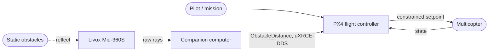
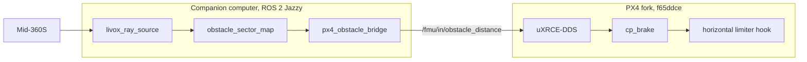

# Architecture

Status: DRAFT. G1 approved by the owner on 2026-11-19 with one exception (HZ-CP-009 stays open as
OPEN-020); the owner is the sole safety approver (waiver, 2026-11-19); G2 approved by the owner on
2026-11-19 (open items for G3 and later remain in section 8). Values marked approved are
design/test baselines, not flight-qualified limits. Decided items are in `docs/adr/`;
platform values in `config/platforms/`.

## 1. Context and ConOps

V1 goal: reduce the risk that a multicopter hits a static obstacle in horizontal flight in
Position or Mission mode, with no planner and no companion-computer control authority. This is risk
mitigation inside the ODD, not a guarantee.

| ODD dimension | In scope V1 | Out of scope or conditional |
| --- | --- | --- |
| Vehicle | Multicopter (X500 SITL first, M350-class target) | Fixed-wing, VTOL |
| Motion and phase | Horizontal transit, valid estimate and control authority | Vertical, takeoff, landing, terrain following |
| Obstacles | Static, inside the qualified detection envelope | Dynamic; wires and branches |
| Modes | Position (`MPC_POS_MODE=4`), Mission | Offboard, Orbit, rerouting |
| Behaviour | Slow, stop, retain constraint, report | Mode change, Hold, RTL, planner, SLAM |
| Coverage | 360 degrees azimuth inside the qualified vertical FOV | Outside that FOV |
| Environment | Light rain <= 2.5 mm/h, wind <= 5 m/s, no fog or dust, clean window | Anything unqualified |

ODD gaps (SE review, approved by the owner on 2026-11-20; each is an open item): the table above
states no minimum height above ground (OPEN-038), no attitude envelope over which the sensor must
still see the direction of motion (OPEN-039), no terrain or vegetation classes that count as
obstacles (OPEN-040) and no policy for isolated returns (OPEN-041). A scenario below marked "Not
specified" carries no claim until its gap is decided.

Claims: (1) mitigation of static obstacles inside the ODD; (2) on loss of the observation
contract free space is never assumed and safe-stop applies while required PX4 state is valid;
(3) non-claim: no guarantee once perception, time, frame, estimator or authority is lost.
Electrical, power, EMI, thermal and humidity design belong to vehicle integration (ADR 0013).

Verified facts (PX4 1.17 at `f65ddce`, `px4_msgs` at `86d8239`):
- PX4 collision prevention covers the manual Position path, not Mission.
- `PositionControl::update()` runs `_positionControl()` before `_velocityControl()`, so a hook
  between them sees the final velocity of a position-only Mission setpoint.
- `PositionSmoothing` slows its trajectory when the vehicle lags (`MPC_XY_ERR_MAX` default 2 m).
- uXRCE-DDS timesync maps timestamps to PX4 monotonic time; zero is replaced by receive time and a later timestamp is clamped to it.
  The stock CP range stream times out after 0.5 s.
- `gz_x500_lidar_2d` is a smoke-test model: about 270 degrees, rays averaged per 5 degrees.
- Seven required message definitions are byte-identical (`tools/check_msg_parity.sh`).

### Operational scenarios (approved by the owner, 2026-11-20)

The catalogue extends the ODD with the cases that decide whether V1 works in the field. Expected
behaviour is stated with the existing requirements and the added ones below (SYS-CP-017 to 032,
HZ-CP-016 to 024). "Today": Specified (a requirement and a design exist), Partial, Not specified (no
requirement, so no claim), Out of ODD (a stated non-claim). Lanes: UT unit test, GZ Gazebo, RPL
replay of captured data, HIL, FLT flight (section 7). A scenario counts as evidence only after the
owner approves its pass criterion (SYS-CP-025, OPEN-043).

| ID | Situation | Expected V1 behaviour | Trace | Lane | Today |
| --- | --- | --- | --- | --- | --- |
| OS-01 | Level approach to a large flat wall at 3 to 12 m/s, Position and Mission | Speed falls so that the vehicle is at rest at least `CPB_MARGIN` before the wall, without oscillation (SITL proof criteria a to c) | SYS-CP-001, 005, 012, PERF-01, 02, SAFE-01 | GZ, FLT | Specified |
| OS-02 | Oblique wall, inside corner, outside corner, two obstacles at different bearings | The commanded direction is kept and only the speed is limited (ADR 0025); a sector counts only when its obstacle may lie within `CPB_MARGIN` of the path; no sliding, no sideways push; a blocked direction gives zero horizontal output | SYS-CP-010, 012 | UT, GZ | Partial: unit tests of ADR 0025 (fork PR #11); Gazebo SITL with bench values: oblique wall 30 degrees stopped at 2.07 m, output direction equal to the input; inside and outside corners not run |
| OS-03 | Pole or post 0.15 to 0.5 m wide, 5 to 40 m ahead, in the path and at its edge | Detected and stopped for a width >= 0.30 m (DET-01); a narrower target is outside the claim and is stated as such | DET-01, HZ-CP-002 | GZ, RPL, FLT | Partial: DET-01 only |
| OS-04 | Obstacle covers only part of a 5 degree sector (building edge, pole, vehicle) | The sector takes the nearest return and its cap applies to the whole sector; the quantization error is half a sector (1.59 m at 36.5 m) | SYS-CP-011, ICD-CP-03 | UT, GZ | Specified |
| OS-05 | Obstacle appears suddenly (from behind another obstacle or around a corner) | The cap tightens at once on the first valid return; stopping is claimed only if the obstacle appears outside the stopping envelope | SYS-CP-013, HZ-CP-001, ADR 0008 | GZ | Partial: envelope only |
| OS-06 | Obstacle closer than 0.10 m: (a) with a valid return; (b) inside the sensor blind zone with no usable return (zero depth) | (a) The sector reports too close: cap 0. (b) Those rays are invalid and give no evidence; the blind zone lies inside the body and self-mask clearance that the 2.0 m margin already excludes (SAFE-01), so it is covered by the margin, not by detection | ICD-CP-03, SAFE-01, HZ-CP-013 | UT | Specified (a); (b) relies on the margin |
| OS-07 | Low reflectivity (< 10%), glass, water, mirror-like surface | Outside the detection claim; a no-return must not make such a sector clear unless the evidence rule of ADR 0004 holds | DET-01, HZ-CP-013, SYS-CP-011 | RPL, FLT | Partial |
| OS-08 | Wire, cable, thin branch | Outside the ODD; stated as a non-claim in the operator documentation | SYS-CP-022, HZ-CP-022 | Review | Out of ODD |
| OS-09 | Tree with foliage, hedge, bushes | Not decided whether foliage is an obstacle class (partial returns, thin branches) | HZ-CP-002, OPEN-040 | RPL, FLT | Not specified |
| OS-10 | Moving obstacle (person, vehicle, bird) | Outside the ODD | Scope | none | Out of ODD |
| OS-11 | Forward acceleration (nose down) at low height over level ground | The ground ahead is not an obstacle and does not lower the cap | HZ-CP-017, SYS-CP-017, 019, REL-01 | GZ, FLT | Not specified |
| OS-12 | Braking (nose up) toward an obstacle at flight level | The obstacle stays inside the field of view over the attitude envelope; where part of the envelope leaves it, the certified free distance shrinks and the vehicle slows; with no evidence the cap is 0 | HZ-CP-016, SYS-CP-004, 018 | GZ, FLT | Not specified |
| OS-13 | Roll while moving sideways or turning | As OS-11 and OS-12 for the lateral sectors | HZ-CP-016, 017 | GZ | Not specified |
| OS-14 | Gust within the ODD (wind <= 5 m/s) | The attitude excursion is handled as OS-11 to OS-13 | ENV-01, SYS-CP-018 | GZ with wind, FLT | Partial: ENV-01 only |
| OS-15 | Cruise near the minimum height above ground | Defined for a height at or above the minimum; below it, behaviour to be decided | OPEN-038, SYS-CP-019 | GZ | Not specified |
| OS-16 | Rising ground or slope ahead | Decide whether a slope is an obstacle and from which angle | OPEN-040 | GZ, FLT | Not specified |
| OS-17 | Overhang, bridge or canopy above the path; low wall or fence below it | Inside the vertical collision envelope it is an obstacle, outside it is ignored | OPEN-036, SYS-CP-020 | GZ | Partial |
| OS-18 | Climb or descent while moving horizontally | Horizontal caps only; no vertical collision claim | SYS-CP-010 | none | Out of ODD |
| OS-19 | Isolated or sparse returns (light rain, dust, insects) | The support a return needs before it counts, and its latency, are explicit; today one return in the envelope makes the sector occupied | HZ-CP-006, 019, REL-01, SYS-CP-021 | RPL, GZ with injection, FLT | Not specified |
| OS-20 | Rain at the ODD limit, dirty or blocked window | Degrades; the response follows the evidence the sensor still returns (returns outside the mask are obstacles or too close, missing returns leave sectors unknown), not an assumed end of the sample stream; the limits are qualified by OPEN-008 | ENV-01, SYS-CP-004, 011 | FLT | Partial |
| OS-21 | Self-returns from propellers, legs, mount, payload | Static self-mask; masked rays are neither obstacle nor clear evidence. With the mount pitched 10 degrees down only the propeller tips enter the field of view, at its -7 degree edge (sensor azimuth +-43 to 52 degrees, range 0.29 to 0.31 m, 0.13 degrees inside the edge, so a mount error of 0.5 degrees decides whether they return); the mask is defined in the body frame, not as upright cylinders in the sensor frame (SYS-CP-032, OPEN-046) | SYS-CP-015, 032 | UT, RPL | Specified |
| OS-22 | Lost packets or partial frame | A discontinuous frame gives no clear evidence (ICD-CP-06): sectors with credible obstacle returns stay occupied at their nearest range, the others are unknown and their cap is 0 | SYS-CP-004, 011, ICD-CP-06 | UT, GZ | Specified |
| OS-23 | Sample stream stops in flight (sensor or process failure, or only frames with no valid ray) | No map is published, `obstacle_distance` goes stale, SAFE_STOP at 0.5 s sample age | PERF-04, SYS-CP-007 | GZ, HIL | Specified |
| OS-24 | Time sync lost or clock jump | The map is rejected, its sectors are unknown, safe stop follows | SYS-CP-016, ICD-CP-02 | HIL | Specified |
| OS-25 | Mode change away from Position or Mission while enforcing (Hold, RTL, Land, Offboard, manual) | The hook is transparent and the vehicle is released (owner scope, 2026-11-19); the release is logged and stated as a non-claim | ADR 0007, HZ-CP-020, SYS-CP-023 | GZ | Partial: the consequence is not recorded (#113) |
| OS-26 | Takeoff, landing, ground contact | Takeoff: CP is observer-only before `TAKEOFF_STATE_FLIGHT`. Landing: an intentional landing or descent needs the pilot's explicit, logged CP disable first; a landing without it is not covered | SYS-CP-014, HZ-CP-015, ADR 0009 | GZ | Specified (the disable procedure is OS-27) |
| OS-27 | Pilot enables, disables or overrides CP in flight | Procedure not defined | HZ-CP-009, OPEN-020 | FLT | Not specified (accepted G1 exception) |
| OS-28 | PX4 state becomes valid for the first time in flight (heading good) | A defined start-up: no latched SAFE_STOP without a stated reason and a way out | HZ-CP-021, SYS-CP-024 | GZ | Specified: the heading that became good after the map was sampled is not qualified yet, never a latch (fork PR #10, #112); SITL 0 of 8 runs needed the `CPB_EN` toggle |
| OS-29 | Estimator or heading invalid in flight | `UNQUALIFIED`, no CP action, PX4 failsafes act | SYS-CP-007, ADR 0007 | GZ | Specified |
| OS-30 | Mission waypoint beyond an obstacle (persistent blockage) | Stays braking, the constraint is retained, the operator is told, no mode change; no timeout is defined | SYS-CP-008, HZ-CP-008 | GZ | Specified |
| OS-31 | Another PX4 failsafe acts at the same time (RC loss, battery, geofence) | PX4 owns the failsafe; the interplay with the hook is not specified | ADR 0007 | GZ | Partial |
| OS-32 | Pilot holds full stick toward an obstacle in Position mode | The caps limit the setpoint; the stick does not override them | SYS-CP-001, 005 | GZ | Specified |
| OS-33 | Cruise above the obstacles with nothing in view (open sky, ground far below) | Near-horizon no-return rays and ground returns below the band certify a free distance; the vehicle flies at the speed that distance allows and is not stopped for lack of returns | SYS-CP-011, 020 | GZ, FLT | Not specified |
| OS-34 | Flying sideways or backward in Position mode | Movement stays allowed. Forward (within 45 degrees of the nose) is protected. Backward, the lowest rear ray is 3 degrees above the lidar level, so at range r only obstacles higher than 0.052 r above the lidar are seen (detection range h_up / tan 3 degrees: 3.8 m for h_up 0.2 m, 9.5 m for 0.5 m); nothing at propeller level or below the lidar is detected (stated non-claim; while the vehicle is nose-up the field reaches lower, not guaranteed). While the bearing of the horizontal velocity is outside the forward class the speed is limited to 5 m/s (a limit on the velocity vector, not a cap on sectors), the Mission nominal tier of PERF-01 (owner, 2026-11-22; the Position nominal 10 m/s is not stoppable laterally: 54.7 m needed against the 40 m range with 1.2 m/s^2 and the bench `CPB_T_LAT` of 0.95 s, 17.9 m at 5 m/s) | SYS-CP-018, 022, 031, OPEN-039 | GZ | Not specified |
| OS-35 | Braking in the forward class until the horizon leaves the field of view (nose-up beyond 17 degrees ahead; the horizon leaves at about 7 + 10 cos(bearing) degrees toward the direction of travel: 17.0, 14.2, 7.1, 2.0 degrees at 0, 45, 90, 120 degrees, never at level beyond 134.6) | The coverage rule of the builder (SYS-CP-029) makes the sector unknown, never clear: the cap is 0, the vehicle brakes to rest, release after the dwell. The measured braking pitch is 11.7 degrees at most (18 runs), so in normal braking the horizon stays in view | HZ-CP-016, 024, SYS-CP-018, 029 | UT, GZ | Partial: coverage rule built (PR #167), no SITL with leveling |
| OS-36 | A cap falls to zero in one evaluation (a map stream stops, a sector turns unknown) | Not claimed: the setpoint steps and the tilt reaches 40 to 44 degrees (ADR 0021); the vehicle stops, which is the safe response. A limit on the descent rate is not built until a run shows a need (SYS-CP-030 withdrawn) | HZ-CP-024 | GZ | Not claimed |
| OS-37 | Steady wind or a gust within the ODD (5 m/s), no braking | Not measured: the claim is for calm air until the steady tilt in 5 m/s wind is measured in SITL (OPEN-039); a gust that takes the horizon out of view is a false brake and counts toward REL-01 | ENV-01, REL-01, OPEN-039 | GZ with wind | Not specified |
| OS-38 | Motion between lateral and rear (90 to 135 degrees), or a heading not along the track | The speed is limited to 5 m/s (SYS-CP-031); the sector protects only where it has evidence (SYS-CP-029), and beyond 45 degrees an obstacle below the lidar is not seen while the vehicle tilts past the horizon margin of its bearing; stated non-claim; Mission legs are protected only with the nose along the track (ODD constraint) | SYS-CP-022, 029, 031 | GZ | Not specified |
| OS-39 | Pitch and roll together (banked turn) | The leveling step works in the level frame from both angles (#57, #137); the coverage rule decides what is seen | SYS-CP-017, 029 | UT, GZ | Not specified |

## 2. Requirements

| ID | Requirement | Source | Verify | Status |
| --- | --- | --- | --- | --- |
| SYS-CP-001 | Constrain horizontal motion in Position and Mission modes | ADR 0001 | SITL | Draft |
| SYS-CP-002 | 72 sectors of 5 degrees, body FRD, sector 0 forward, clockwise | ADR 0002 | UT | Draft, encoder UT exist |
| SYS-CP-003 | Exactly one CP authority modifies motion; stock PX4 CP is disabled when `cp_brake` is enabled | ADR 0014, HZ-CP-007 | UT, SITL | Draft |
| SYS-CP-004 | Unknown, invalid or stale observation is never free space; velocity into it is zero | ADR 0004 | UT, SITL | Draft |
| SYS-CP-005 | Constraint acts on the final horizontal setpoint, so position-only Mission is covered | ADR 0014 | SITL | Draft |
| SYS-CP-006 | Disabling V1 CP preserves PX4 baseline behaviour | ADR 0001 | SITL | Draft |
| SYS-CP-007 | Invalid config, math fault or lost constraint gives safe-stop while PX4 state and authority are valid; otherwise `UNQUALIFIED`, existing failsafes act, no mode command | ADR 0007 | UT, SITL | Draft |
| SYS-CP-008 | No Hold, RTL or mode request; persistent blockage keeps the constraint and notifies | ADR 0007 | SITL | Draft |
| SYS-CP-009 | Log enough to reconstruct observation age, constraint application and response | HZ-CP-003 | SITL, HIL | Draft |
| SYS-CP-010 | No planner, SLAM, dynamic tracking, vertical CP or sliding | Scope | Review | Draft |
| SYS-CP-011 | Clear only from positive, time-valid evidence meeting the coverage rule; else `UINT16_MAX` | ADR 0004 | UT | Draft, UT partial, OPEN-023 |
| SYS-CP-012 | Keep the direction of the horizontal velocity setpoint and limit only its speed; a sector counts when its obstacle may lie within `CPB_MARGIN` of the ray along the setpoint or the current velocity; a blocked direction gives zero horizontal output and a report | ADR 0008, 0025 | UT, SITL | Draft; amended by ADR 0025 (#195) |
| SYS-CP-013 | New obstacle tightens at once; relaxation after 0.3 s of qualified clear data, rise bounded | ADR 0008 | UT, SITL | Draft, OPEN-024 |
| SYS-CP-014 | Observer-only before `TAKEOFF_STATE_FLIGHT`; landing needs an explicit logged disable | ADR 0009 | SITL | Draft |
| SYS-CP-015 | Static self-mask removes self-returns; masked rays are neither obstacle nor clear evidence | ADR 0006 | UT | Draft |
| SYS-CP-016 | Map timestamp is the earliest contributing acquisition time; zero or unconvertible is rejected | ADR 0003 | UT, HIL | Draft |
| PERF-01 | Maximum speed 12 m/s (Mission nominal 5, Position nominal 10) | ADR 0010 | SITL, Flight | Approved baseline, OPEN-002 |
| PERF-02 | Braking reference 3 m/s^2, jerk 4 m/s^3 (setpoint limits, not physical guarantees) | ADR 0010 | Flight | Approved baseline, OPEN-003 |
| PERF-03 | Sensor sample to PX4 enforcement <= 350 ms at p99, hard gate 500 ms; attitude response excluded | ADR 0005 | HIL | Approved baseline, OPEN-004 |
| PERF-04 | Safe-stop at 0.5 s sample age; no Hold timer | ADR 0007 | SITL, HIL | Approved baseline (owner, 2026-11-19); qualify at G5 |
| PERF-05 | Rise 2.0 m/s^2 after 0.3 s clear dwell | ADR 0008 | SITL, Flight | Approved baseline, OPEN-024 |
| SAFE-01 | Clearance margin 2.0 m beyond body and self-mask radius | ADR 0010 | Analysis | Approved baseline, OPEN-005 |
| DET-01 | Detect at >= 40 m a static target: width >= 0.30 m, reflectivity >= 10%; wires unqualified | ADR 0010 | Flight | Approved baseline, OPEN-006. Conflict (ADR 0024, owner decision): at Livox-like gaps (1.07 x 1.0 deg, estimate, OPEN-023) with a 0.85 m band and 3 confirming returns, a 0.30 m wide target is guaranteed in every frame only to 8.6 m (face-on, 1.0 m tall) (`tools/scenarios/certified_range.py`); over several frames the pattern may still hit it |
| REL-01 | False-brake <= 5% of labelled 60 s clear windows (>= 0.5 m/s reduction for >= 0.2 s) | ADR 0010 | Flight | Approved baseline, OPEN-007 |
| ENV-01 | Light rain <= 2.5 mm/h, wind <= 5 m/s, no fog, dust or water film | ADR 0010 | Flight | Approved baseline, OPEN-008 |
| NFR-CP-001 | Deterministic output for the same input | Baseline | UT | Draft |
| NFR-CP-002 | External floats finite and in bounds before use; cm conversion saturates before integer cast | Baseline | UT | Draft |
| NFR-CP-003 | Expose health, reason, age and counters | Baseline | SITL | Draft |
| NFR-CP-004 | Safe-stop when the latency envelope is exceeded | HZ-CP-011 | HIL | Draft |

Requirements added by the SE review, approved by the owner on 2026-11-20 (chat; recorded in issue
#119); every value in them is TBD.

| ID | Requirement | Source | Verify | Status |
| --- | --- | --- | --- | --- |
| SYS-CP-017 | Rays are expressed in a gravity-aligned, yaw-only frame at the map reference time, so the sector map does not depend on roll and pitch | ICD-CP-06, ADR 0015, 0019, 0023, HZ-CP-017 | UT, GZ | Approved; implemented (#179, #188: FMU pose at the reference time, Livox gyro inside the frame); SITL: wall distance within 0.017 m to a 36.5 deg tilt and 160 deg/s (#191) |
| SYS-CP-018 | Over the attitude envelope of the ODD (OPEN-039) the horizon in the direction of motion stays inside the sensor field of view, by the mount pose and by braking limits set per direction; where part of the envelope is not observed, the sector's certified free distance covers only what is observed, and with no evidence the sector is unknown (cap 0), never clear (the rear non-claim zone, where the cap is the locked speed of SYS-CP-031, is the stated exception) | HZ-CP-016 | Analysis, GZ, FLT | Approved |
| SYS-CP-019 | A ground return is not an obstacle for a vehicle at or above the minimum height (OPEN-038); it is rejected by the vertical envelope in the gravity-aligned frame, not by range | HZ-CP-017 | UT, GZ | Approved |
| SYS-CP-020 | The distance of a sector is the smaller of the confirmed obstacle distance and the certified range `certified_range_m`, given when rays cover both halves of the vertical collision envelope (ADR 0024: the range at which one sector is guaranteed the confirming returns of the smallest claimed obstacle); the sector is clear only when that range is the qualified range and no obstacle is confirmed | HZ-CP-018, OPEN-036, ADR 0024 | UT, GZ | Approved; amended by ADR 0024 (#191) |
| SYS-CP-021 | The support a return needs before it counts as obstacle evidence (rays, time) is explicit, set from measured false-brake and miss rates, and its latency is in the budget | HZ-CP-006, 019, REL-01, PERF-03 | RPL, GZ, FLT | Approved; value TBD (OPEN-041) |
| SYS-CP-022 | The operator documentation lists the obstacle classes outside the claim: wires, thin branches, foliage unless qualified, low reflectivity, dynamic obstacles, and, per frame, objects smaller than the smallest claimed obstacle or more oblique than `phi_max` at the certified range (ADR 0024) | HZ-CP-022, DET-01 | Review | Approved; amended by ADR 0024 |
| SYS-CP-023 | Every release of the constraint by a mode change is logged and shown to the operator; the behaviour afterwards is PX4's | ADR 0007, HZ-CP-020 | GZ | Approved (#113) |
| SYS-CP-024 | The change from invalid to valid PX4 state in flight gives a defined start-up: no latched SAFE_STOP without a stated reason and a stated way out | HZ-CP-021, SYS-CP-007 | GZ | Approved (#112) |
| SYS-CP-025 | A scenario counts as evidence only after the owner approves its pass criterion; a scenario without one is exploratory and carries no claim | ADR 0011 | Review | Approved |
| SYS-CP-026 | The range used for a cap is corrected for the distance moved toward the sector since the sample time (ICD-CP-04) | HZ-CP-023, HZ-CP-001 | UT, GZ | Approved; designed, not implemented (#115) |
| SYS-CP-027 | The stopping model inputs (`CPB_T_LAT`, `CPB_A_BRK`, `CPB_JERK`) are set from measurement, and the achieved stopping distance is compared with the model across the speed range; a shortfall invalidates the speed claim | PERF-01, 02, OPEN-002, 003, 004 | GZ, FLT | Approved |
| SYS-CP-028 | Two direction classes (owner, 2026-11-23, the simplest stable design): forward, within 45 degrees of the nose, uses the cap law as it is (`CPB_A_BRK`, `CPB_MAX_V`); every other direction uses the braking acceleration g tan 7 degrees = 1.2 m/s^2 (the lateral lower edge of the field of view, ADR 0020 D3) and the speed lock of SYS-CP-031. No tilt reserve, wind term or per-bearing formula: the coverage rule (SYS-CP-029) makes a sector unknown, never clear, when the tilt takes the horizon out of view, and the achieved forward braking tilt is checked on the logs (VM-51; if a run exceeds the 14.2 degrees of the class edge, `CPB_A_BRK` falls) | HZ-CP-016, 024 | UT, GZ | Approved by the owner (2026-11-22), simplified 2026-11-23; built (fork PR #12, unit tests, SITL bench) |
| SYS-CP-029 | Vertical coverage is checked per sector in the builder: a half of the band that holds fewer than `n_free` rays, free or obstacle, is outside the field of view and the sector is unknown (cap 0), even when an obstacle is confirmed farther away, so the cap cannot rise on the data that is left; no separate flag and no hysteresis. Beyond the forward class (more than 45 degrees from the nose) only the upper half is required and a confirmed obstacle still limits (ADR 0020 D3, amendment 2026-11-25; was the rear zone beyond 134.6 degrees, #141): there, an obstacle below the lidar is not seen while the tilt takes the lower half of that bearing out of view (a stated non-claim) | HZ-CP-016, 024 | UT, GZ | Approved by the owner (2026-11-22), widened 2026-11-25 (#123); built (PR #167, #176, unit tests) |
| SYS-CP-030 | Withdrawn (owner, 2026-11-23): a limit on the cap descent rate is not built; no run has shown a need, and a step to a 40 to 44 degree tilt is outside the envelope (ADR 0021) | HZ-CP-024 | - | Withdrawn |
| SYS-CP-031 | (a) Speed class: while the bearing of the horizontal velocity is outside the forward class (more than 45 degrees from the nose) the horizontal speed is at most 5 m/s, the PERF-01 Mission nominal tier; it limits the velocity vector by its own bearing and is never written as a cap on the sectors of the claimed directions, so forward flight toward clear sectors at +-50 degrees is not limited to 5 / cos 50 degrees. (b) Unclaimed bearings (beyond 134.6 degrees, where the horizon is never in view at level): a sector with no usable evidence has the cap 5 m/s instead of 0, the one stated exception to the no-evidence rule of SYS-CP-018; a confirmed obstacle there still limits through the cap law; the directions outside the claim are listed in the operator documentation (SYS-CP-022) and the vehicle state tells the pilot when it moves toward one | HZ-CP-016, SYS-CP-022 | UT, GZ | Approved by the owner (2026-11-22); built (fork PR #12, unit tests, SITL bench). The pilot indication is the reason flag `REASON_UNCLAIMED_DIRECTION`, set for a setpoint faster than 0.2 m/s (owner, 2026-11-25); no GCS message |
| SYS-CP-032 | The self-mask is defined in the body frame from the mount rotation and the lever arm (not as upright cylinders in the sensor frame), is applied before leveling, and the airframe parts that can enter the field of view over the mount tolerance are listed; the mount keeps the airframe out of the field of view with a margin larger than the mount tolerance, or the mask covers them with the smallest approved margin | SYS-CP-015, HZ-CP-016 | UT, GZ | Approved by the owner (2026-11-22); mask values decided (OPEN-046) |

Stopping envelope (screening, not an oracle): jerk-limited braking from 12 m/s is about 28.5 m;
with the 0.5 s freshness gate and 2.0 m margin the envelope is `28.5 + 12 * 0.5 + 2.0 = 36.5 m`
(34.7 m at 350 ms). Half-sector quantization at 36.5 m is `36.5 * tan(2.5 deg) = 1.59 m`. If
measured range is below 40 m or errors exceed the residual margin, the 12 m/s claim is invalid.

## 3. Hazards

| ID | Hazard | Cause | Safety constraint, requirement |
| --- | --- | --- | --- |
| HZ-CP-001 | Collision with static obstacle in a qualified sector | Late or weak braking | Conservative caps, tighten at once: SYS-CP-001, 012, PERF-01/02 |
| HZ-CP-002 | Obstacle outside FOV, masked, thin or unobserved | Coverage gap | Unknown is not free: SYS-CP-004, 011; free space is certified only to the range that guarantees the confirming returns of the smallest claimed obstacle (ADR 0024); smaller objects, and surfaces more oblique than `phi_max`, are a stated non-claim per frame (SYS-CP-022) |
| HZ-CP-003 | Stale, malformed or missing stream | Link, driver or process fault | Reject, safe-stop, report: SYS-CP-004, 007, 009, PERF-04 |
| HZ-CP-004 | Wrong timestamp, clock, frame or sector sign | Metadata or conversion fault | Validate and reject: SYS-CP-002, 016 |
| HZ-CP-005 | NaN, overflow, bad parameter or denominator | Math or config fault | Validate; fault gives safe-stop: SYS-CP-007, NFR-CP-002 |
| HZ-CP-006 | Self-reflection or filter overreach causes false obstacle | Mask error or temporal filter | Static mask, no debounce: SYS-CP-015, REL-01 |
| HZ-CP-007 | Two CP authorities constrain at once | Both enabled | One-authority rule: SYS-CP-003 |
| HZ-CP-008 | Mission blocked after repeated intervention | Persistent obstacle | Retain constraint, never change mode: SYS-CP-008 |
| HZ-CP-009 | Pilot override without understanding risk | Missing procedure | None yet (gap), OPEN-020 |
| HZ-CP-010 | Estimator or authority lost while degraded | Co-occurring faults | `UNQUALIFIED`, PX4 failsafe: SYS-CP-007, ADR 0007 |
| HZ-CP-011 | Compute overload raises latency | CPU or thermal load | Monitor, safe-stop beyond budget: NFR-CP-004, PERF-03 |
| HZ-CP-012 | Weather, payload or geometry outside qualification | ODD violation | Restrict ODD, `UNQUALIFIED`: ENV-01, DET-01 |
| HZ-CP-013 | Empty Cartesian data read as clear | Zero-depth sample loses direction | Raw rays, positive coverage: SYS-CP-011 |
| HZ-CP-014 | Brake/release chatter on transient return | Immediate release | Dwell and bounded rise: SYS-CP-013, PERF-05 |
| HZ-CP-015 | Horizontal constraint during takeoff or landing | Removes PX4 correction authority | Observer-only: SYS-CP-014 |

Hazards added by the SE review, approved by the owner on 2026-11-20:

| ID | Hazard | Cause | Safety constraint, requirement |
| --- | --- | --- | --- |
| HZ-CP-016 | The obstacle ahead leaves the sensor field of view when the vehicle pitches or rolls: a level Mid-360S sees -7 to 52 degrees (ICD-CP-01), so a nose-up pitch above 7 degrees puts the horizon below the field of view (mount pose: OPEN-029) | Attitude, field of view, mount | Coverage over the attitude envelope, else unknown: SYS-CP-018 |
| HZ-CP-017 | The ground is read as an obstacle, so the vehicle brakes or limits its own speed at low height | Pitch or roll without leveling, no ground rejection | Gravity-aligned frame, vertical envelope: SYS-CP-017, 019 |
| HZ-CP-018 | A sector is called clear while part of the swept volume is not observed | Rays at some elevations only | Clear needs envelope coverage: SYS-CP-020 |
| HZ-CP-019 | An isolated false return brakes the vehicle, or a filter hides or delays a real one | Isolated-return policy | Explicit support rule from measured rates: SYS-CP-021 |
| HZ-CP-020 | A mode change releases the constraint while the vehicle still moves toward an obstacle | Hook transparent outside Position and Mission | Log, notify, state the non-claim: SYS-CP-023 |
| HZ-CP-021 | CP latches SAFE_STOP when the PX4 state becomes valid in flight | State machine start-up | Defined start-up: SYS-CP-024 |
| HZ-CP-022 | The operator expects protection from obstacle classes outside the claim | Unstated limits | Documented non-claims: SYS-CP-022 |
| HZ-CP-023 | A cap uses a range older than the vehicle position: the vehicle has moved since the sample | Motion since the sample not corrected | Range correction and measured stopping distance: SYS-CP-026, 027 |
| HZ-CP-024 | The braking that CP itself commands tilts the vehicle until the direction of motion leaves the field of view; the sector then turns unknown (cap 0) and the setpoint steps toward zero | Braking not limited off the forward class; at the forward class edge (45 degrees) the horizon allows 14.2 degrees of tilt while 3.0 m/s^2 is 16.7 degrees | Two classes, braking 1.2 m/s^2 and the 5 m/s lock off the forward class (SYS-CP-028, 031); the coverage rule makes the loss unknown, never clear (SYS-CP-029); the achieved forward braking pitch is checked (VM-51, 11.7 degrees at most so far); a step to zero is the safe response and is outside the envelope (ADR 0021) |

Preliminary: no safety review, no residual-risk owners.

## 4. Architecture

| Component | Status | Owns | Does not own | Reqs |
| --- | --- | --- | --- | --- |
| `livox_ray_source` | Interface, segmentation, replay source, self-mask, spherical packet decoder, packet sampler and the Livox SDK2 adapter; no deskew yet (#57) | Raw spherical samples: direction, depth, per-sample time, packet continuity; deskew (ADR 0015); static self-mask (ADR 0006), setting `RaySample.masked`; sensor tag and confidence filtering | Clear decisions, speed limits | SYS-CP-011, 016 |
| `obstacle_sector_map` (pure C++) | Reference impl | Validation, masked/return-kind handling, sector classification, nearest projected range; no ROS or PX4 types | Frames, units, safety policy, sensor tags | SYS-CP-004, 011, 015 |
| `px4_obstacle_bridge` | Reference impl | FLU/CCW to BODY_FRD/CW, cm conversion, fail-closed encoding | Filtering to improve results | SYS-CP-002, NFR-CP-002 |
| Orin node (`obstacle_sector_node`) | Pipeline, platform config loader, ROS node class and an executable with a planar-scan source (Gazebo) and a Livox source (SDK2) | One process composing source, map, bridge; publishes `/fmu/in/obstacle_distance` | Safety policy | SYS-CP-016, NFR-CP-003 |
| `cp_brake` (PX4 module) | Fork PRs #1 to #6: checks, caps, limiter, state machine; no heading history and no hook yet, ADR 0014 | Input validation, freshness, stopping model, sector caps, state machine | Planning, attitude, sensor filtering | SYS-CP-001, 003, 007, 008, 012, 013, 014 |
| Horizontal limiter hook (PX4) | Implemented in `mc_pos_control` (fork PR #8, merged 2026-11-21), bench proof only | Apply caps to the final horizontal setpoint | Sensor, DDS, mode logic | SYS-CP-005, 006, 012 |
| Existing PX4 modes and failsafes | Existing | Mode and failsafe handling | CP-owned mode logic | SYS-CP-008 |

### Feature decomposition (approved by the owner, 2026-11-20)

| ID | Feature | Allocated to | Today | Reqs |
| --- | --- | --- | --- | --- |
| FEAT-01 | Lidar acquisition with per-point time | `livox_ray_source` | Exists; real-lidar checks open (#58) | SYS-CP-016 |
| FEAT-02 | Time alignment of the map and PX4 | Orin node, `cp_brake` | Exists; limits TBD (OPEN-033) | SYS-CP-016, ICD-CP-02 |
| FEAT-03 | Static self-mask | `livox_ray_source` | Done in the body frame (FEAT-23, #206): `SelfMask` and `MaskingRaySource`, applied by `obstacle_sector_node` to every 3-D source before leveling | SYS-CP-015 |
| FEAT-04 | Pose-based deskew | `livox_ray_source` | Missing (#57) | SYS-CP-016 |
| FEAT-05 | Gravity-aligned leveling (roll and pitch removed) | `livox_ray_source` | Built: `LevelingRaySource` with the FMU pose at the reference time and the Livox gyro inside the frame (#179, #188, ADR 0023); SITL only, the gyro path unit-tested only | SYS-CP-017 |
| FEAT-06 | Vertical envelope and ground rejection | `livox_ray_source`, `obstacle_sector_map` | Built: height band with the attitude allowance, coverage rule (PR #167) and the certified range (ADR 0024, #191) on leveled rays; SITL with bench values, no hardware | SYS-CP-019, 020 |
| FEAT-07 | Evidence classification and isolated-return policy | `livox_ray_source`, `obstacle_sector_map` | Partial: return, no-return and invalid exist; a zero-depth sample with a valid direction is a qualified no-return (PR #173); one return makes a sector occupied, no support rule | SYS-CP-011, 021 |
| FEAT-08 | Sector map: nearest range, coverage, too close | `obstacle_sector_map` | Exists, unit tests | SYS-CP-004, 011 |
| FEAT-09 | Wire encoding and transport | `px4_obstacle_bridge`, Orin node | Exists | SYS-CP-002 |
| FEAT-10 | Input validation and freshness | `cp_brake` | Exists | SYS-CP-004, 007 |
| FEAT-11 | Heading and travelled distance at the sample time | `cp_brake` | Exists: heading history (#94) and the distance moved since the sample, recomputed at every evaluation and only tightening (fork PR #9, #115); `CPB_DECEL_MAX` is a required parameter, SITL bench 10 m/s^2 decided on 2026-11-24 (#207): it covers every deceleration peak seen in SITL (3.3 m/s^2 while braking, transients up to 8.4 m/s^2) at a cost of at most about 0.3 m of range at the p99 map age (OPEN-003 for flight); SITL effect +0.0 to +0.08 m | SYS-CP-016, 026 |
| FEAT-12 | Cap law: stopping model per sector | `cp_brake` | Exists; `CPB_T_LAT` unmeasured | SYS-CP-001, 012, 027 |
| FEAT-13 | Release policy: dwell and rise | `cp_brake` | Exists | SYS-CP-013 |
| FEAT-14 | State machine and start-up | `cp_brake` | Exists; start-up: one lookup value `kNotYetGood` and one state input make a heading that became good after the map was sampled unqualified (NOT_READY, no latch), a stale map still stops at `CPB_AGE_STOP` (fork PR #10, #112; ADR 0020 D5 states the first rule, corrected by the next docs-sync PR) | SYS-CP-007, 014, 024 |
| FEAT-15 | Setpoint limiting hook | `mc_pos_control` | Exists (fork PR #8, merged); direction kept, speed scaled in the `CPB_MARGIN` corridor (ADR 0025, fork PR #11, merged); SITL with bench values: six scenes (walls beside the leg, corridor, wall ahead, oblique wall, pole off the path) | SYS-CP-005, 006, 012 |
| FEAT-16 | Mode scope and release | hook, `cp_brake` | Partial: Position and Mission only; release not recorded (#113) | SYS-CP-008, 023 |
| FEAT-17 | Logging, status, diagnostics | `cp_brake`, hook, Orin node | Partial | SYS-CP-009, NFR-CP-003 |
| FEAT-18 | Configuration and platform values | `config/platforms`, `CPB_` parameters | Partial: values TBD, sentinels fail safe | SYS-CP-007, OPEN-005 |
| FEAT-19 | Pilot procedure: enable, disable, acknowledge | Operations | Not specified | HZ-CP-009, OPEN-020 |
| FEAT-20 | Verification infrastructure: worlds, sensor models, replay, noise injection, scenario harness | tests, tools | Partial: unit tests and a Gazebo software-flow run | SYS-CP-025, ADR 0011 |
| FEAT-21 | Withdrawn: the coverage rule is part of FEAT-06 (the builder, PR #167); there is no flag | - | - | SYS-CP-029 |
| FEAT-22 | Two direction classes: the cap law ahead, braking 1.2 m/s^2 and the 5 m/s lock elsewhere | `cp_brake` (fork), `obstacle_sector_map` for the rear class | Built: fork PR `TanDatEmb/PX4-Autopilot#12` (#123), rear class #176 (#141), from 45 degrees (#123). SITL bench, one run per case: the measured speed reaches 5.19 m/s against the 5 m/s lock, 12 m/s forward is not reachable with the 20 m certified range, VM-21 not run | SYS-CP-028, 031 |
| FEAT-23 | Self-mask in the body frame with the mount rotation and lever arm, applied to every ray source of the node before leveling | `livox_ray_source`, `obstacle_sector_node` | Built (#206). The mask uses the mount rotation that the leveler uses (`mountRotation`). The node reports the rejected rays (`rejected_rays`, self-masked rays included). VM-55 GZ, bench model with visual propeller discs, hover at 2.5 m, 300 frames per run (records outside the repository): without discs 0 rays masked per frame; discs with the mask off give 28 disc returns per frame and a 27 to 29 cm obstacle in every frame; with the mask on all 28 are masked (`rejected_rays` 28 per frame) and the map equals the run without discs; with the mount sign inverted the 28 returns are not masked (and 1740 other rays are); a pole 0.55 m from the lidar behind the tip rays is reported at 51 to 58 cm in every frame with 0 rays masked; mount 10.5 degrees with the config at 10.0: 70 of 70 disc returns masked; mount 9.5 degrees: no disc return. At 12 m height the mask also removes 315 no-return rays per frame that cross the cylinders (no unknown sector). Not run: HIL, bench, flight, spinning propellers | SYS-CP-015, 032 |

The "Today" column was checked in the sources on 2026-11-20: no attitude or gravity input exists in
`livox_ray_source`, `obstacle_sector_map`, `obstacle_sector_node` or `px4_obstacle_bridge`;
Before fork PR #9 `CpBrake.cpp` called `sectorSpeedCap(..., 0.f, ...)`, so the travelled-distance argument of the
stopping model was unused; `HeadingHistory` stores heading only; the builder makes a sector occupied
from one return inside the elevation band and needs `coverage_min_rays_per_sector` returns without
obstacle for clear (before PR #131; since then the builder applies the D2 evidence rule: a height band, a window of
returns for an obstacle, a free distance certified per half-band).

Operational states (reason flags carry the cause): `DISABLED`, `OBSERVER_ONLY`, `NOT_READY`,
`ACTIVE_CLEAR`, `BRAKING`, `SAFE_STOP`. `SAFE_STOP` leaves only through pilot acknowledgement and
revalidation, or a logged override. Persistent blockage stays `BRAKING`; persistent invalid data
stays `SAFE_STOP`. `UNQUALIFIED` is a reason flag, not a state. `SAFE_STOP` means zero
horizontal velocity with the horizontal feed-forward cleared, no position hold. The operator is
told through the PX4 log and event channel; the pilot acknowledges with a MAVLink command handled
by `cp_brake` (command id fixed at detailed design). The exit rules are the ones stated above
(owner, 2026-11-19).

Directional limiting (ADR 0008, amended by ADR 0025): the hook keeps the direction of the
horizontal velocity setpoint and scales only its speed, against the sectors whose obstacle may lie
within `CPB_MARGIN` of the ray along the setpoint or the current velocity; an obstacle farther than
that from the path does not reduce motion along it, a front obstacle does not reduce retreat, and the
vehicle never slides. A global minimum range applied to all motion is prohibited. Node and topic naming: `obstacle_sector_node`,
namespace `/obstacle_sector`. Unit suffixes: `_us`, `_s`, `_m`, `_cm`, `_m_s`, `_rad`, `_ns`.

## 5. Interfaces (ICD)

Frames: Orin `base_link` is FLU, positive angle counter-clockwise from above. Sector distance is
the minimum horizontal projected range `sqrt(x^2 + y^2)` of credible points inside the vertical
collision envelope. PX4 uses `MAV_FRAME_BODY_FRD`; only `px4_obstacle_bridge` converts.

| Interface | Contract | Invalid-data behaviour |
| --- | --- | --- |
| ICD-CP-01 sensor geometry | Mid-360S, 360 deg horizontal, -7 to 52 deg vertical; CAD self-mask; `livox_frame -> base_link` repeatability <= 5 mm, <= 0.5 deg | Out of tolerance: recalibrate, new mask revision |
| ICD-CP-02 time | Hardware PTPv2 or sim `/clock` (ADR 0003); three runtime timestamps: sample, constraint, status; `sample_age = status - sample`; sync residual <= 2 ms; integer microseconds | Zero or unconvertible: unknown sectors; regression or age > 0.5 s: safe-stop |
| ICD-CP-03 `ObstacleDistance` | `/fmu/in/obstacle_distance`; frame 12, sensor LASER (0); 72 x 5 deg, `angle_offset=0`; cm; 10 Hz nominal, no bursts; QoS best-effort, volatile, keep-last 2 (OPEN-011); `min_distance=10`, `max_distance=4000`; `0` too close, `max_distance+1` clear, `UINT16_MAX` unknown; a distance is the nearest confirmed obstacle or, when none is nearer, the certified range (ADR 0024: free space guaranteed for the smallest claimed obstacle, not an obstacle seen there); timestamp = acquisition time | Missing, invalid or stale: no velocity toward affected sectors; never inferred clear |
| ICD-CP-04 PX4 constraint | `cp_brake` messages and limiter hook: approved design below (ADR 0014) | Non-finite, stale or malformed constraint: zero velocity toward the affected direction plus a reason |
| ICD-CP-05 logging | Each intervention reconstructs sample, constraint, hook, response, recovery; status 10 Hz plus every transition; Orin diagnostics 1 Hz; raw clouds only in a debug profile; raw ULog, rosbag, MCAP stay out of Git (manifests and hashes only) | Run verdict `PASS`, `FAIL` or `INVALID`; incomplete evidence is never `PASS` |
| ICD-CP-06 ray batch | `livox_ray_source` to `obstacle_sector_map`, in one process with no ROS hop: approved design below (ADR 0004, 0006, 0015) | A ray without a valid time or direction is `kInvalid`; a frame without continuity gives no clear evidence |

ICD-CP-01, 02, 03 and 05 are approved by the owner (2026-11-19) as sole safety approver.
ICD-CP-04 is approved by the owner (2026-11-19) with its open items (OPEN-032, 033, 035).
ICD-CP-06 is approved by the owner (2026-11-19) with its open items (OPEN-030, 031, 036).
ADR 0019 (one pose chain from the FMU for heading and deskew) is approved by the owner (2026-11-20).
Orin parameters (versioned, logged): `sector_map_rate_hz` 10, `coverage_window_ms` 100,
`height_up_m`, `height_down_m`, `obstacle_window_m`, `obstacle_min_returns` and `free_min_rays` (the sector evidence
values of ADR 0020 D2, no defaults until OPEN-005, 023, 036, 041, never tuned after an acceptance run),
`certified_range_m` and `attitude_allowance_rad` (ADR 0024, TBD). Trade-off of the last two: the certified range
sets the top speed and is only as long as one sector is guaranteed `obstacle_min_returns` returns from the smallest
claimed obstacle inside one confirmation window, so a longer range costs a larger (mostly wider) smallest obstacle,
a smaller claimed obliqueness, a wider window or fewer confirming returns (more false stops) or a denser sensor; the
allowance must cover the measured attitude error and trades over-claims at the band edges against false stops;
examples and the derivation are in ADR 0024 and `tools/scenarios/certified_range.py`.
The range limits (10 cm and 40 m, ICD-CP-03) are fixed constants, not parameters. The
sector-boundary tolerance is a fixed constant of 2.0e-6 rad in `obstacle_sector_map`, approved by
the owner (2026-11-19); it is a numerical tolerance, not a safety threshold. Raw point cloud
source: ADR 0004.

### ICD-CP-06 design (approved 2026-11-19)

- Contract: per map, one frame of `RaySample` (non-zero `timestamp_ns`, `range_m`, `azimuth_rad`
  counter-clockwise FLU, `elevation_rad`, `masked`, `return_kind`) plus one packet-continuity flag
  (the two frame bounds of ADR 0022 decision 1 item e are removed by ADR 0024). Sensor tags and
  confidence stay in `livox_ray_source`.
- Frame: gravity-aligned, yaw only (roll and pitch removed), origin at the sensor position (body
  origin plus the lever arm) at the deskew reference time, which is the map timestamp (earliest
  contributing ray, SYS-CP-016).
- Framing: a window of `coverage_window_ms` by sensor timestamp; the whole frame is buffered, then
  `reset(continuity)`, `addRay` and `finalize` run. A covered sector is certified free to
  `certified_range_m` (ADR 0024); a return is obstacle evidence when its height, widened by
  `distance tan(attitude_allowance_rad)`, meets the band. Returns are never dropped for origin motion; their end
  point is shifted exactly.
- Leveling poses (ADR 0023): the FMU pose (`VehicleOdometry`) is looked up only at the reference time; the
  rotation inside the frame comes from the Livox gyro (trapezoid integration, a gap or a time step restarts it)
  and the position from the FMU velocity at the reference time. A ray at the reference time needs neither (the
  Gazebo cloud).
- Distance limits: one pair `kMinDistanceM` and `kMaxDistanceM` (ICD-CP-03: 10 cm, 4000 cm), fixed
  constants in `obstacle_sector_map` and not platform configuration; the separate name
  `qualified_range_m` is dropped.
- Clear evidence (owner, 2026-11-20): a qualified no-return and a return beyond `kMaxDistanceM` (its
  horizontal projection) both prove that the ray path up to `kMaxDistanceM` is empty and both count
  toward the coverage rule. A far return is never dropped and never an obstacle: 40 m is the range
  at which a dark target is still detected (DET-01), not a limit of the sensor. The wire value of a
  clear sector stays `max_distance + 1`; an obstacle or a too-close return in the sector wins.
- Self-mask (ADR 0006, SYS-CP-032): `livox_ray_source` sets `masked`, before leveling. Each ray is carried
  into `base_link` with the mount rotation and lever arm, where the cylinders are defined. A return is
  masked when its endpoint is inside a cylinder; a no-return is masked when its ray segment from the
  sensor up to `max_distance_m` crosses a cylinder. A masked ray is neither obstacle nor clear evidence.
- Missing pose (ADR 0015, 0023): no FMU pose at the reference time, or no gyro cover for a ray's time, drops the
  ray and clears the frame's continuity flag, so no sector of that frame becomes clear.
- Vertical envelope: platform values (OPEN-005) in the gravity-aligned frame. The owner prefers a
  height band to an elevation-angle band; how a no-return ray, which has no endpoint, is tested
  against a height band is decided by ADR 0020 D2 (OPEN-036 keeps the values); since ADR 0024 a no-return only
  counts for the coverage of its half, and the rays are leveled (#179, #188).

### ICD-CP-04 design (approved 2026-11-19)

- Inputs of `cp_brake`: uORB `obstacle_distance` (from `/fmu/in/obstacle_distance`),
  `vehicle_local_position`, `vehicle_status` and the takeoff state. Output: it never publishes a
  vehicle command and never requests a mode.
- `cp_brake_constraints` (uORB, from `cp_brake` to the limiter): publication `timestamp`;
  `sample_timestamp` of the source map; `heading_rad` and `heading_valid` at the sample time; 72
  body-FRD velocity caps in m/s clamped to `[0, CPB_MAX_V]`; `distances_m`, per sector the distance
  whose stopping speed is the cap (ADR 0025; a cap of 0 gives `CPB_MARGIN`); `clearance_m`
  (`CPB_MARGIN`, the half-width of the corridor of ADR 0025); `enforcement_active`; `valid`; state;
  reason flags; counters. `cp_brake_status` (uORB, logging, from `cp_brake`) carries the module's own
  status: the three timestamps and ages, state, reasons, input counters and the heading lookup.
  `cp_brake_hook` (uORB, logging, published by `mc_pos_control`, apart from `cp_brake_status` so that a
  stopped module does not hide it) carries what the hook did: the three timestamps and ages (its
  timestamp is taken when the hook applies the constraint, so sample-to-hook is sample-to-enforcement),
  input and output setpoints and feed-forward, actual velocity, active sector, state, reasons and the action.
- Hook (verified in the pinned source): `PositionControl::update()` runs `_positionControl()` and
  then `_velocityControl(dt)`. The limiter acts between them on `_vel_sp.xy()`: it scales it, never
  turns it, against the sectors in the `CPB_MARGIN` corridor of the setpoint or of the current
  velocity `_vel.xy()` (ADR 0025), and clears the horizontal feed-forward acceleration `_acc_sp.xy()`
  when it limits (ADR 0020). `_vel_sp` there
  already holds the position-error term and the feed-forward, so position-only Mission setpoints
  are covered. Vertical, yaw, attitude and actuator outputs are not touched; no second control
  thread.
- Reference time: the deskew reference time of the rays equals the map timestamp (the earliest
  contributing ray time, SYS-CP-016), because `ObstacleDistance` carries only that timestamp. The
  heading used for the caps is the heading at that time. Another reference time cannot be
  recovered from the wire without a new field. `cp_brake` keeps a timestamped history of the PX4
  heading estimate and interpolates it at the map timestamp (converted to PX4 time); source topic
  and history depth are fixed at detailed design (OPEN-032). A timestamp outside the history is the
  "no heading for the sample time" case below.
- Frames: caps are body FRD at the sample heading. The limiter rotates them to local NED with the
  `heading_rad` in the constraint, not the current heading. If the PX4 heading or estimator state
  is itself invalid, the claim is `UNQUALIFIED` and the hook takes no action (ADR 0007). If PX4
  state is valid but no heading exists for the sample time, there is no valid transform, so the
  limiter outputs zero horizontal velocity and clears the horizontal feed-forward acceleration
  (safe-stop, SYS-CP-007), plus a reason.
- Time alignment (fork PR #7, ADR 0019): a map whose alignment to PX4 time is not good, judged from
  `timesync_status`, is not used; its sectors are unknown, never free, and the reason flag is
  `REASON_TIME_SYNC`. The limits are OPEN-033 (sentinels). The heading history is fed from
  `vehicle_local_position` and keyed by `timestamp_sample`; a reset counter change invalidates
  interpolation across it.
- Limiter rule: ADR 0008 amended by ADR 0025 (direction kept, speed scaled against the sectors in the
  `CPB_MARGIN` corridor; no global minimum range; no sliding).
- Direction classes (SYS-CP-028, 031; fork PR #12): a sector within 45 degrees of the nose is capped with
  `CPB_A_BRK`, every other with `CPB_A_SIDE`. In the hook, while the setpoint, or the velocity when it is faster
  than `CPB_V_SIDE`, points more than 45 degrees from the nose (the current heading, not the sample heading), the
  speed is at most `CPB_V_SIDE`; the direction is kept and the reduction counts as limiting. Beyond `CPB_REAR_ANG`
  a sector with no evidence has the cap `CPB_V_SIDE`, and the hook sets `REASON_UNCLAIMED_DIRECTION` for a
  setpoint faster than 0.2 m/s. The three parameters are platform values with a -1 sentinel (X500 bench 1.2 m/s^2,
  5 m/s, 134.6 degrees).
- Transparent paths: with `CPB_EN` off, or before `TAKEOFF_STATE_FLIGHT` (observer-only, ADR 0009)
  whether the constraint is valid or not, the hook leaves the setpoints unchanged (SYS-CP-006, 014).
- Once `TAKEOFF_STATE_FLIGHT` is reached: a stale constraint, or one that is unusable as a whole
  (non-finite or malformed, no valid cap set), is no evidence of free space, so the limiter outputs
  zero horizontal velocity and clears the horizontal feed-forward acceleration (`SAFE_STOP`,
  SYS-CP-007), plus a reason. If only some sector entries are invalid, those sectors get zero
  velocity toward them. Constraint age is `status - constraint timestamp`; its staleness
  threshold is OPEN-032.
- Facts of the pinned PX4 (`f65ddce`) that the design must handle (no choice made here):
  `MulticopterPositionControl::Run()` calls `_control.update()` up to three times per cycle and
  falls back to the last valid setpoint or a failsafe setpoint when the output is not finite
  (`mc_pos_control/MulticopterPositionControl.cpp`); the position setpoint is published after the
  hook position and `FlightTask::_evaluateVehicleLocalPositionSetpoint()` reads it back
  (`flight_mode_manager/tasks/FlightTask/FlightTask.cpp`); `takeoff_status` is published only on
  change (`MulticopterPositionControl.cpp`); `obstacle_distance` has three publishers: DDS
  (`dds_topics.yaml`), MAVLink (`mavlink_receiver.cpp`) and the Gazebo bridge
  (`gz_bridge/GZBridge.cpp`, enabled by `SIM_GZ_EN_LIDAR`, default 1); DDS input clamps a later
  timestamp to the receive time (`Tools/msg/templates/ucdr/msg.h.em`), so PX4 cannot
  see a per-map clamp and `ObstacleDistance` has no spare field for it (ADR 0002). Therefore the
  Orin node must not publish a map whose sample time is later than its own clock (negative age),
  and on the hardware profile `cp_brake` judges the sync from `timesync_status` (estimated offset
  and round-trip time; the message has no convergence flag) and rejects maps while the sync is not
  valid. The numeric limits are OPEN-033, measured at G5 (owner, 2026-11-19).
- Enforcement scope (owner, 2026-11-19): the hook enforces in Position and Mission (the ODD); in
  any other nav state it is transparent and the status carries a reason flag. `NOT_READY` is an
  indication only and does not block arming (ADR 0007). `cp_brake` sends `cp_brake_constraints`
  to the hook over uORB; module and hook stay separate (ADR 0014).
- Start-up checks, `INVALID_CONFIG` while `CPB_EN` is on: stock collision prevention off (active
  only when `CP_DIST` > 0, default -1, `lib/collision_prevention/CollisionPrevention.cpp`);
  `MPC_XY_VEL_MAX` (default 12) not above `CPB_MAX_V`; no `CPB_` parameter still holding its TBD
  sentinel (a value outside its valid range); a single `obstacle_distance` source, so
  `SIM_GZ_EN_LIDAR` must be 0 in simulation. How a second publisher is detected is left to the
  detailed design.
- Cap law (owner, 2026-11-19): the cap of a sector is the largest speed `v` in `[0, CPB_MAX_V]`
  whose stopping distance fits the usable range. Stopping distance = `v * T_LAT` + jerk-limited
  braking distance from `v` with `A_BRK` and `JERK` + `MARGIN`; it is strictly increasing in `v`,
  so the cap is non-decreasing in the range and unit tests can use that as an oracle. Reference
  check: 12 m/s with 3 m/s^2 and 4 m/s^3 brakes in about 28.5 m (section 2). Usable range = the
  measured range minus the distance the vehicle moved toward the sector since the sample time,
  from the position history that also holds the heading. By sector state: unknown or stale gives
  cap 0; `0` (too close) gives cap 0; clear is evaluated at `max_distance` with no special case;
  an occupied sector uses its measured range. `A_BRK` and `JERK` are model inputs, not limits on
  the setpoint rate; a new obstacle tightens the cap at once (ADR 0008). `T_LAT` is the lag between the hook
  output and the vehicle response; the latency from sample to hook is already in the usable range
  correction, so it is not counted again. It is a required input with no default (OPEN-004). Inputs are validated finite and positive first (NFR-CP-002).
- Parameters (`CPB_`): `EN`; `MAX_V` 12 m/s (PERF-01); `A_BRK` 3 m/s^2 and `JERK` 4 m/s^3 (PERF-02);
  `AGE_STOP` 0.5 s (PERF-04); `CLR_T` 0.3 s and `RISE` 2.0 m/s^2 (PERF-05); `MARGIN` 2.0 m
  (SAFE-01); `T_LAT` TBD (OPEN-004); `DECEL_MAX` required with no default (TBD, OPEN-003, never below `A_BRK`; bench 3.0 m/s^2, unapproved). Values are baselines, not qualified limits.

## 6. Budgets

| Budget | Value | Status |
| --- | --- | --- |
| End-to-end latency, sensor sample to PX4 enforcement | 350 ms p99, 500 ms hard gate | Approved baseline, OPEN-004 |
| Provisional stage split (ms) | frame gathering 100, driver 20, filtering 80, limiter 20, ROS 2 bridge 30, reserve 100 | Not approved, replace by measurement |
| Sector map rate | 10 Hz nominal | Approved baseline |
| Wire load | one 72-sector message per 100 ms | Measure at HIL |
| Orin CPU, memory, thermal | TBD: OPEN-028 | Open |
| FMU CPU and scheduling | `cp_brake` and the hook together add at most 10 points of CPU load on top of PX4 multicopter flight (owner, 2026-11-19, from the owner's experience of 40 to 50% load on the Pixhawk 6X; not measured by the project) | Approved baseline, measured at G5 (OPEN-028) |

Attitude response is in the measured braking envelope, not in PERF-03 (ADR 0005).

Allocation and owners (owner decision 2026-11-19: G2 approves this allocation; values are measured
and approved at G5, OPEN-004 and OPEN-028; no number is entered before then, except the FMU CPU
ceiling above):

| Budget item | Owner role | How it is measured |
| --- | --- | --- |
| Frame gathering (coverage window) | Perception | First and last ray timestamps of each window |
| Acquisition, deskew and mask (`livox_ray_source`) | Perception | Stage timestamps in a latency-profiling run (ADR 0003) |
| Sector map and bridge | Perception | Same profiling run |
| uXRCE-DDS transport | Software Integration | Publish time against uORB receive time, HIL (OPEN-011, 015) |
| `cp_brake` and hook | PX4 + Controls | Sample, constraint and hook timestamps in `cp_brake_hook` (ICD-CP-05); the hook timestamp is taken when the hook applies the constraint |
| Reserve | SE | Difference between the measured p99 and the sum of the stages |
| Orin CPU, memory, temperature | Orin Lead | Per-process CPU and memory, board temperature, worst-case load, HIL |
| FMU CPU and scheduling | PX4 | `cpuload` topic and the `cp_brake` task load, HIL (`msg/Cpuload.msg`) |

## 7. V&V plan and gates

| Lane | Claim | Shall not claim |
| --- | --- | --- |
| Unit and property (UT) | Numerical correctness, invariants | Aircraft dynamics |
| Synthetic SITL | PX4 integration, state machine, deterministic faults | Livox perception fidelity |
| Gazebo end to end (GZ) | Geometry and software flow | Qualified detection or stopping |
| Rosbag replay (RPL) | Perception on captured data | Closed-loop behaviour |
| HIL and bench | FMU timing, DDS, load, scheduling | Full flight envelope |
| Flight (FLT) | Behaviour inside the tested configuration | Untested conditions |

Rules: simulation preserves emitted-ray direction for returns and no-returns; sector downsampling
uses the minimum credible range, never the mean; no test invents or relaxes a requirement. Today
there are host unit tests, a Gazebo software-flow run (map to PX4 and `cp_brake`) and a run of the
node on a real lidar under PTP; none is detection, stopping, runtime or qualification evidence.

SITL stopping proof (bench, owner decision 2026-11-20): before the real lidar is integrated further,
the stopping algorithm is shown in Gazebo SITL. A vehicle flies toward a wall in Position or Mission
mode with `cp_brake` and the hook on, after a baseline run with `CPB_EN` off. The values are not
approved platform values, so this is neither a G4 claim nor qualified stopping evidence (the limit
of the GZ lane stands). Criteria approved by the owner: (a) the distance to the wall never goes
below `CPB_MARGIN`; (b) the vehicle is at rest before the wall; (c) no oscillation: after the cap
first reaches zero the approach velocity changes sign at most once; (d) when the `obstacle_distance`
input stops in flight the state becomes SAFE_STOP. Bench values approved by the owner for this proof
only: `CPB_T_LAT` measured from a velocity step response in the same SITL and rounded up, and
`CPB_CSTR_AGE` 0.25 s. The platform values of the map (elevation band, rays per sector) stay in a
file outside the repository and unapproved.

Result of the proof run on 2026-11-21 (PR #124, issue #121; bench values, one world, not a G4 claim).
`CPB_T_LAT` measured from Offboard velocity steps to zero is 0.56 to 0.90 s from 3 to 12 m/s (it grows
with speed) and is 0.95 s rounded up. With it, on the fork head `e0a2739b90` (the hook) and a 50 m,
360 degree lidar, criteria a to c held at 3, 5, 8, 10 and 12 m/s against a tall flat wall 125 m
away: closest approach 2.00 to 2.25 m against the margin 2.0 m, so the slack is 0.00 to 0.06 m at 3
and 5 m/s, 0.1 to 0.25 m from 8 to 12 m/s. The `CPB_EN` off baseline flew into the wall. With
`CPB_T_LAT` 0.75 s criterion a failed at 5 m/s (1.85 m), so the pass depends on that value. In these
runs the nose stayed at north while the vehicle flew east, so the legs were sideways to the nose; one run
with the nose along the leg (5 m/s) also held, 2.13 m. Not shown: criterion d, wind, other
obstacle shapes, tilt, ground, other directions, hardware, HIL, flight. The travelled-distance
correction was added by fork PR #9 (#115): on this bench it moves the closest approach by +0.0 to +0.08 m
(sideways legs; the final approach creeps to the margin, so the stop point hardly follows the cap), and the hook
enforces the caps 0.07 to 0.14 s after the sample, which is why the module recomputes them at every evaluation.

| Gate | Pass criteria |
| --- | --- |
| G0 Baseline | Repo, CI and branch rules active (the CI clause is waived by the owner, 2026-11-19, while the GitHub billing lock keeps the `ci` workflow disabled; it applies again once the lock is lifted and `ci` passes on `main`; until then each PR reports its local build and test results); submodule pins verified; message parity passes |
| G1 Requirements | ODD, hazards and SYS-CP requirements approved by the owner, who is the sole safety approver until another is named (waiver, 2026-11-19); every hazard traces to a requirement or an OPEN item; every requirement has a verify method |
| G2 Architecture | OPEN-026 and OPEN-027 closed by ADR 0014 and 0015; ICD-CP-01 to 06 approved (done: 06, the ray-source to map interface, was approved on 2026-11-19); latency and CPU budget allocation and owners approved, values measured and approved at G5 (OPEN-004, OPEN-028); observation core reviewed against the proposed architecture (issue #5) before G2 is approved  Approved by the owner on 2026-11-19. |
| G3 Core implementation | Build clean with `-Werror`; UT groups for assigned requirements pass; Orin node composes source, map and bridge; no SITL claim |
| G4 SITL X500 | `x500.yaml` values approved and filled (SITL bench values on 2026-11-24, #207; self-mask filled and applied in the body frame, #210, VM-55 Gazebo positive control passed; the gyro history waits for the real sensor); SITL scenarios pass with fidelity gaps below recorded; no detection or braking claim |
| G5 HIL | FMU timing, DDS, load and p99 latency within the approved budget on target hardware |
| G6 Flight | Flight scenarios pass; measured braking envelope closes OPEN-002 and OPEN-003; release review |

SITL fidelity gaps:

| Gap | Effect | Mitigation in sim | Gate that checks it |
| --- | --- | --- | --- |
| Per-point timestamp and deskew | Sim stamps a scan once and has no motion distortion; skew effects are invisible (ADR 0015) | Log per-ray time; inject synthetic skew in replay | G5 bench rotation, G6 |
| Non-repetitive scan and ray density | A regular sim pattern hides coverage gaps; the coverage rule cannot be tuned in sim (OPEN-023) | Randomised or Livox-like pattern; synthetic gap tests | G5 with real data, RPL-003 |
| Self-mask, landing legs, propellers | X500 geometry and rotating props differ from the target; a sim lidar may ignore them | Model the mask cylinders from the X500 model; inject self-returns | G5 mounting data (RPL-001), G6 |
| Noise, dropout, reflectivity | Ideal sim returns hide false obstacles and missing returns | Noise and dropout injection; fault injection | RPL-002, G6 |
| Lidar range | The stock Gazebo 2D lidar reaches 30 m, below the 40 m of the map, so no sector can be observed clear; every empty sector stays unknown and its cap is 0 | A bench copy of the lidar model with a 50 m range, kept outside the repository, for the stopping proof only | G4 decision on the simulated sensor (OPEN-029) |
| X500 vs M350 kinematics | Mass, inertia, thrust and motor response differ, so `t_lag` and braking differ | Measure X500 values for X500 only; never reuse for M350 | G6 on the target class (OPEN-002/003) |

### Verification matrix (SE proposal for owner approval, issue #132)

No record below has been run by this change and no value below is approved: a value marked [Pn] is a proposal for the owner (table at the end of this subsection); a value marked TBD stays open with its OPEN item; criteria a to d above are used exactly as written. A record whose OS row is Partial, Not specified or Out of ODD (section 1) is exploratory (SYS-CP-025): it is run and reported, never counted as evidence until the owner approves its criterion (OPEN-043).

**Frame and direction.** Body FRD: x forward (the nose), y right, z down. The bearing of a direction is measured clockwise from the nose seen from above. Sector `k` of `ObstacleDistance` is centred on bearing `5k` degrees (SYS-CP-002, ICD-CP-03 `angle_offset=0`; the bridge maps FLU index `i` to `(72 - i) % 72`, the builder rounds to the nearest centre, so sector 0 spans -2.5 to +2.5 degrees). The program is tuned for body +x, so D1 is the priority direction; every direction is its own record, a verdict is never shared between directions.

| Dir | Direction relative to the nose | Bearing | Sector | Class (ADR 0020 D3) |
| --- | --- | --- | --- | --- |
| D1 | +x, forward (priority) | 0 | 0 | Forward |
| D2 | -x, rear | 180 | 36 | Rear |
| D3 | +y, lateral right | 90 | 18 | Lateral |
| D4 | -y, lateral left | 270 | 54 | Lateral |
| D5, D6 | +x+y, +x-y, forward diagonals | 45, 315 | 9, 63 | On the 45 degree class boundary: class TBD [P1] |
| D7, D8 | -x+y, -x-y, rear diagonals | 135, 225 | 27, 45 | On the 135 degree class boundary: class TBD [P1] |

Heading rule: for D1 the nose is set along the leg (mission waypoint heading equal to the leg course) and held. For D2 to D8 the nose is held fixed at the leg course minus the bearing (mission waypoint heading, no yaw during the leg), so the leg is flown at the stated bearing. The heading is logged during every run, and the bearing of the velocity to the nose at approach start is computed from the log; a bearing more than [P2] away from the record's bearing makes the record INVALID. Class: N normal, E edge, S stress.

**Record** (one run, one record, id `<case>-D<k>` plus a variant letter in the order of the setup list): identifier; direction (D1 to D8, bearing and sector); speed; obstacle class and geometry (size, range, yaw, height, reflectivity); setup (lane, mode, world, lidar model, repository and fork commits, and every parameter set explicitly and read back before the leg: `CPB_EN`, `CPB_T_LAT`, `CPB_CSTR_AGE`, `CPB_MARGIN`, `CPB_MAX_V`, `CPB_A_BRK`, `CPB_JERK`, `MPC_XY_VEL_MAX`, `SIM_GZ_EN_LIDAR`, `CP_DIST`, because PX4 saves parameters between SITL starts); expected result; metrics; evidence location (ULog, converted data and analyzer output outside Git, with a manifest and hashes: ICD-CP-05); verdict. PASS: the expected result of the case holds on valid evidence; "a to c" in the case table means criteria a to c as written above (and d for sensor loss), "M9 zero" and the like are the stated expectation, and a case with no approved criterion is exploratory. FAIL: it does not hold. A UT record has no stopping verdict (the UT lane claims numerical correctness, not aircraft dynamics): its expected result is a UT assertion on the module output for a synthetic input at the record's bearing (sector index, sector distance, cap, state, zero output on an empty feasible set), and criteria a to d and the metrics M1 to M9 apply only to GZ, HIL and FLT records. INVALID: the evidence cannot support either answer; it is never a pass. A record not run is NOT RUN, not a verdict.

| Metric | Definition | Harness today (`tools/scenarios`) |
| --- | --- | --- |
| M1 closest approach, 1-D | Distance along the leg from the lidar to a wall face perpendicular to it | `analyze_stop.py` (`--dir-ned`, `--wall-dist`) |
| M2 closest approach, 2-D | Smallest horizontal distance from the lidar to the obstacle outline known from the world file; needed for a pole or an oblique wall, where M1 is wrong | Not implemented |
| M3 rest distance | M1 and M2 where the vehicle is at rest | M1 only |
| M4 reversals | Sign changes of the approach velocity after the approach started | Yes (criterion c) |
| M5 cap tracking | Largest excess of the speed toward the limiting sector over its cap in `cp_brake_constraints` while limiting (m/s) | Not implemented |
| M6 peak deceleration | Largest deceleration after the peak speed | Yes |
| M7 state timeline | `cp_brake` states with times | Yes |
| M8 attitude and heading | Heading, bearing to the nose, peak pitch and roll during braking | Not implemented |
| M9 false brakes | Reductions of at least 0.5 m/s lasting at least 0.2 s with no obstacle (the REL-01 definition) | Not implemented |

Criterion a is read with M2 for an obstacle that is not a perpendicular wall, and criterion c per approach when a case has more than one [P4]. A numeric limit on M5 is TBD (OPEN-043). Pitfalls: the first stopping proof flew with the nose at 90 degrees to the leg (D3 or D4, not D1); every stopping result so far (PR #124 and the probe runs) was obtained without the attitude and horizon compensation of the rays (#57); M1 is wrong for poles and oblique walls; PX4 keeps parameters between SITL starts, so an unset value is a stale one; a leg whose mission never started is INVALID.

**Suites** (each contains the one before): smoke S, regression R, full F. Smoke: every PR that changes the chain from ray source to hook (`livox_ray_source`, `obstacle_sector_map`, `px4_obstacle_bridge`, `obstacle_sector_node`, `cp_brake`, the hook, `config/platforms`, a fork pointer move): all UT records plus the GZ records marked S. Regression: every finished phase or strong change (a merged ADR 0020 work item D1 to D7, a change of the cap law, a parameter value, the sensor model, the world or the PX4 base, the fix of a FAIL): smoke, then every record of the lanes the change touches, with a floor of UT and GZ for a chain change. Full: before each of G3, G4 and G5, every record of every lane available at that gate; a lane without infrastructure gives NOT RUN and the gate is not passed. A suite passes only when every record in it is PASS; an INVALID record is repeated; a FAIL stops the suite.

Suite column: the smallest suite holding the GZ and RPL records of the row; UT records are always in S; HIL and FLT records are in F; n is the number of records (directions times variants).

| ID | Cls | Case (variants a, b, c in order) and expected result | Lane: directions | n | Trace: OS; SYS-CP; FEAT | Suite |
| --- | --- | --- | --- | --- | --- | --- |
| VM-01 | N | Perpendicular tall wall at 5 m/s in D1 and 3 m/s in D2 to D8 [P3]: a Mission, b Position (stick profile). Expected a to c. Known probe (issue #132): a lateral leg 1.79 m against 2.0 m | GZ 1-8 | 2 | OS-01, 12; SYS-CP-001, 005, 012; FEAT-08, 12, 15 | S (D1 a), R |
| VM-02 | N | Control: the same legs with `CPB_EN` 0. Expected: the vehicle reaches the wall, so the leg would collide | GZ 1-8 | 1 | OS-01; SYS-CP-001, 006; FEAT-15 | R |
| VM-03 | N | D1 speed sweep, Mission: a 1, b 3, c 8, d 10, e 12 m/s (PERF-01). Expected a to c at every speed | GZ 1 | 5 | OS-01; SYS-CP-001, 027; FEAT-12 | R |
| VM-04 | N | D2 to D8: a 1 m/s, b the direction-class maximum (TBD, ADR 0020 D3). Blocked until D3 exists | GZ 2-8 | 2 | OS-34; SYS-CP-018, 027; FEAT-12 | R |
| VM-05 | S | Pilot holds full stick toward the wall in Position mode, `MPC_XY_VEL_MAX` at its largest allowed value. Expected a to c, M5 reported | GZ 1-8 | 1 | OS-32; SYS-CP-001, 005; FEAT-12, 15 | R |
| VM-06 | E | Oblique wall yawed a 30, b 60 degrees to the leg [P7]; M2 required. Expected a to c on M2 (GZ); UT: each sector holds the nearest return of the wall | GZ 1-4; UT 1-8 | 2 | OS-02; SYS-CP-010, 012; FEAT-08, 12 | R |
| VM-07 | E | a Inside corner, b outside corner. Expected: an empty feasible set gives zero horizontal output | GZ 1-4; UT 1-8 | 2 | OS-02; SYS-CP-012; FEAT-08, 12 | R |
| VM-08 | E | Two obstacles: lateral one closer, one ahead farther. Expected: the lateral one, farther than `CPB_MARGIN` from the path, does not limit; the one ahead stops the vehicle `CPB_MARGIN` short; the direction is kept (ADR 0025) | GZ 1-4; UT 1-8 | 1 | OS-02; SYS-CP-012; FEAT-08, 12 | R |
| VM-09 | E | Thin pole on the leg, width a 0.15 (below DET-01, exploratory), b 0.30, c 0.50 m. Expected a to c on M2 for b and c (GZ, FLT); UT: the pole's sector holds its nearest return | GZ 1-4; UT 1-8; FLT 1 | 3 | OS-03; SYS-CP-021, DET-01; FEAT-07, 08 | R |
| VM-10 | E | Pole near the path, lateral offset a 0.5, b 1.5 m [P7]. Expected: stops, M2 at least `CPB_MARGIN` | GZ 1-4 | 2 | OS-03, 02; SYS-CP-012; FEAT-08, 12 | R |
| VM-11 | E | Partial sector: a obstacle edge on a sector boundary (leg 2.5 degrees off the sector centre), b obstacle covering half a sector. Expected: the nearest return caps the whole sector | GZ 1; UT 1-8 | 2 | OS-04; SYS-CP-011; FEAT-08 | R |
| VM-12 | E, S | Obstacle appears from behind a screen: a outside the stopping envelope (E, a to c), b inside it (S, exploratory: no stop claim, closest approach recorded) | GZ 1-4 | 2 | OS-05; SYS-CP-013; FEAT-12, 13 | R |
| VM-13 | E | a Return closer than 0.10 m (cap 0), b blind zone, no usable return (covered by the margin, SAFE-01) | UT 1-8 | 2 | OS-06; SYS-CP-011; FEAT-08 | S |
| VM-14 | E | Short wall, top below the lidar plane, low altitude (heights TBD: OPEN-036, 038), vehicle pitching while braking. Known probe: 1.02 m against 2.0 m, so FAIL expected until leveling (#57) | GZ 1-4 | 1 | OS-12, 17; SYS-CP-017, 018, 020; FEAT-05, 06 | R |
| VM-15 | E | Nose-down acceleration at low height over level ground (roll for lateral legs). Expected: the ground does not lower the cap, M9 zero | GZ 1-8 | 1 | OS-11, 13; SYS-CP-017, 019; FEAT-05, 06 | R |
| VM-16 | E | Overhead structure: a above the vertical envelope (ignored), b inside it (stops), c low fence below the path (TBD, OPEN-036) | GZ 1-4; UT 1-8 | 3 | OS-17; SYS-CP-020; FEAT-06 | R |
| VM-17 | E | Cruise at the minimum height (TBD, OPEN-038): a level ground, b rising slope (angle TBD, OPEN-040). Exploratory | GZ 1-4 | 2 | OS-15, 16; SYS-CP-019; FEAT-06 | R |
| VM-18 | N | Open sky: cruise above the obstacles, nothing in view. Expected: not stopped, M9 zero | GZ 1-8 | 1 | OS-33; SYS-CP-011, 020; FEAT-06, 07 | R |
| VM-19 | E | Steady wind 5 m/s (ENV-01), gust profile TBD: a head, b tail, c cross to the leg. Expected a to c | GZ 1-4 | 3 | OS-14; ENV-01, SYS-CP-018, 027; FEAT-12 | R |
| VM-20 | S | Wind above the ODD, 8 m/s [P7]. Exploratory, outside ENV-01 | GZ 1 | 1 | OS-14; ENV-01; FEAT-12 | F |
| VM-21 | E | Sensor input lost in flight: a at cruise, b while limiting. Expected: criterion d, SAFE_STOP, zero horizontal velocity | GZ 1-8; HIL 1 | 2 | OS-23; SYS-CP-007, PERF-04; FEAT-10, 14 | S (D1 a), R |
| VM-22 | S | Map age and latency, delay injected on the stream: a 0.10, b 0.35 (PERF-03), c 0.49, d 0.60 s [P5]; HIL measures the real age. Expected: a to c up to the 0.5 s gate (PERF-04), SAFE_STOP beyond it | GZ 1-4; UT 1-8; HIL 1 | 4 | OS-23; SYS-CP-016, 026, PERF-03; FEAT-02, 10, 11 | R |
| VM-23 | E | Lost packets: a one discontinuous frame, b a burst. Expected: no clear sector, credible obstacles stay occupied | GZ 1; UT 1-8 | 2 | OS-22; SYS-CP-004, 011; FEAT-07, 08 | R |
| VM-24 | E | Time sync lost: a lost, b clock jump. Expected: map rejected, sectors unknown, safe stop | HIL 1 | 2 | OS-24; SYS-CP-016; FEAT-02 | F |
| VM-25 | S | Noise returns inside the envelope (rain, dust, insects): a isolated returns, b a burst, rates TBD (OPEN-041). Exploratory, M9 reported | GZ 1-4; UT 1-8 | 2 | OS-19; SYS-CP-021; FEAT-07 | R |
| VM-26 | S | Tree-like sparse returns (foliage), classes TBD (OPEN-040). Exploratory | UT 1-8; RPL 1; FLT 1 | 1 | OS-09; SYS-CP-011; FEAT-07 | R |
| VM-27 | E | Self-returns from propeller, leg, mount: masked, neither obstacle nor clear; a mount pitch 9.5, 10.0, 10.5 degrees (the propeller tips cross the -7 degree edge between 9.5 and 10), the mask in the body frame (SYS-CP-032) | UT 1-8; RPL 1 | 1 | OS-21; SYS-CP-015; FEAT-03 | R |
| VM-28 | E | Low reflectivity or glass in captured data: no-return not clear without ADR 0004 evidence. Exploratory | RPL 1; FLT 1 | 1 | OS-07; DET-01, SYS-CP-011; FEAT-07 | F |
| VM-29 | S | Range extremes: a first return at 36.5 m at 12 m/s, b at 40 m, c 10% reflectivity target at 40 m | GZ 1; RPL 1; FLT 1 | 3 | OS-01, 03; DET-01, PERF-01; FEAT-08, 12 | F |
| VM-30 | E | Start-up while moving: PX4 state becomes valid in flight at speed (#112). Exploratory | GZ 1-4 | 1 | OS-28; SYS-CP-024; FEAT-14 | R |
| VM-31 | E | Mode change while moving toward the wall: a Hold, b Offboard, c Land. Expected (ADR 0020 D6 A): hook transparent, release logged; the later path is a stated non-claim, closest approach recorded | GZ 1-4 | 3 | OS-25; SYS-CP-023; FEAT-16 | R |
| VM-32 | E | Estimator or heading invalid in flight. Expected: `UNQUALIFIED`, no CP action | GZ 1 | 1 | OS-29; SYS-CP-007; FEAT-14 | R |
| VM-33 | E | a Takeoff before `TAKEOFF_STATE_FLIGHT` (hook unchanged), b landing with an explicit logged disable | GZ 1 | 2 | OS-26; SYS-CP-014; FEAT-14 | R |
| VM-34 | E | Persistent blockage: Mission waypoint beyond the wall, hold duration TBD (no timeout defined). Expected: stays BRAKING, no mode change | GZ 1-4 | 1 | OS-30; SYS-CP-008; FEAT-14, 17 | R |
| VM-35 | E | Another PX4 failsafe at the same time (RC loss, battery, geofence). Exploratory | GZ 1 | 1 | OS-31; SYS-CP-008; FEAT-14 | F |
| VM-36 | E | SAFE_STOP and recovery after VM-21: a input returns, no acknowledgement (stays latched), b acknowledged and revalidated (flight resumes under the caps) | GZ 1-4 | 2 | OS-23, 29; SYS-CP-007; FEAT-14 | R |
| VM-37 | N | Moving away: wall at the opposite bearing (a) and abeam (b). Expected: no reduction from that sector, M9 zero | GZ 1-8 | 2 | OS-02; SYS-CP-012; FEAT-12 | R |
| VM-38 | E | Hover next to the obstacle at `CPB_MARGIN` + 0.5 m [P7], then a motion along it, b motion toward it. Expected: a not limited below the speed the sector quantisation allows (ADR 0025: about 2.7 m/s at this distance with the bench stopping model), no sideways motion; b held, M2 at least `CPB_MARGIN` | GZ 1-4 | 2 | OS-02, 32; SYS-CP-001, 012; FEAT-12, 15 | R |
| VM-39 | S | Reversal near the wall: retreat commanded during braking, then toward again. Expected: retreat not limited (ADR 0008), second approach also stops, M4 per approach | GZ 1-4; UT 1-8 | 1 | OS-02, 30; SYS-CP-012, 013; FEAT-12, 13 | R |
| VM-40 | E | Flight: level wall in Mission and Position, speeds from the G6 test card (TBD, OPEN-002, 003) | FLT 1-4 | 1 | OS-01; SYS-CP-027; FEAT-12 | F |
| VM-41 | E | Rain at the ODD limit, dirty or blocked window. Exploratory | FLT 1 | 1 | OS-20; SYS-CP-004, 011; FEAT-07 | F |

**Coupled motion** (owner, 2026-11-21: real motion is multi-axis). Every record logs heading (H), vertical speed (Vz), yaw rate (W), pitch and roll (A) and thrust saturation (T, a motor command at its limit), with M8; the direction is the bearing of the horizontal velocity to the nose at approach start, and the heading rule above holds except where the case yaws. Vertical motion carries no vertical collision claim (SYS-CP-010): only the horizontal caps are judged. "a to c" is as above; every number is a proposal.

| ID | Cls | Case (variants a, b, c in order) and expected result | Lane: directions | n | Log | Metric | Trace: OS; SYS-CP; FEAT | Suite |
| --- | --- | --- | --- | --- | --- | --- | --- | --- |
| VM-42 | E | Horizontal approach with a simultaneous climb or descent: a climb 1, b climb 3, c descent 1, d descent 3 m/s [P8]. Expected a to c, exploratory (OS-18 is Out of ODD) | GZ 1-8 | 4 | H, Vz, A, T | M2, M4, M5 | OS-18, 01; SYS-CP-010, 001, 012; FEAT-12, 15 | R |
| VM-43 | E, S | Approach with a yaw rotation held through the leg: a 5 (E), b 30 (S) deg/s [P9]; the bearing to the nose changes, so the direction is the bearing at approach start. Expected a to c | GZ 1-4 | 2 | H, W, A, T | M2, M4, M5 | OS-01, 13; SYS-CP-016, 026, 001; FEAT-11, 12 | R |
| VM-44 | S | Yaw rotation started when the cap first limits, held while braking: a 5, b 30 deg/s [P9, P11]. Expected a to c; caps use the heading at the sample time | GZ 1-4 | 2 | H, W, A, T | M2, M4, M5 | OS-13, 01; SYS-CP-016, 001; FEAT-11, 12 | R |
| VM-45 | E | Oblique wall yawed to the leg by a +30, b -30 degrees [P7] (the yaw is set relative to the leg, so the diagonal bearing of D5 to D8 and the heading rule hold), flown with the nose 45 or 135 degrees off the leg. Expected a to c on M2 | GZ 5-8 | 2 | H, A | M2, M4, M5 | OS-02; SYS-CP-010, 012; FEAT-08, 12 | R |
| VM-46 | E | Climb or descent that moves the lidar plane relative to a short obstacle (heights TBD, OPEN-036, 038): a descent into the obstacle's height, b climb above its top, at 1 m/s [P8]. Expected: stops while the obstacle is in the vertical envelope, ignored outside. Exploratory | GZ 1-4 | 2 | H, Vz, A | M2, M4 | OS-17, 18; SYS-CP-020, 017; FEAT-06, 05 | R |
| VM-47 | E | Hover next to the obstacle with a yaw command, one full turn: a 5, b 30 deg/s [P9, P11], hover at margin + 0.5 m [P7]. Expected: no creep toward the obstacle, M2 at least `CPB_MARGIN`, M9 reported | GZ 1-4 | 2 | H, W, A, T | M2, M9 | OS-02, 13; SYS-CP-012, 001; FEAT-11, 12 | R |
| VM-48 | S | All four axes moving: a diagonal leg at 3 m/s [P3] with climb 1 m/s and yaw 5 deg/s, b the same leg with climb 3 m/s and yaw 30 deg/s [P8, P9, P10]. Expected a to c on M2 | GZ 5-8; FLT 5 | 2 | H, Vz, W, A, T | M2, M4, M5 | OS-01, 13, 18; SYS-CP-001, 010, 012; FEAT-11, 12, 15 | R |
| VM-49 | E | Attitude and horizon compensation of the rays (ADR 0020 D1, FEAT-05, #57): a 10 degree pitched-down mount, vehicle level, b vehicle pitched and rolled (angles TBD, OPEN-039). UT assertion: the sector distances equal those of a level vehicle with no mount pitch; GZ: M2 as VM-14. Cases that need it: VM-14, 15, 16, 17, 18, 19, 46, 48 | UT 1-8; GZ 1-4 | 2 | H, A | M2 | OS-11, 12, 13; SYS-CP-017, 018; FEAT-05 | R |
| VM-50 | N | Coverage rule of the builder: a half with fewer than `n_free` rays makes the sector unknown; a wall filling both halves stays occupied; horizon returns count for both halves; the counters are reset every frame. Built with PR #167 | UT 1-8 | 1 | OS-35; SYS-CP-029; FEAT-06 | S |
| VM-51 | E | Braking in the forward class at 5 and 12 m/s with the multi-ring lidar and leveling: the achieved pitch stays under 14 degrees (the horizon limit at 45 degrees) and criteria a to c hold; braking toward 90 degrees at 1.2 m/s^2 and 5 m/s | GZ 1-8 | 3 | OS-35, 38; SYS-CP-028; FEAT-22 | R |
| VM-52 | E | Tilt past the horizon limit (forced braking above it): the sector turns unknown, the cap is 0, no rise before the horizon is back and the dwell has passed | GZ 1-4 | 2 | OS-35; SYS-CP-029; FEAT-06 | R |
| VM-53 | E | Steady wind 5 m/s, head, tail and cross: record the steady tilt (OPEN-039) and the false brakes (M9) | GZ with wind | 3 | OS-37; ENV-01, OPEN-039 | R |
| VM-54 | N | Movement toward lateral and rear directions at the locked 5 m/s. Expected: the speed never exceeds the lock while the velocity bearing is outside the forward class, forward flight above 5 m/s with clear sectors at +-50 degrees is not limited by it, the non-claim is stated in the report | GZ 2-8 | 2 | OS-34, 38; SYS-CP-031; FEAT-22 | R |
| VM-55 | E | Self-mask frame: UT with the mount rotation, lever arm and a propeller-tip return at the -7 degree edge; GZ: bench model with four visual-only propeller discs, hover, mount pitch 9.5, 10.0, 10.5 degrees with the config at 10.0, the mask off and on, the mount sign inverted, and a pole behind the tip rays; node `rejected_rays` compared with the disc returns in the raw cloud. Expected: every disc return masked, the map equals the run without discs, no ray that does not cross the airframe is masked; with the mask off or the sign inverted the discs appear | UT 1-8; GZ 1 | 2 | OS-21; SYS-CP-032; FEAT-23 | R |
| VM-56 | E | Thin and composite obstacles on the leg (`tools/scenarios/detection_objects.py`): vertical poles a 0.10, b 0.20, c 0.40 m; horizontal bars across the path at flight height d 0.10, e 0.20 m; 0.20 m bars at 45 degrees f in the vertical plane, g in the horizontal plane; h power pole 0.30 m with a cross-arm; i lattice tower (0.10 m legs, 0.05 m braces); j wire 0.02 m (below DET-01, exploratory). Per frame (`analyze_detection.py`, the part of the object within `CPB_MARGIN` of the leg): detected, unknown (cap 0) or over-claim per range bin, and the range from which no frame over-claims; a report farther than the true distance by more than the range tolerance (TBD, owner; 0 is the strict reading) is an over-claim. Expected: no over-claim inside the stopping distance of the flown speed, M2 at least `CPB_MARGIN`; the range sets the speed each class allows under ADR 0024 | GZ 1 | 10 | OS-03; DET-01; SYS-CP-020, 022; FEAT-06, 08 | R |

The records of VM-14, 15, 16, 17, 18, 19, 46, 48 and VM-49 (GZ) depend on #57 and are NOT claimable until it is built: they are run and reported as BLOCKED (#57); a BLOCKED record is outside the pass of smoke and regression and stops the full suite at G4 and G5 [P12].

Coverage: every OS row with a UT, GZ, RPL, HIL or FLT lane is in a record; none for OS-08, 10, 18 (Out of ODD) and OS-27 (procedure not defined, OPEN-020). Not claimed: any run of the matrix. Today `analyze_stop.py` is 1-D against a perpendicular wall and `run_approach.py` flies one Mission leg east, so M2, M5, M8, M9, the bearing check, the Position-mode stick, wind and injection are harness work in separate issues (#133 for the first part).

| Proposal for the owner | Value |
| --- | --- |
| P1 | Class of D5 to D8: the lower-speed class of the two neighbours, until measured |
| P2 | Bearing tolerance of a leg: 2.5 degrees (half a sector) |
| P3 | Reference speeds 5 m/s (D1) and 3 m/s (D2 to D8) until the class maxima exist |
| P4 | Criterion a on M2 for non-wall obstacles; criterion c per approach |
| P5 | Delays 0.10, 0.49 and 0.60 s (0.35 and 0.5 s are PERF-03 and 04) |
| P6 | Full suite also before G6, with the FLT records |
| P7 | Geometry and values marked [P7]: wall yaw 30 and 60 degrees, pole offsets 0.5 and 1.5 m, wind 8 m/s, hover at margin + 0.5 m |
| P8 | Climb and descent rates 1 and 3 m/s |
| P9 | Held yaw rates 5 deg/s (slow) and 30 deg/s (fast) |
| P10 | The two combined sets of VM-48 (3 m/s with 1 m/s climb and 5 deg/s; 3 m/s with 3 m/s climb and 30 deg/s) |
| P11 | The yaw command of VM-44 starts when the cap first limits; VM-47 turns one full turn |
| P12 | A record that depends on #57 is BLOCKED: outside smoke and regression, stops the full suite at G4 and G5 |

## 8. Open items

| ID | Open question | Owner | Due | Blocks |
| --- | --- | --- | --- | --- |
| OPEN-002 | Qualify the 12 m/s maximum speed | SE + Flight Test | TBD | G6 |
| OPEN-003 | Measure braking and jerk against 3 m/s^2 and 4 m/s^3 | Controls + Flight Test | TBD | G6 |
| OPEN-004 | Approve 350 ms latency and 500 ms gate | SE + Orin + PX4 | TBD | G5 |
| OPEN-005 | Approve 2.0 m margin, elevation band, self-mask values. SITL bench decided by the owner on 2026-11-24 (#207): `CPB_MARGIN` 2.0 m, also the corridor half-width of ADR 0025 (SITL stops at 2.05 to 2.12 m, ground truth); band 0.25 / 0.60 m (OPEN-036); self-mask values decided (OPEN-046), filled with the body-frame mask (#206). Flight values TBD | Mechanical + SE | Bench decided; flight TBD | G4 |
| OPEN-006 | Qualify 40 m detection for the target class | Perception + Test | TBD | G6 |
| OPEN-007 | Freeze false-brake metric and 5% threshold | SE + Operations | TBD | G6 |
| OPEN-008 | Rain and optical contamination envelope | SE + Test | TBD | G6 |
| OPEN-010 | Freedom-to-operate review of referenced patents | Legal + SE | TBD | Release |
| OPEN-011 | Validate DDS QoS on the target network | Software Integration | TBD | G5 |
| OPEN-013 | Baseline target Orin OS, JetPack, native ROS 2 runtime | Orin Lead + SE | TBD | G5 |
| OPEN-014 | Project license and third-party notice policy | Project Owner | TBD | Release |
| OPEN-015 | Pin Micro XRCE-DDS Agent and target runtime versions | Software Integration | TBD | G5 |
| OPEN-016 | Record FMU V6X hardware revision, bootloader, baseline | Hardware + Test | TBD | G5 |
| OPEN-020 | Pilot enable, disable and override procedure; HZ-CP-009 has no requirement | SE + Operations | TBD | G6 (accepted G1 exception) |
| OPEN-022 | Pin the Mid-360S firmware (SDK2 pin: ADR 0016); per-point timestamps, zero-depth, too-close, tag and packet-loss semantics; the rule that classifies a sample as a qualified no-return. Decided 2026-11-23 (PR #173): a zero-depth sample with a valid direction is a qualified no-return, the vendor convention; the vendor SDK and ROS driver give depth 0 no meaning (read, not guessed), and the lidar sends a fixed 200,000 points/s of which 48.7 % had depth 0 in a room scene (2026-11-20). Open: a blocked or dirty window may read the same, the meaning of the two `hms_code` values the lidar reports (0x04010002, 0x04090002) and of the tag bits 6 and 7 (set only on depth-0 points) is not documented: a bench capture with open sky, a covered window and an object closer than 0.1 m decides whether anything is built | Perception + Test | TBD | G3 |
| OPEN-023 | Freeze the ray-coverage rule and `coverage_min_rays_per_sector`. SITL bench decided on 2026-11-24 (#207): `free_min_rays` 5 (used in every SITL campaign). The angular gaps of the real sensor, which `certified_range_m` needs, are still to be measured | Perception + SE + Test | Bench decided; real sensor TBD | G4 |
| OPEN-024 | Qualify dwell 0.3 s and rise 2.0 m/s^2 | Controls + Operations | TBD | G4, G6 |
| OPEN-028 | Orin and FMU CPU, memory and thermal budgets | Orin Lead + PX4 | TBD | G5 |
| OPEN-029 | X500 SITL model name and lidar mount pose (note, no value: the SDF include pose `.12 0 .26` is in the model frame, which puts the lidar link 0.02 m and the sensor 0.075 m above `base_link`, and the X500 propellers enter the lower field of view at that height with a 10 degree nose-down pitch; read from the SDF, not checked by a static run, #153; ADR 0022) | SE | TBD | G4 |
| OPEN-030 | Measured latency of `VehicleOdometry` on the target network: the latency plus one odometry period must stay below the frame span minus the time from the frame origin to the reference ray, since the FMU pose is looked up only at the reference time (ADR 0023; source ADR 0018). SITL uORB: p99 24 ms at 125 Hz (OPEN-032) | Perception + PX4 | TBD | G3 |
| OPEN-031 | Clear evidence when the ray origin moves during a scan. Superseded by ADR 0024 (#191): a ray no longer certifies a distance of its own, so the frame-level origin bounds of ADR 0022 decision 1 items b, c and e are removed; the vertical origin motion enters the derivation of `certified_range_m` as `dz` (0.07 m in SITL). Returns stay shifted exactly with the lever arm (ADR 0022 items a, d). Closed on 2026-11-24 (#207) with the SITL bench values: `certified_range_m` 20 m (VM-56: no over-claim inside 20 m for poles of 0.3 m and more, the lattice tower and the vertical 0.2 m bar; 7.1 m/s with the bench stopping model), `attitude_allowance_rad` 0.0157 (0.9 deg, above the SITL EKF tilt error p99 0.68, max 0.85 deg, #182), h_up 0.25 m, h_down 0.60 m, n_free 5 | Perception + SE | Closed (bench values) | G3 |
| OPEN-032 | Staleness threshold and publish rate of the `cp_brake_constraints` output; heading history source and depth (source `vehicle_local_position`, chosen in fork PR #7 from Gazebo SITL measurements: 125 Hz for it and for `vehicle_odometry`, 250 Hz for `vehicle_attitude`, `timestamp - timestamp_sample` mean 3.5 ms and p99 24 ms; the depth and the gap limit are `CPB_HDG_DEPTH` and `CPB_HDG_GAP`: SITL bench decided on 2026-11-24 (#207), 64 samples (0.51 s at 125 Hz, at least `CPB_AGE_STOP`; map age at evaluation p99 236 ms, max 332 ms) and 0.05 s (3 of 123,238 heading samples had a gap above 50 ms, the largest 100 ms; such a gap fails closed); `CPB_CSTR_AGE` 0.25 s bench approved earlier (constraint age at the hook p50 24 ms, max 52 ms); until then the module evaluates and publishes every 50 ms (an implementation value of fork PR #6, not approved) | PX4 + Controls | TBD | G4 |
| OPEN-033 | Numeric limits for judging the sync from `timesync_status` at PX4 and for an excessive map age (the gate of fork PR #7 judges three quantities, the age of the latest `timesync_status`, its round-trip time and the absolute difference of the observed and estimated offset, against the sentinels `CPB_SYNC_AGE`, `CPB_SYNC_RTT` and `CPB_SYNC_OFF`, measured at G5; it is on only when `UXRCE_DDS_SYNCT` is not 0, and a NuttX build with it off is a configuration fault); the Orin-side rejection of a negative age is implemented in a separate issue (structure decided) | PX4 + Software Integration | TBD | G5 |
| OPEN-035 | Hook interaction with FlightTask feedback of the published setpoint, the XY velocity integrator and the tilt limit; V1 handling decided by the owner on 2026-11-20: the hook is a stateless pure function applied identically on every `update()` call (PX4 calls it up to three times per cycle), the read-back of the limited setpoint by `FlightTask` is accepted, the XY velocity integrator gets no special handling, and any windup seen in SITL is recorded | Controls + PX4 | TBD | G4 |
| OPEN-036 | Vertical collision envelope as a height band: how a no-return ray, which has no endpoint, is tested against it; builder change from the elevation band . Decided by delegation (owner, 2026-11-22: no basis to decide, "choose it yourself"): `h_up` 0.25 m and `h_down` 0.60 m from the lidar in the level frame, bench values. Basis: the vehicle extent relative to the lidar at 17 degrees of tilt (the forward horizon limit; two calculations differ, the larger is kept): 0.43 m below and 0.08 m above, plus 0.15 m for the altitude excursion measured while braking (largest 0.143 m at 12 m/s, 18 truth-frame runs, 5 and 12 m/s), rounded up to 0.05 m. Not in these values: the attitude and origin-motion errors (OPEN-031, #156: `epsilon` and `dtheta_b` stay TBD; `dz_b` is computed per frame, ADR 0022). Consequence: a ray certifies 40 m only within atan(h/40) of the horizon (0.36 degrees up, 0.86 degrees down), so free-air speed depends on the ray density near the horizon (OPEN-023, real Livox data); if it is not enough, raise `h_up` (cost: an overhang inside the band stops the vehicle). Revisit after #156 and the Livox capture | Perception + SE | Bench: `h_up` 0.25 m, `h_down` 0.60 m (delegated) | G3 |
| OPEN-037 | `fmu-v6x` FLASH budget: `cp_brake` does not fit the board image; decided 2026-11-20: build `fmu-v6x` with the PX4 multicopter variant; `cp_brake` is enabled and builds there (fork PR #5, #93; facts and options below) | Project Owner + PX4 | TBD | #64, #65, #66 on `fmu-v6x` |
| OPEN-038 | Minimum height above ground in cruise inside the ODD, and the behaviour below it (SE review 2026-11-20) | SE + Operations | TBD | G4 |
| OPEN-039 | Attitude envelope (pitch and roll limits from braking, acceleration and wind) over which the horizon in the direction of motion must stay in the field of view; sensor mount pitch (OPEN-029); the owner chose in chat on 2026-11-20 a mount pitched down 10 degrees and lower lateral and rear speeds, to be recorded in the approval PR . Decided (2026-11-22, simplified 2026-11-23): the claim is the forward class (within 45 degrees of the nose) in calm air; the horizon limit ahead is 17 degrees and the measured braking pitch 11.7 degrees at most; other directions are speed-locked (SYS-CP-031); the 5 m/s wind of ENV-01 is outside the claim until the steady tilt in wind is measured; cap steps stay outside the envelope (ADR 0021) | SE + Mechanical + Controls | Decided: forward class, calm air; wind tilt TBD | G4 |
| OPEN-040 | Terrain and vegetation classes counted as obstacles: slope angle, foliage, hedges, water, glass | SE + Perception | TBD | G4 |
| OPEN-041 | Treatment of isolated returns: support needed (rays, time), measured false-brake and miss rates, latency cost. SITL bench decided on 2026-11-24 (#207): `obstacle_window_m` 0.5 m, `obstacle_min_returns` 3; the miss side is VM-56; the false-brake side is not measured (the SITL sensor has no noise) | Perception + SE + Test | Bench decided; false-brake rate TBD | G4 |
| OPEN-042 | Start-up rule when the PX4 state becomes valid in flight (#112); release behaviour on a mode change (#113) decided by the owner on 2026-11-20 as ADR 0020 D6 option A: CP does not intervene outside Position and Mission, Hold is not a moving mode and a drift in Hold is a control or localization fault, so the release is the stated non-claim | SE + PX4 + Operations | TBD | G4 |
| OPEN-043 | Owner approval of a pass criterion for each operational scenario used as evidence, and of the proposals P1 to P12 of the verification matrix (section 7, #132) | Project Owner + SE | TBD | G4 |
| OPEN-044 | Withdrawn (2026-11-23): the tilt reserve rho (4.5 degrees, delegated on 2026-11-22) and the wind tilt term belonged to the per-bearing tilt budget that the two classes of SYS-CP-028 replace; the steady tilt in wind is measured under OPEN-039 | SE + Controls | Withdrawn | - |
| OPEN-045 | Withdrawn (2026-11-23) with SYS-CP-030 | Controls | Withdrawn | - |
| OPEN-046 | Self-mask values for the mount pitched 10 degrees down. Decided by the owner on 2026-11-22: cover the propeller returns with a mask (no mount change). Mask: four cylinders about the propeller axes, in the body frame (SYS-CP-032): centres (+-0.174, +-0.174) m, radius 0.1565 m (propeller radius 0.1465 m plus 0.01 m), z 0.034 to 0.0794 m from `base_link` (propeller thickness plus 0.01 m). The margin 0.01 m is the smallest (ADR 0006): it masks 398 of the 43200 rays of a 720 x 60 grid against the 40 that cross the discs (0.02 m would take 960). The values come from the SDF and mesh of the X500; the CAD value of the real airframe stays with OPEN-005 and RPL-001. Filled in `x500.yaml` and applied in the body frame (FEAT-23, #206); in Gazebo the margin also covers a 0.5 degree mount error (VM-55) | Mechanical + SE | Decided: four cylinders, margin 0.01 m | G4 |
| OPEN-047 | Setpoint the hook receives in Position and Mission: ADR 0025 limits the setpoint, not the path flown while the vehicle follows a changed command. A kinematic model kept at least 1.93 m with the command ramped at 3 m/s^2 and fell to 0.34 m with an instantaneous 90 degree step at 8 m/s near a pole. Measure in SITL how fast the setpoint the hook sees can turn in both modes, and the clearance in command swerves, before the claim | Controls + SE | TBD | G3 |

OPEN-022 and 023 block any operational clear-sector claim. OPEN-002 to OPEN-008 block the
12 m/s claim. Neither blocks the implementation and SITL work that produces the evidence.

### OPEN-037 `fmu-v6x` FLASH budget (owner decision 2026-11-20)

Facts, as measured in the PX4 fork build `px4_fmu-v6x_default` on 2026-11-19 (fork PR
`TanDatEmb/PX4-Autopilot#4`); no build was run in this repository for this entry:
- The FLASH region is 1,966,080 bytes (1920 KB).
- Fork baseline without `cp_brake`: 1,960,680 bytes used (99.73%), 5,400 bytes free.
- With `cp_brake` enabled, before the review fix: 1,966,052 bytes used, 28 bytes free. The module
  took 5,372 bytes.
- The review fix added 80 bytes and the link failed with `region FLASH overflowed by 52 bytes`.
- #64 (heading history and state machine) and #65 (limiter hook) add more code, so they will not
  fit the default image either.
- Taken in the fork PR: `cp_brake` is left out of the `fmu-v6x` board config and stays enabled for
  `sitl`. Until `cp_brake` is built in the multicopter variant no claim that `cp_brake` or the
  hook runs on `fmu-v6x` hardware can be made (build, HIL or flight).

Options (the owner chose the first on 2026-11-20, see below; the others stay as the record of what
was considered):
- Build `fmu-v6x` with PX4's own multicopter variant (`px4_fmu-v6x_multicopter`,
  `boards/px4/fmu-v6x/multicopter.px4board`), which leaves out the fixed-wing, VTOL and airspeed
  modules.
- Drop other PX4 modules from the fork's `fmu-v6x` config; the owner picks which.
- Decide that `cp_brake` does not run on this board, and record what that means for SYS-CP-001
  and 005 on the target hardware.
- Use another board; this changes the target hardware recorded in OPEN-016.
- Reduce the module footprint; it must recover at least the 52 bytes of the reviewed module plus
  what #64 and #65 add (not yet measured). No byte target or margin is set here: TBD.

Owner decision, 2026-11-20: no VTOL airframe is in scope, so `fmu-v6x` is built with PX4's
multicopter variant. This replaces the owner decision of 2026-11-19 that the VTOL modules stay,
which was given before the variant was known. Measured in the fork tree on 2026-11-20
(`px4_fmu-v6x_multicopter`, without `cp_brake`): 1,880,240 bytes used (95.63%), 85,840 bytes free,
80,440 bytes less than the default image. `cp_brake` took 5,372 bytes before the review fix, which
is about 6% of that margin. The board file `boards/px4/fmu-v6x/multicopter.px4board` switches off
the fixed-wing, VTOL and airspeed modules, so a VTOL or fixed-wing airframe cannot run on this
image; if one comes into scope this item is open again. Done 2026-11-20 (fork PR
`TanDatEmb/PX4-Autopilot#5`, issue #93): `cp_brake` is enabled in the multicopter variant
(`CONFIG_MODULES_CP_BRAKE=y`; `CPB_EN` stays 0, so it does not start by default) and
`px4_fmu-v6x_multicopter` links. The fork PR measured 1,885,492 bytes used (95.90%), 80,588 bytes
free, 5,252 bytes more than without the module; on the commit the pointer moves to (#66) the image
is 1,885,476 bytes, 80,604 free (the embedded version string differs). `px4_fmu-v6x_default` is
unchanged and has no `cp_brake`. Still undecided: any flash margin and any size target.

#64 (the state machine, fork PR `TanDatEmb/PX4-Autopilot#6`) is in the image: on the pointer
commit `2646f97dce` it is 1,886,276 bytes (95.94%), 79,804 bytes free, 800 bytes more than on
`e8ed65e026`. #94 (the heading history and the time gate, fork PR `TanDatEmb/PX4-Autopilot#7`)
adds 3,472 bytes: on `e539f947b0` the image is 1,889,748 bytes (96.12%), 76,332 bytes free
(measured 2026-11-20). #115 (the travelled distance, fork PR `TanDatEmb/PX4-Autopilot#9`) adds 1,432 bytes on top
of the hook: on `e1e9f5b3ed` (same tree as the reviewed head `2d8801ed1d`) the image is 1,893,860 bytes (96.33%), 72,220
bytes free (measured 2026-11-21). #112 (the heading start-up, fork PR `TanDatEmb/PX4-Autopilot#10`) adds 136 bytes
on top of that: on `5af0869ac4` (same tree as the reviewed head `5ca1fc2a35`) the image is 1,893,996 bytes (96.33%), 72,084
bytes free (measured 2026-11-23). #199 (the hook keeps the direction, fork PR `TanDatEmb/PX4-Autopilot#11`) adds 400
bytes, both images rebuilt on the same host on 2026-11-24: `5af0869ac4` 1,893,972 bytes, `30c59d5e18` 1,894,372 bytes
(96.35%), 71,708 bytes free (the git version string makes the image vary by some tens of bytes between builds of
the same tree). #65 (the limiter hook, fork PR `TanDatEmb/PX4-Autopilot#8`) adds 2,680 bytes: on
`982a2d83ad` (same tree as the reviewed head `e0a2739b90`) the image is 1,892,428 bytes (96.25%), 73,652
bytes free (measured 2026-11-21). #123 (the direction classes and the speed lock, fork PR
`TanDatEmb/PX4-Autopilot#12`) adds 1,808 bytes: on `a814a95391` (same tree as the reviewed head `38075e88dc`) the
image is 1,896,180 bytes (96.44%), 69,900 bytes free, against 1,894,372 bytes for `30c59d5e18` on the same host
(measured 2026-11-25). Any flash margin and any size target stay TBD until approved by the
owner.
